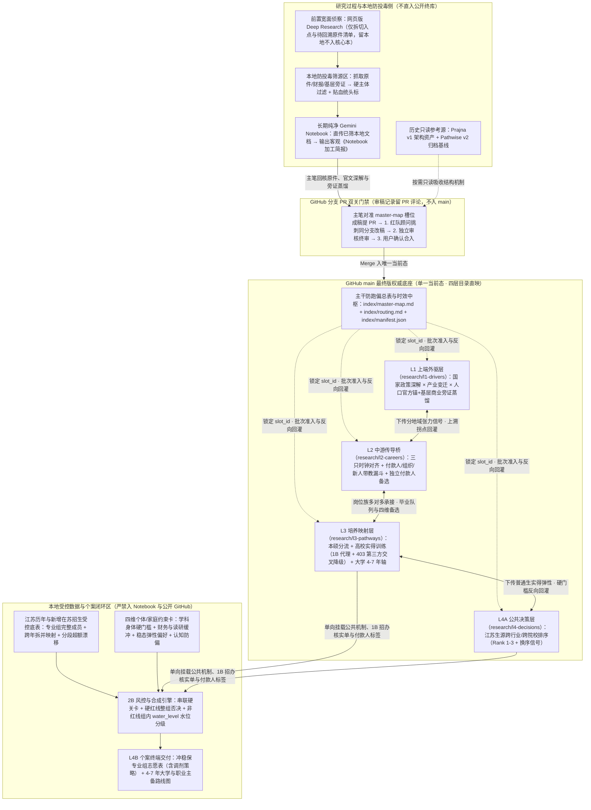
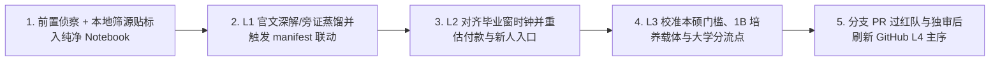
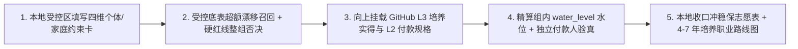

# 知途研究 v3（Pathwise v3）总体实现框架蓝图（定调版）

**核心结论（置信度：高）**：知途研究 v3 通过构建**「L1 宏观外驱三主线耦合 ⇄ L2 毕业窗与付款人传导桥 ⇄ L3 培养实得与大学执行映射 ⇄ L4 公共底座与个案志愿双模收口」**的四层双向实现架构，将上端「国家政策、产业变迁、人口结构变化」端到端传导并闭合落地至下端「高考志愿填报与 4–7 年大学/职业规划」。框架以 [index/master-map.md](../index/master-map.md) 锁定主干槽位与分批填充顺序以防细枝跑偏，在采集端执行「网页版 Deep Research 前置侦察 → 本地防投毒筛源贴血统头标 → 长期纯净 Gemini Notebook 加工简报」，在机制端内嵌确定性梯度、`1B` 结构代理与 `403` 第三方交叉降级、`2B` 硬红线否决加组内相对水位（`water_level`）分级及 `3B` 公私双模解耦，并通过 GitHub PR「先红队挑刺、后独立审核、审稿留 PR 评论不入 `main`」沉淀唯一当前态权威库。

> **表述分类说明**：本文档定义系统的工程实现拓扑与信源/协作边界，显式区分四类表述——`[已核实事实｜出处]`（源自已归档的 `Prajna v1` 历史参考库、`mythpan1/pathwise-research @ v2-archive` 基线及已锁定的 v3 架构/信源/PR 工作流共识）、`[明示假设]`（系统运行设定的前提边界）、`[分析推断]`（基于前两代得失设计的 v3 实现架构与接口逻辑）、`[待核未知]`（待后续分批研究实测校准的事项）。

---

## 一、系统全景总图与上下端闭合逻辑

### 1.1 全景实现拓扑图（业务四层主干 × 采集与 PR 流转 × 资产三层边界）



### 1.2 核心闭合机制：四处结构咬合如何打通上下端？

`[已核实事实｜Prajna v1 整体架构；mythpan1/pathwise-research @ v2-archive]` 第一版（`Prajna v1`）打通了从宏观到志愿表的端到端链条，但缺少毕业时钟对齐与付款人穿透，且把特定个案偏好混入了通用专业打分表；第二版（`Pathwise v2`）补齐了严密的宏观—组织传导机制，却因要求远期与高校内部数据达到同等微观铁证、暂停招生底表接入并对混编专业组采取单点一票否决，导致系统悬停于条件矩阵，无法合成为志愿方案。

`[分析推断]` v3 依靠**四处结构性咬合 + 一道主干防跑偏总闸**实现闭环：
1. **先锁主干版图再分批填充（防细枝跑偏总闸）**：由 [index/master-map.md](../index/master-map.md) 锁定 L1–L4 全部主干槽位（`slot_id`）与 `Batch 1 → Batch 4` 推进顺序，凡不归属主干槽位或无法改变下端志愿/培养排序的边角议题一律拒不立项。
2. **用「确定性梯度承压阀」打通时间跨度断层**：下端招生规则追求硬原件精确匹配；上中端（4–15 年演化）在完成三只时钟对齐与付款链穿透后即输出默认优劣主序，绝不因远期缺乏精确编制数而阻塞下端决策。
3. **用「`1B` 结构代理 + `403` 第三方交叉降级 + 招办核实单」跨过高校公开断层**：高校未公开同届细分项目升学分母时，启用公开培养方案实验学分、硕博点与头部雇主校招名单给出保守默认序；高校官网 `403` 时允许用阳光高考、主流高招平台或官方公众号交叉验证并标明降级，同步转化为填报前招办核实清单。
4. **用「`3B` 公私双模解耦 + `2B` 硬红线否决与组内 `water_level` 水位分级」完成落表**：GitHub `main` 只沉淀零个案偏好的公共排序卡；本地受控区动态注入四维家庭约束卡与江苏投档底表，仅对硬红线项整组否决，对一般弱偏好专业按组内相对水位分级控调剂，收口产出冲稳保志愿表与 4–7 年路线图。

### 1.3 三层资产物理边界与 PR 入库流转

`[已核实事实｜v3 锁版信源与工作流共识]` 系统严格隔离过程态、公开定稿态与本地受控态：

| 资产层级 | 承载位置 | 存放内容与运行规则 | 物理隔离红线 |
| --- | --- | --- | --- |
| **研究过程工作台** | 网页版 `Deep Research` + 本地受控原料筛源区 + 长期纯净 `Gemini Notebook` | Deep Research 做前置宽面侦察（仅取切入点与待回溯原件清单，报告留本地不进核心本）；资料员抓原件落本地、过“可追溯硬主体”防投毒初筛并贴血统头标（`[官方原件]` / `[商业财报/基层旁证]` / `[第三方交叉待核]`）后直传 Notebook，输出客观《加工简报》 | 严禁裸扔外部 URL 直喂 Notebook；未经回核一手原件并走完 PR 双审定稿的过程材料，不得视作最终结论 |
| **最终版权威底座** | GitHub `mythpan1/pathwise-research`（`main` 分支） | **唯一当前生效态**的 L1–L4 公共卡片、主干版图与路由时效索引、空白标准模板、受控数据与校验脚本契约；经独立分支 PR 先红队挑刺改稿、后独立审核终审、用户确认后合入 | 审稿过程留存于 GitHub PR 评论区，不向 `main` 塞入 `reviews/` 日志；严禁含真实个人姓名、本机绝对路径、凭据或受控 CSV |
| **本地受控与历史参考区** | 本地受控工作区（被 `.gitignore` 排除） + 本地 `Prajna v1` / `Pathwise v2` 只读库 | 江苏 2022–2025 历史底表及后续年度本地受控增量投档/专业分数据、跨年组号映射、水位/漂移实跑结果、真实考生四维约束卡与个案志愿方案；两套旧库仅按需只读吸收 | 招生底表与个案隐私 **100% 留存本地受控区**，严禁上传公开 GitHub 或传入云端 Notebook |

---

## 二、四层实现架构与锁定信源逐层拆解

`[明示假设]` 本框架默认以**江苏生源高三考生、全国在苏招生本科院校（“院校专业组”平行志愿模式）及 4–10 年本硕博培养周期**为基准实现场景；外省模式仅需在 L4 替换本地受控招生底表与投档规则插件，L1–L3 主干完全复用。

### 2.1 L1 上端外驱层（`research/l1-drivers/`）：国家政策 × 产业变迁 × 人口结构变化

`[已核实事实｜v3 信源共识]` L1 按三类专属信源策略采集，由研究主笔完成官文深解与旁证蒸馏，并通过**三线交叉耦合**输出结构张力信号：

| 外驱主线 | 观测的结构变量（放什么） | 锁定信源口径与主笔深解规则 |
| --- | --- | --- |
| **国家政策主线**（`L1-POL-*`） | 《“十五五”规划纲要（2026—2030）》八大重合任务组合、财政转移支付/专项债/化债约束、行业准入牌照与强检标准、央国企与公立机构考核指挥棒 | 优先采集**新华社、人民日报、中国政府网、《求是》杂志及国务院/部委/省厅官方原件**；研究主笔负责穿透晦涩官文的潜台词、真实资金落点与执行刚性，区分硬预算工具与倡导性表态 |
| **产业变迁主线**（`L1-IND-*`） | 工艺路线迭代、价值链利润池转移、资本开支阶段（**新建扩张期 vs 存量运维期**）、甲乙方内外包分工重组、AI 与自动化对任务颗粒度的替代/增强边界 | 优先采集**权威行业站、政府监管与行业协会报告、龙头上市公司年报**；区分“行业总产值/出海增长”与“国内应届生初级岗位净增减” |
| **人口结构主线**（`L1-DEM-*`） | **需求侧队列**：出生婴幼、学前至高教生源达峰退潮、老龄慢病与失能照护队列；**供给侧队列**：本硕毕业生洪峰、在岗中老年骨干退休潮 vs 机构存量人员余缺调配 | 执行**「官方统计口径（基准锚）+ 商业/基层旁证（蒸馏校准）」双轨互验**：同步核对母婴/奶粉/纸尿裤龙头财报销量、医院妇产科撤并缩床公告、民办园终止批复、中小学教师缩编与跨学段调配公告、医保/长护险收支决算与养老空置率 |

- **三线交叉耦合与地域/队列锚定机制**：① **政策 × 产业**：检验补贴拉动的是设备资本深化还是可持续用工现金流；② **人口 × 政策**：检验全国队列拐点与目标就业地（`target_regions`：江苏本地 / 长三角 / 全国流动 / 异地驻场或基层）的人口净流入、退休补员及地方财力分化；③ **产业 × 人口**：检验骨干退休空间是被自动化加熟手兼任吸收，还是向目标毕业队列（`graduation_cohort`）开放应届入口。
- **向下（L2）标准输出**：按 [templates/driver-signal.md](../templates/driver-signal.md) 产出带 `target_regions` 与 `graduation_cohort` 锚点的《L1 宏观外驱张力信号卡》。

### 2.2 L2 中游传导与职业规格桥（`research/l2-careers/`）：岗位族多对多转换器

`[分析推断]` L2 按**职业岗位族（Role Family，`L2-CAR-01~09`）**归口，与上游 `L1-IND-01~09` 产业变迁及下游 `L3-PTH-01~08` 本科专业簇均构成**多对多映射关系**——跨行业通用职能（如软件交付、自动化联调、财会审计、法务合规）统一归入所属岗位族主槽内横向对比不同承接行业的付款与门槛差异，严禁按行业复制拆出平行野卡：

1. **三只独立时钟与地域/毕业队列（`target_regions × graduation_cohort`）强制对齐**
   - **政策与建设时钟**：当前规划或资本开支执行期（2026–2030 年）；
   - **考生毕业入职时钟（`graduation_cohort`）**：按真实入学年 `T` 加学制计算（四年本科 `T+4`、五年制 `T+5`、本硕 `T+7`、临床规培等长周期 `T+8~10`）；
   - **远期能力复利时钟**：入职后约 5–6 年（`T+10`），检验积累的是“可跨组织迁移的排障/签字/交付权责”还是“随年龄贬值的重复工时”。
   - *硬转换规则*：严禁用全国总量趋势替代目标就业地（`target_regions`）局部校招实况；毕业前已达峰转跌或仅在异地偏远驻场扩招的赛道，必须如实标明地域与队列错位。
2. **付款人 → 承接组织 → 应届名额转化与带教漏斗**
   - 逐级穿透四问：① **谁持续买单**（一般公共预算、医保/长护基金、垄断央国企运维刚需、竞争性制造业技改研发、居民家庭自付消费）；② **谁在何地签约承接**（区分本地总部研发、分支运维与外包驻场）；③ **资本深化/存量消化 vs 外部校招转化**（核实投资扩产是转化为自动化与招熟手，还是面向目标届普通生开放校招名额）；④ **有无新人带教闭环**（是否允许无经验应届生进入受监督实操并获熟手复核）。
3. **能力迁移网与「四维独立备选冲击核验」**
   - 仅“付款人不同”不足以构成真独立备选。L2 与 L4 对备选路径强制执行**四维冲击核验（付款主体 × 江苏同组调剂隔离 × 学历/执照门槛 × 地域/承接组织单点）**：不强求四维全异，但必须显式披露仍共享的故障点，**严禁把同专业组捆绑暴露或共享单一刚性考研/同张高难执照门槛的路径包装成无条件独立保底**。
4. **确定性梯度承压阀**
   - L2 完成时钟对齐、地域锚定与四维备选核验后，按 [templates/career-entry-spec.md](../templates/career-entry-spec.md) 收口《L2 毕业窗职业入口规格卡》，移交 L3。

### 2.3 L3 培养兑现与路径映射层（`research/l3-pathways/`）：职业规格 ⇄ 专业、院校与大学执行轴

`[分析推断｜内嵌 1B 与 403 降级共识]` L3 将 L2 岗位规格反向锚定至本科专业代码、江苏重点招生院校项目与大学 4–7 年执行节点：

1. **学历准入分流与专业目录刚性映射**
   - 严格核对教育部《普通高等学校本科专业目录（2026 年）》精确代码与主流招录目录，拆清三类通道：① **本科直就兑现通道**（核校招/公考专业代码精确匹配）；② **对口硕士硬门槛通道**（核心算法、机理研发、三甲临床等，本科核心指标转为推免通道、硕博点与统考专业课衔接）；③ **院校层级/行业血统壁垒通道**（区分原电力/兵工/铁道/交通部属校渠道壁垒与综合双一流初筛门槛）。
2. **高校实得训练核验、`1B` 结构代理与 `403` 第三方交叉降级**
   - 聚焦评估**普通本科生**能否实际获得匹配 L2 规格的训练与升学出口，优先核验各校官网培养方案、转专业/推免细则与就业质量报告。
   - **`403` 可达性降级**：当高校官网或地方附件返回 `403` 不可达时，允许使用**阳光高考、主流高招平台、高校官方认证公众号**等第三方信源，但须至少两路独立交叉核验并显式标明 `[第三方交叉降级]`。
   - **`1B` 缺分母不断链降级（严控结构代理边界）**：当高校未公开同届细分项目升学/就业分母时，四项公开结构代理指标（① 核心实验/课程设计/实训必修学分占比；② 一级学科硕博点与省部级重点实验室覆盖；③ 目标头部雇主进校校招白名单；④ 特殊班型保研、高学费与禁转专业硬条款）仅作结构线索支撑**标注 `[结构代理降级]` 的保守默认序与 1–3 条招办线下核实单**，严禁据此伪造普通生成功概率或强行大幅换序；**若多项代理指标相互冲突，一律降级标为 `[待核未知]`，严禁投票取多数**。
3. **高考志愿与大学 4–7 年执行规划一体化时间轴**
   - 每份 [templates/pathway-mapping.md](../templates/pathway-mapping.md) 同步锁定入校后四道关口：**大一（`T+0.5~1`）**大类分流绩点线与跨院转专业硬门槛核验（严禁拿严苛转专业当混编组保底借口） → **大二至大三上（`T+1.5~2.5`）**核心硬课、白名单竞赛/实训与资格证准备 → **大三下（`T+3`）**保研/考研/本科直就实习分流决断 → **毕业口（`T+4 / T+7`）**主路径兑现与独立付款人备选切换。

### 2.4 L4 下端志愿决策与职业规划落地层（`research/l4-decisions/` + 本地受控区）

`[分析推断｜内嵌 2B 与 3B 架构取舍]` L4 采用**「公共研究底座 + 本地个案闭环」双模解耦架构（`3B`）**：

- **模式 A：公共底座态（`L4A`，落盘 `research/l4-decisions/`）**
  - 面向江苏生源公共边界，按 [index/master-map.md](../index/master-map.md) 的 `L4-DEC-01~06` 主干槽位合成去个案化的 [templates/public-comparison.md](../templates/public-comparison.md)。
  - **基准前提锚定与强制收口格式**：必须显式声明所依托的**「默认基准前提包」**（如默认选科、省外同档院校接受度、常规公办本硕成本支持度及 `target_regions / graduation_cohort`），在此前提下给出**基准默认主序（`Rank 1 默认主推 → Rank 2 同簇稳健替代 → Rank 3 经四维冲击核验的独立备选`）**、一级换序触发信号与汇总自 L3 的**线下招办核实总单**，防止把特定前提下的基准序误读为无条件普适排序。
- **模式 B：个案闭环态（`L4B`，100% 运行于本地受控区）**
  1. **挂载「四维个体/家庭约束卡」（模板见 [templates/individual-constraints.md](../templates/individual-constraints.md)，零 MBTI）**：录入① 学科能力长短板与体检受限代码、② 本科学费上限与读研/低薪期财务缓冲、③ 体制稳态 vs 市场弹性底线偏好与地域半径（含硬红线排斥集 vs 一般弱偏好集）、④ 亲子共识与防“唯最低分锚定/盲信转专业”认知核对。
  2. **调用本地受控招生底表与 `2B` 风控合成引擎**（契约见 [data/README.md](../data/README.md) 与 [scripts/README.md](../scripts/README.md)）：
     - **第一关（串联硬关卡 + 硬红线整组否决）**：基于本地 2022–2025 历史底表及后续年度受控增量招生数据，绑定 `target_year` 当年招生章程版本与组内实际调剂覆盖/排除范围（`D2-D`），核验选科、跨年组号拆并变动与实际可调剂成员；凡可调剂范围内任一专业触碰考生**硬红线**（学费超限、体检限报退档风险、捆绑绝对排斥方向且位次不足以规避）即整组一票否决；任一红线核验字段未知即置 `unverified_redline_block_safety=true` 硬拦截出保底池；
     - **第二关（位次购买力分段超额漂移校准）**：仅剔除经省考试院适用年份正式选科指引原件与当年受控计划表核定的政策断裂转换对（注：本地既有底稿对江苏物化选科改革冲击年存在 `2022→2023` 与 `2023→2024`［2024 届起实施通用版选科指引］两种记录，官方原件核定前一律标 `[待核未知]`，严禁静默剔除或混作常态漂移输入），分解考生规模增长与段内超额漂移，生成自适应冲/稳/保位次窗，并强制跨省多样性扫描防长三角扎堆漏选外省同档强校；
     - **第三关（非红线弱偏好专业的组内 `water_level` 水位分级）**：按考生位次在组内历年专业分分布中的相对水位（`top` 前 20% / `mid` 20%–50% / `low` 50%–80% / `bottom` 80%+）分级判定调剂暴露度与服从策略；凡组内任一实际可调剂成员缺失录取最低位次（`major_min_rank`）或录取人数（`admitted_count`）、或缺失当年章程调剂规则（`D2-D` 为 `unknown/partial`）时，一律判定 `water_level=unknown` 并与踩线混编组同级硬拦截出 `safety` 保底池。
  3. **个案双单收口**：交付**《冲稳保院校专业组志愿表（含逐组水位评级、调剂策略与招办核实单）》** + **《4–7 年大学培养与职业主备路线图》**。

---

## 三、两条端到端实现路径（上下双向跑通验证）

### 3.1 自上而下路径：宏观拐点出现 → 逐层刷新下端志愿与职业排序



1. **防投毒取证与加工**：针对归属 `master-map` 主干槽位的重大政策/产业/人口拐点，资料员将官方原件与商业/基层旁证抓取至本地筛源贴头标后直传纯净 Notebook，输出《加工简报》。
2. **L1 三线定性与依赖唤醒**：研究主笔深解政策潜台词、蒸馏人口与产业旁证，更新 `L1` 信号卡，通过 [index/manifest.json](../index/manifest.json) 依赖链自动标记受波及的下游 `L2–L4` 卡片。
3. **L2 毕业窗与付款漏斗重算**：将拐点校准至目标届考生的 `T+4 / T+7` 毕业窗，重估承接组织存量调配挤压与外部应届入口宽窄，排查主备共同付款方风险。
4. **L3 培养载体与反向回灌校准**：判定该拐点是抬高对口硕士门槛还是引发本硕倒挂，按 `1B` / `403` 规则更新关联高校培养映射；反之，若 `Batch 3/4` 下游实证发现硬门槛或地域供需推翻上游 `L1/L2` 假设，同样在同一 PR 触发**反向回灌**联立修订上游卡片或在 `manifest.json` 标记待复核。
5. **PR 双审合入刷新底座**：主笔提交分支 PR，依次经红队顾问挑刺改稿与独立审核终审（记录留 PR 评论），用户确认合入 `main` 刷新 `L4` 默认主序。

### 3.2 自下而上路径：给定江苏考生条件 → 倒推志愿方案与 4–7 年职业规划



1. **本地受控建档**：在本地受控区填写四维约束卡，锁定选科、位次、体检代码、本硕预算上限、稳态/弹性偏好，切分硬红线排斥集与一般弱偏好集。
2. **底表召回与硬关卡过滤**：调用数据工程师脚本按分段超额漂移召回全国在苏候选专业组（含跨省多样性补充与跨年组号拆并核对），一票否决触碰体检、超学费上限或硬红线专业的专业组。
3. **向上穿透公共底座**：挂载 `GitHub main` 的 L3 培养卡与 L2 规格卡，剔除“岗位刚性读硕但家庭仅规划本科直就”或“课程数理负荷超考生能力底线”的错配项，提取 `[结构代理降级]` 项目的招办核实问题。
4. **组内水位精算与四维冲击验真**：计算非红线混编组的 `water_level` 水位以锁定冲稳保档位与调剂服从策略，并对主攻组与备选组执行**四维独立冲击核验**（拒绝同组捆绑暴露或共卡单一刚性考研门槛充当保底）。
5. **双单闭环交付**：在本地受控区输出最终志愿梯度表与 4–7 年大学及职业主备路线图。

### 3.3 骨架级最小纵向契约穿行沙盘

`[结构契约穿行沙盘｜不伪造未采信实证，未核环节如实标 [待核未知]]` 下表以两条契约样本链干跑验证 `L1 → L2 → L3 → D3/D5/D2-D/D6 → L4` 的字段咬合与未知阻断逻辑：

| 传导与契约环节 | 样本链 A：跨行业多对多岗位族穿透（防行业拆野卡） | 样本链 B：“付款方不同但同组/同门槛”假独立备选拦截 |
| --- | --- | --- |
| **L1 外驱耦合** | `L1-POL-02/03 + L1-IND-01/02/03`：设备技改、电力投资与地方公用事业财政约束耦合，锚定 `target_regions` 与 `graduation_cohort`（如 `2026` 入学 `T+4/T+7`） | 宏观外驱表面指向两类不同买单池：如药械产业研发（`L1-IND-06`）vs 医疗卫生保障（`L1-POL-07`），或企业合规需求 vs 公共司法财政 |
| **L2 岗位族桥接** | 统一归口 `L2-CAR-02`（现场工控与自动化联调岗位族），单卡横向对比**制造产线甲方**（`competitive_mfg_capex_rd`）、**能源电力运营**（`monopoly_soe_opex`）与**市政设施维保**（`local_fiscal`）的付款方、`target_regions × graduation_cohort` 及受监督带教漏斗，禁拆三张行业野卡 | 表面跨两类独立付款主体：① 竞争性药械 B2B vs 公立医院医保支付（`medical_insurance_fund`），或 ② 企业商事法务 vs 体制司法财政（`central_fiscal / local_fiscal`） |
| **L3 培养映射** | 多对多映射 `L3-PTH-02`（`080801` 自动化 / `080601` 电气工程及其自动化）：核验普通生控制/强电实验必修学分与校招名单，启用 `1B` 保守默认序并附招办核实单；各校细分项目升学/就业分母标 `[待核未知]` | 映射 `L3-PTH-06 / L3-PTH-07` 临床/药学或法学培养链：暴露下端真实准入硬约束；具体高校当年在苏专业组分位与同届分母在实证前标 `[待核未知]` |
| **D3 / D5 / D2-D 契约** | `D3` 江苏物化选科断裂年（`2022→2023` vs `2023→2024`）核定前标 `[待核未知]`；`D5` 在 `primary_routes[] / backup_routes[]` 逐路径记录三类承接行业的 `role_family_id`、`job_regions` 与 `degree_threshold`；`D2-D` 绑定当年章程调剂范围 | 暴露两类共损故障：① 两方向在苏混编于同一院校专业组且当年章程 `D2-D` 未隔离调剂；② 在 `D5` 逐路径记录中共卡 `master_mandatory` 统考读硕，或共享同一 `license_ids`（如 `LIC_PHYSICIAN` 或 `LIC_LEGAL_BAR`） |
| **D6 → L4 裁决** | `L4-DEC-02/03` 在明示「默认基准前提包」下输出 `Rank 1–3`；个案端若某候选组缺成员位次/录取人数或 `D2-D` 为 `unknown`，即置 `water_level=unknown` 硬拦出 `safety` 池 | `D6` 逐配对四维核验判定 `group_isolation=fail` 或 `entry_gate_isolation=fail`（若门槛或 `D2-D` 未核全则返 `unknown_blocked`），**严禁判 `pass` 充当独立保底**，强制披露共损点并要求跨专业组、异构学历/证照重配真备选 |

---

## 四、v3 GitHub 仓库目录蓝图 & 数据结构需求清单

### 4.1 v3 GitHub 仓库定调目录蓝图（单一当前态，无 `reviews/` 目录）

`[已核实事实｜用户已确认四层目录直映与 PR 评论留痕]` 公开仓库（`mythpan1/pathwise-research` `main`）严格按四层架构直映组织，审稿记录留存 GitHub PR 评论区，仓库内不设 `reviews/` 或 `work/` 过程日志目录：

```text
pathwise-research/                 # GitHub main：最终版社科研究权威底座（单一当前态，零隐私）
├── .gitignore                     # 本地受控数据、私有画像与临时文件忽略规则（数据工程师维护）
├── README.md                      # 项目总纲：一句话定位、四层闭合导览、三层资产边界与分批填充原则
├── AGENTS.md                      # 协作规范：6 岗职责、防投毒采集 + GitHub PR 双审工作流与公私红线
├── docs/                          # 总体架构规范区
│   └── architecture-v3.md         # 总体实现框架蓝图（本文档）
├── index/                         # 主干防跑偏版图、路由与时效联动中枢
│   ├── master-map.md              # [核心防跑偏抓手] L1-L4 主干槽位总表、Batch 1-4 顺序与立题三问闸门
│   ├── routing.md                 # 场景化按需加载路由表（立题排重 / 自上而下刷新 / 自下而上倒推）
│   └── manifest.json              # 知识资产机器索引与上下游时效依赖清单（数据工程师实现）
├── research/                      # 核心社科知识资产库（四层直映，仅存挂接 slot_id 的公共最终版）
│   ├── l1-drivers/                # [L1 上端外驱层] 国家政策深解、产业变迁周期、人口队列+旁证蒸馏卡
│   │   └── README.md
│   ├── l2-careers/                # [L2 中游传导层] 三只时钟对齐的付款链、承接组织与应届入口规格卡
│   │   └── README.md
│   ├── l3-pathways/               # [L3 培养映射层] 本硕准入分流、高校实得训练（1B/403 降级）及大学执行轴
│   │   └── README.md
│   └── l4-decisions/              # [L4 公共决策层] 江苏生源跨行业/跨院校条件排序卡（Rank 1-3 + 换序信号）
│       └── README.md
├── templates/                     # 绑定 slot_id 的标准化单态卡片模板集
│   ├── driver-signal.md           # L1 宏观外驱信号卡模板
│   ├── career-entry-spec.md       # L2 职业入口与独立备选规格卡模板
│   ├── pathway-mapping.md         # L3 培养实得训练与大学 4-7 年执行路线模板
│   ├── public-comparison.md       # L4A 公共路径排序收口卡模板
│   └── individual-constraints.md  # L4B 空白四维个体/家庭约束卡模板（实填件严留本地受控区）
├── data/                          # 受控数据契约说明区（公开库不含任何受控 CSV 或个案文件）
│   └── README.md                  # D2/D3/D5 字段级表结构与公私隔离契约（数据工程师实现）
└── scripts/                       # 计算接口与框架自动化校验区
    ├── README.md                  # D4/D6 超额漂移、组内 water_level 计算契约说明（数据工程师实现）
    └── validate_framework.py      # JSON 语法、站内相对链接与隐私/本机路径零命中自动校验脚本（数据工程师实现）
```

### 4.2 移交「数据工程师」的数据结构需求清单（`D1–D6` 社科业务契约）

具体表结构、JSON Schema 与脚本由数据工程师在 [index/manifest.json](../index/manifest.json)、[data/README.md](../data/README.md)、[scripts/README.md](../scripts/README.md) 与 [scripts/validate_framework.py](../scripts/validate_framework.py) 中实现，社科业务侧锁定以下 **6 项核心需求**：

| 编号 | 数据对象 / 计算接口 | 社科业务用途 | 核心业务字段需求 | 输入 ⇄ 输出关系 | 公私隔离等级 |
| --- | --- | --- | --- | --- | --- |
| **D1** | **知识资产路由与时效依赖清单**（`index/manifest.json`） | 绑定 `master-map.md` 主干 `slot_id`，追踪 L1–L4 卡片时效、地域/毕业队列范围与上下游正反向重审链 | 资产 ID、受控 `slot_id`（43 主干槽及 `FW-*/TPL-*`）、所属层级、时效属性 `stability`（`evergreen` / `volatile`）与 `valid_until`、关联 `drivers` 与 `major_codes`、`target_regions`（非空地域数组）、`graduation_cohort`（目标入学/毕业队列非空数组，常青项填 `all_cohorts`）、`upstream_ids`、`stale_action`、唯一状态枚举 `status`（`active \| draft \| needs_reverify \| deprecated`） | **入**：卡片新增、修订或反向回灌标记<br>**出**：按队列与地域定位的过期预警清单 + 正反向重审链路 | **公开入库**（严禁含本机路径或私有文件名） |
| **D2** | **江苏在苏招生专业组与历年投档/专业分底表（含 `D2-D` 当年章程调剂规则表）** | 支撑下端同位次全国召回、当年调剂暴露边界核定与高费/冷门混编识别 | 招生年份（2022–2025 存量 + 年度本地受控增量）、科类选科、院校代码/名称/层次/省份、专业组号、组内完整专业明细（代码、名称、计划数、录取数、学费、学制、办学地/合作标识、体检限报、各专业分/最低位次）、**当年招生章程版本与来源、组内实际调剂覆盖/排除成员及场景暴露规则表（`D2-D`）**、字段级完整性状态（缺失即阻断保底） | **入**：本地受控招生计划、投档/专业分表与当年章程清洗<br>**出**：标准化招生分位与当年可调剂边界主数据 | **严格本地受控**；公开库 `data/README.md` 仅放脱敏字段契约 |
| **D3** | **跨年专业组拆并映射与异常年标记表** | 防“同组号跨年偷换专业成员”误导位次预估，剥离经官方原件核定的一次性选科断裂年 | 院校代码、目标年组号 vs 历史基准组号、变动枚举（原样延续 / 增删冷门或高费专业 / 拆分 / 合并 / 新设）、历史分位可继承标记、**带官方原件出处与核验状态（`verified_primary_source / pending_verification`）的政策断裂转换对标记（江苏物化冲击年核定前标 `[待核未知]`）** | **入**：相邻年度专业组集合比对 + 省考试院选科原件核验<br>**出**：跨年位次可比性等级 + 经核实的断裂年隔离列表 | 全量映射明细**留本地受控区**；通用规则写于 `data/README.md` / `scripts/README.md` |
| **D4** | **位次购买力分段超额漂移计算接口** | 将考生位次校准为自适应冲/稳/保检索窗，并防长三角扎堆漏选外省强校 | 考生科类、等效位次、基准年份窗口（仅剔除 `D3` 中已核实的政策断裂对）；分解“考生总数增长贡献”与“同分段院校群年化超额漂移”；省内/长三角占比统计与外省同档强制补充召回开关 | **入**：考生科类与位次 + `D2/D3` 底表<br>**出**：带冲/稳/保档位与地域分布诊断的候选专业组初筛池 | 算法契约公开于 `scripts/README.md`；实跑计算在本地受控区 |
| **D5** | **专业↔岗位族/培养多对多映射字典** | 建立招生专业/大类与 `L2-CAR-*` 岗位族、`L3-PTH-*` 培养卡的多对多关联及逐路径准入门槛 | 教育部 2026 标准本科专业代码与名称、常见高校大类别名映射、关联 `L2-CAR-*` / `L3-PTH-*` 卡片 ID、**逐路径结构化的 `primary_routes[] / backup_routes[]`（每条路径独立记录 `role_family_id`、`job_regions`、`degree_threshold`、具体 `license_ids`、承接组织类别、付款主体与共享故障标签；缺门槛标 `unknown`）**、L3 证据状态与招办核实问题 | **入**：候选专业组内的专业列表<br>**出**：逐主/备路径挂载三只时钟结论、四维配对核验输入与招办核实单 | 标准专业与公共卡片映射**可公开入库** |
| **D6** | **四维个体约束结构与 `2B` 组内 `water_level` 精算接口** | 将个体约束、当年调剂范围与混编组水位结合，拦截未知红线与假独立备选 | **个体侧**：选科位次、学科长短板、体检代码、本硕学费与低薪期缓冲档、稳态/弹性与地域边界、硬红线排斥集 vs 一般弱偏好集；<br>**组内与配对输出侧**：接入当年调剂规则 `D2-D`；任一可调剂成员红线字段或分位/录取人数缺失即置 `water_level=unknown` / `unverified_redline_block_safety=true` 阻断保底池；**逐配对四维独立备选核验（未核全返回 `unknown_blocked`，严禁判 `pass`）** | **入**：个体四维约束实例 + `D4` 初筛池 + `D2`（含 `D2-D`）+ `D5` 逐路径字典<br>**出**：去伪备选后的冲稳保精排候选表 + 逐组调剂策略与共享故障清单 | 空白结构可公开；**含真实考生数据的输入与输出 100% 留本地受控区** |

---

## 五、跨代冲突取舍、成立边界与已定调架构决议

### 5.1 前两代架构冲突采信说明

| 架构冲突点 | `Prajna v1`（2026-04~07）做法 | `Pathwise v2`（`v2-archive`，2026-10~11）做法 | v3 定调采信方案与理由 |
| --- | --- | --- | --- |
| **宏观到专业的连接深度** | 双轮外驱直连专业前景矩阵，偶现产值直推岗位与静态观察窗误判 | 强制分离三只时钟，穿透付款人、承接组织与新人受监督带教入口 | **100% 采信 v2 中游传导结构（L1→L2）**，并强化官文潜台词深解与人口微观旁证蒸馏 |
| **中远期缺微观铁证或遇 `403` 时的行为** | 按确定性梯度允许模糊弹性推进，不阻塞志愿落表 | 跨时间尺度执行同一高门槛原件要求，缺同届分母或 `403` 即停在多分支并列 | **采信确定性梯度 + `1B` 结构代理 + `403` 第三方交叉验证降级**，保证不断链并附招办线下核实单 |
| **混编专业组风控与个体偏好位置** | 用 `water_level` 水位分级控调剂，但把个案偏好硬编码进通用打分表 | 严守公私分离，但组内任一成员不接受即整组布尔否决，且砍掉个体收敛模块 | **分层合成（`2B` + `3B`）**：公共库零个案偏好；本地个案端硬红线整组否决，非红线用 `water_level` 水位分级 |
| **研究演进与审稿归档形态** | 模块化路由 + `_kb_manifest.json` 时效追踪，上下文极省 | `107 KB` 追加式 `coverage.md` + 仓库内堆积数百份 `reviews/` 与 `work/` JSON | **采信单态卡片 + `master-map` / `manifest` 中枢 + GitHub PR 评论留审稿记录**，保持 `main` 极度干净 |

### 5.2 成立边界、推翻条件与架构自检

- **成立边界条件**：
  1. 目标问题聚焦存在 4–10 年培养时滞的本科志愿选择与中长期职业规划，且招生端实行“院校专业组”平行志愿投档与组内调剂机制；
  2. 公开互联网对高校细分项目同届升学分母与企业远期编制仍存在客观信息不对称，人口与产业宏观口径需结合商业财报与基层行政动作交叉验证。
- **推翻与调整条件**：
  1. 若目标生源省份全面改行“单专业（类）平行志愿、无组内专业调剂”，则 `D6` 组内混编 `water_level` 模块可简化为纯单专业超额漂移校准；
  2. 若回测显示某分段组内前 `20%` 水位考生仍有显著比例滑落末位冷门专业，则 `2B` 高水位放行阈值须按实测分位收紧；
  3. 若首轮单本 Gemini Notebook 实跑出现外围旁证干扰权威政策检索权重，则按预案将 Notebook 拆分为“纯净官方原件本 + 商业基层旁证本”。
- **高风险架构自检**：
  - *自检问题*：四层卡片分目录存放是否会诱发“为填满格子而去写无关紧要的细枝末节”？
  - *锁定对策*：通过 [index/master-map.md](../index/master-map.md) 设定**固定上限的 43 个主干槽位**与**立题防细枝三问硬闸门**，所有 `L1/L2` 卡片作为一对多共享底座复用，严禁脱离主干槽位自行派生细碎子课题。

### 5.3 已锁定架构定调清单与待实测事项

- **已获用户确认锁定的架构决议（`[已核实事实｜2026-11-25 定调]`）**：
  1. **目录拓扑锁定**：公开库 `research/` 正式采用 `l1-drivers / l2-careers / l3-pathways / l4-decisions` 四层直映结构，去掉仓库内 `reviews/` 目录；
  2. **先搭全套骨架再分批填充**：以 [index/master-map.md](../index/master-map.md) 锁定 L1–L4 主干版图与 `Batch 1 → Batch 4` 顺序，防后续跑偏至细枝末节；
  3. **信源与 PR 闭环锁定**：执行“网页 Deep Research 前置侦察 → 本地防投毒筛源贴头标 → 纯净 Notebook 加工简报 → 主笔对槽提 PR → 先红队后独审留 PR 评论 → 用户确认合入 `main`”。
- **后续分批填充启动前待实测项（`[待核未知]`）**：
  - 待本骨架经 `validate_framework.py` 校验、红队压测、独立审核与用户终检合入 GitHub `main` 后，以 `Batch 1` 首个主干槽位开展一次“本地防投毒筛源 → 单本 Notebook 写入 → PR 双审”实跑校准。
