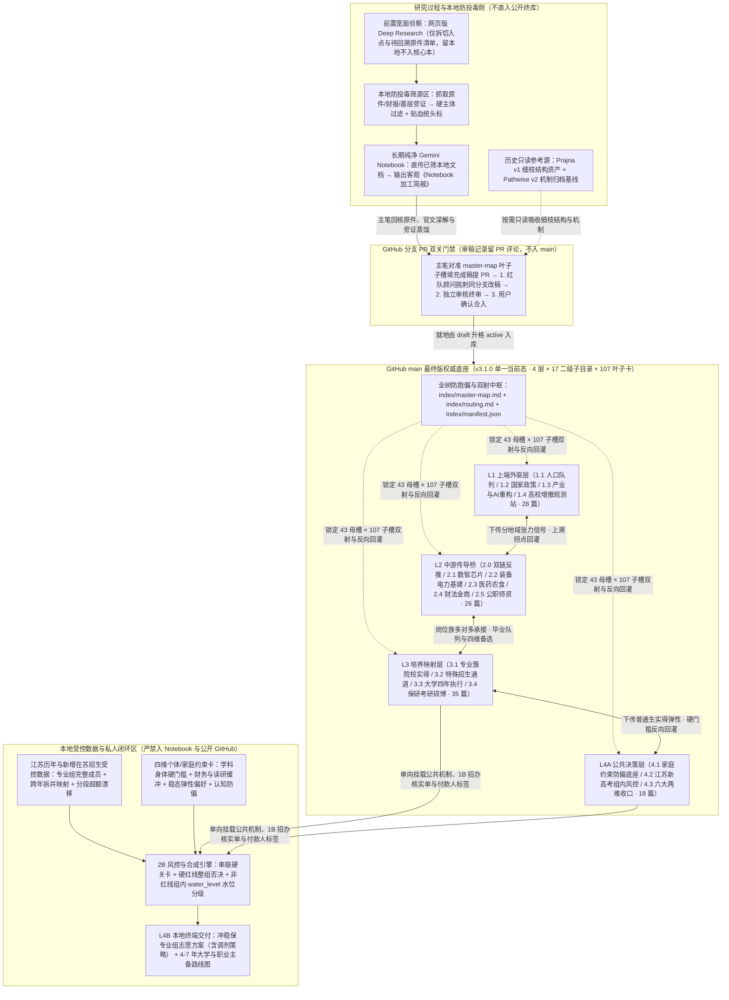

# 知途研究 v3.1（Pathwise v3.1.0）总体实现框架蓝图

**核心结论（置信度：高）**：知途研究 `v3.1.0` 通过构建**「L1 宏观外驱三主线耦合 ⇄ L2 毕业窗与付款人传导桥 ⇄ L3 培养实得与大学执行映射 ⇄ L4 公共底座与私人志愿双模收口」**的四层双向实现架构，并在 `research/` 下展开 **17 个中文编号二级专题子目录与 107 篇单篇提纲占位卡（隶属 43 个一级主干母槽）**，将上端「国家政策、产业变迁、人口结构变化」直观、无损地闭合落地至下端「江苏生源高考志愿填报与 4–7 年大学/职业规划」。框架以 [index/master-map.md](../index/master-map.md) 锁定 43 母槽与 107 叶子子槽三方双射及 `Batch 1–4` 推进顺序，在采集端执行「网页版 Deep Research 前置侦察 → 本地防投毒筛源贴血统头标 → 长期纯净 Gemini Notebook 加工简报」，在机制端内嵌确定性梯度、`1B` 结构代理与 `403` 第三方交叉降级、`2B` 硬红线否决加组内相对水位（`water_level`）分级及 `3B` 公私双模解耦，并通过 GitHub PR「先红队挑刺、后独立审核、审稿留 PR 评论不入 `main`」沉淀唯一当前态权威库。

> **表述分类说明**：本文档定义系统的工程实现拓扑与信源/协作边界，显式区分四类表述——`[已核实事实｜出处]`（源自已归档的 `Prajna v1` 历史参考库、`mythpan1/pathwise-research @ v2-archive` 基线及已锁定的 `v3.1.0` 架构/信源/PR 工作流共识）、`[明示假设]`（系统运行设定的前提边界）、`[分析推断]`（基于前两代得失设计的实现架构与接口逻辑）、`[待核未知]`（待后续分批研究实测校准的事项）。

---

## 一、系统全景总图与上下端闭合逻辑

### 1.1 全景实现拓扑图（四层 × 17 二级子目录主干 × 采集与 PR 流转 × 资产三层边界）



### 1.2 核心闭合机制：五处结构咬合如何兼具细枝可读性与严密闭环？

`[已核实事实｜Prajna v1 整体架构；mythpan1/pathwise-research @ v2-archive]` 第一版（`Prajna v1`）拥有一目了然的三级章节细枝与从宏观到志愿的完整链条，但缺少毕业时钟对齐与付款人穿透，且混入了特定学生偏好打分；第二版（`Pathwise v2`）补齐了严密的宏观—组织传导机制，却因要求远期与高校内部数据达到同等微观铁证、暂停受控数据接入并对混编组采取单点一票否决，导致悬停于条件矩阵无法收口；早期 `v3` 骨架虽打通机制，但仅设 43 个粗粒度大槽，缺少单篇课题颗粒度。

`[分析推断]` `v3.1.0` 依靠**五处结构性咬合**完成终极融合：
1. **「43 母槽防跑偏 + 17 二级子目录 × 107 篇细枝提纲卡直观对号」双层拓扑**：在 43 个 `parent_slot_id` 主干母槽刚性约束下，把特殊通道、四年执行、硕博出口、江苏组内风控与各行业专业簇全部拆为清晰的中文编号单篇 `.md` 提纲卡（`slot_id = L*-***-dd.dd`），彻底消除大杂烩挤压。
2. **用「确定性梯度承压阀」打通时间跨度断层**：下端招生规则追求硬原件精确匹配；上中端（4–15 年演化）在完成三只时钟对齐与付款链穿透后即输出默认优劣主序，绝不因远期缺乏精确编制数而阻塞下端决策。
3. **用「`1B` 结构代理 + `403` 第三方交叉降级 + 招办核实单」跨过高校公开断层**：高校未公开同届细分项目升学分母时，启用公开培养方案实验学分、硕博点与头部雇主校招名单给出保守默认序（冲突即转 `[待核未知]`）；高校官网 `403` 时允许用阳光高考、主流高招平台或官方认证公众号两路交叉验证并标明降级，同步转化为填报前招办核实清单。
4. **用「`3B` 公私双模解耦 + `2B` 硬红线否决与组内 `water_level` 水位分级」完成落表**：GitHub `main` 只沉淀零私人偏好的公共排序卡；本地受控区动态注入四维家庭约束卡与江苏受控招生数据，仅对硬红线项整组否决，对一般弱偏好专业按组内相对水位分级控调剂。
5. **全树三方 1:1 机器双射门禁**：磁盘 `research/` 全部 107 篇叶子卡片 YAML Frontmatter、`index/master-map.md` 子槽行与 `index/manifest.json` 业务条目由 `validate_framework.py` 强制执行三方双射与无环 DAG 校验。

### 1.3 三层资产物理边界与 PR 入库流转

`[已核实事实｜v3.1.0 锁版信源与工作流共识]` 系统严格隔离过程态、公开定稿态与本地受控态：

| 资产层级 | 承载位置 | 存放内容与运行规则 | 物理隔离红线 |
| --- | --- | --- | --- |
| **研究过程工作台** | 网页版 `Deep Research` + 本地受控原料筛源区 + 长期纯净 `Gemini Notebook` | Deep Research 做前置宽面侦察（仅取切入点与待回溯原件清单，报告留本地不进核心本）；资料员抓原件落本地、过“可追溯硬主体”防投毒初筛并贴血统头标（`[官方原件]` / `[商业财报/基层旁证]` / `[第三方交叉待核]`）后直传 Notebook，输出客观《加工简报》 | 严禁裸扔外部 URL 直喂 Notebook；未经回核一手原件并走完 PR 双审定稿的过程材料，不得视作最终结论 |
| **最终版权威底座** | GitHub `mythpan1/pathwise-research`（`main` 分支） | **唯一当前生效态**的 4 层 × 17 子目录 × 107 篇公共卡片（`draft` 提纲就位 → 按批升格 `active`）、主干版图与路由时效索引、空白标准模板、受控数据与校验脚本契约；经独立分支 PR 双审合入 | 审稿过程留存于 GitHub PR 评论区，不向 `main` 塞入 `reviews/` 日志；严禁含真实个人姓名、本机绝对路径、凭据或受控 CSV |
| **本地受控与历史参考区** | 本地受控工作区（被 `.gitignore` 排除） + 本地 `Prajna v1` / `Pathwise v2` 只读库 | 江苏 2022–2025 历史存量及后续年度本地受控增量投档/专业分数据、跨年组号映射、水位/漂移实跑结果、真实考生四维约束卡与私人规划产出；两套旧库仅按需只读吸收 | 受控招生数据与个人隐私 **100% 留存本地受控区**，严禁上传公开 GitHub 或传入云端 Notebook |

---

## 二、四层 × 17 二级子目录实现架构与锁定信源逐层拆解

`[明示假设]` 本框架默认以**江苏生源高三考生、全国在苏招生本科院校（“院校专业组”平行志愿模式）及 4–10 年本硕博培养周期**为基准实现场景；外省模式仅需在 L4 替换本地受控招生数据与投档规则插件，L1–L3 主干完全复用。

### 2.1 L1 上端外驱层（`research/l1-drivers/`，4 个二级子目录 · 28 篇）：人口队列 × 国家政策 × 产业变迁 × 高校增撤观测

`[已核实事实｜v3.1.0 信源共识]` L1 展开为 `1.1-人口队列与存量接续`（6 篇）、`1.2-国家政策与财政工具`（9 篇）、`1.3-产业变迁与AI重构`（10 篇）、`1.4-高校专业增撤观测站`（3 篇）：

| 外驱主线与子目录 | 观测的结构变量（放什么） | 锁定信源口径与主笔深解规则 |
| --- | --- | --- |
| **人口结构主线**（`1.1`，`L1-DEM-*`） | **需求侧队列**：出生婴幼、学前至高教生源达峰退潮（2026/2029/2032）、老龄慢病与失能照护支付上限；**供给侧队列**：本硕毕业生洪峰、在岗骨干退休潮 vs 退一不补及江苏 13 设区市净流入分化 | 执行**「官方统计口径（基准锚）+ 商业/基层旁证（蒸馏校准）」双轨互验**：同步核对母婴龙头财报销量、医院妇产科撤并缩床、民办园终止批复、中小学教师缩编与跨学段调配公告、医保/长护险决算与养老空置率 |
| **国家政策与高校增撤观测**（`1.2` + `1.4`，`L1-POL-*`） | 《“十五五”规划纲要（2026—2030）》八大任务组合、专项债/地方化债约束、行业强检牌照、央国企考核指标，以及教育部本科专业审批/备案/撤销四年时滞与双一流动态调整 | 优先采集**新华社、人民日报、中国政府网、《求是》杂志及国务院/部委/省厅官方原件**；研究主笔负责穿透官文潜台词与真实资金落点，区分硬预算工具与口号倡导，校准高校扎堆备案新专业的供给踩踏风险 |
| **产业变迁与 AI 重构**（`1.3`，`L1-IND-*`） | 工艺路线迭代、价值链利润池转移、资本开支阶段（**新建扩张期 vs 存量运维期**）、甲乙方内外包分工重组、AI 与具身自动化对**任务颗粒度**的替代/增强边界 | 优先采集**权威行业站、政府监管与行业协会报告、龙头上市公司年报**；区分“行业总产值/出海增长”与“国内应届生初级岗位净增减” |

- **向下（L2）标准输出**：按 [templates/driver-signal.md](../templates/driver-signal.md) 产出带 `target_regions` 与 `graduation_cohort` 锚点的《L1 宏观外驱张力信号卡》。

### 2.2 L2 中游传导与职业规格桥（`research/l2-careers/`，6 个二级子目录 · 26 篇）：岗位族多对多转换器

`[分析推断]` L2 展开为 `2.0-双链逻辑与校招反推法`（3 篇）、`2.1-数智软件半导体与通信`（4 篇）、`2.2-装备工控能源电力与基建`（6 篇）、`2.3-医疗卫生药械与现代农食`（6 篇）、`2.4-财会法务金融与出海商贸`（4 篇）、`2.5-公职选调师资与公共服务`（3 篇），绑定 `L2-CAR-01~09` 母槽——跨行业通用职能统一归入主岗位篇内横向对比不同承接行业的付款与门槛差异，严禁按行业复制拆出平行野卡：

1. **三只独立时钟与地域/毕业队列（`target_regions × graduation_cohort`）强制对齐**
   - 分离政策与建设时钟（`2026–2030`）、考生毕业入职时钟（四年本 `T+4`、五年制 `T+5`、本硕 `T+7`、临床规培 `T+8~10`）与远期能力复利时钟（`T+10`），严禁用全国总量替代江苏/长三角局部校招实况。
2. **付款人 → 承接组织 → 应届名额转化与带教漏斗**
   - 逐级穿透持续买单主体、签约驻地、资本深化/存量消化 vs 普通生正式校招转化比例，以及零经验应届生受监督实操带教闭环。
3. **能力迁移网与「四维独立备选冲击核验」**
   - 强制对主备路径执行**付款主体 × 江苏同组调剂隔离 × 学历/执照门槛 × 地域/承接组织单点**四维冲击核验，严禁把同专业组捆绑暴露或共享单一刚性考研/同张高难执照门槛的路径包装成无条件独立保底。

### 2.3 L3 培养兑现与路径映射层（`research/l3-pathways/`，4 个二级子目录 · 35 篇）：专业实得 × 特殊通道 × 四年执行 × 硕博出口

`[分析推断｜内嵌 1B 与 403 降级共识]` L3 展开为 `3.1-本科专业簇与江苏院校实得`（13 篇）、`3.2-多元与特殊招生通道`（9 篇逐通道拆透）、`3.3-大学四年关键节点执行`（6 篇）、`3.4-保研考研与硕博出口`（7 篇），绑定 `L3-PTH-01~08` 母槽：

1. **学历准入分流与 2026 专业目录 6 位代码刚性映射**：拆清本科直就通道、对口硕士硬门槛通道、法定执业资格红线（如四年制理学医技终身禁考执业医师、非 `0301` 法学类禁应届直考法考）与原部属院校行业渠道壁垒。
2. **九大多元与特殊招生通道独立穿透**：强基、江苏综评 A/B、军校、公安司法警校、五大官校海关海事、公费定向师医农、三大招飞、中外合作 S10/计划内 `4+0`、港澳与专项计划逐篇算清降分红利与锁死期权成本。
3. **高校实得训练核验、`1B` 结构代理与 `403` 第三方交叉降级**：官网 `403` 启用至少两路权威第三方交叉核验并标 `[第三方交叉降级]`；缺同届细分项目分母时，实验学分、硕博点、校招白名单与特殊班条款仅支撑标注 `[结构代理降级]` 的保守默认序与招办核实单；**若多项代理指标相互冲突，一律降级标为 `[待核未知]`，严禁投票取多数**。
4. **大学八学期执行节点与保研/考研/读博全链闭环**：一体打通转专业准入差额排雷、GPA/辅修/白名单竞赛、暑期转正实习秋春招卡位及保研预推免、34 所自划线 408 烈度、博士非升即走与硕博考公定级收益。

### 2.4 L4 下端志愿决策与职业规划落地层（`research/l4-decisions/`，3 个二级子目录 · 18 篇 + 本地受控区）

`[分析推断｜内嵌 2B 与 3B 架构取舍]` L4 采用**「公共研究底座 + 本地私人闭环」双模解耦架构（`3B`）**：

- **模式 A：公共底座态（`L4A`，落盘 `research/l4-decisions/`）**
  - 展开为 `4.1-个体家庭约束与防偏底座`（6 篇，零 MBTI）、`4.2-江苏新高考机制与组内风控`（6 篇）、`4.3-江苏分科分段核心两难收口`（6 篇）。
  - `4.3` 每篇显式声明**「默认基准前提包」**，输出 **`Rank 1 默认主推 → Rank 2 同簇稳健替代 → Rank 3 经四维冲击核验的独立备选`**、一级换序触发信号与线下招办核实总单。
- **模式 B：本地闭环态（`L4B`，100% 运行于本地受控区）**
  1. 挂载 [templates/individual-constraints.md](../templates/individual-constraints.md) 四维约束实例（零 MBTI）；
  2. 调用本地受控招生数据与 `2B` 风控合成引擎（契约见 [data/README.md](../data/README.md) 与 [scripts/README.md](../scripts/README.md)）：依次执行**第一关（串联硬关卡 + 硬红线整组否决，未知红线置 `unverified_redline_block_safety=true` 拦出保底池）** → **第二关（断裂年一手原件核验隔离与分段超额漂移校准，待核断裂候选对强制置 `degraded` 回退保守上界，并强制跨省多样性扫描）** → **第三关（非红线弱偏好专业的组内 `water_level` 四档水位精算，缺成员分位/录取人数或章程规则未知一律置 `water_level=unknown` 硬拦出保底池）**；
  3. 交付终端冲稳保专业组方案与 4–7 年大学及职业主备路线图。

---

## 三、两条端到端实现路径与最小纵向契约穿行沙盘

### 3.1 自上而下路径：宏观拐点出现 → 逐层刷新下端志愿与职业排序


### 3.2 自下而上路径：给定江苏考生条件 → 倒推志愿方案与 4–7 年职业规划


### 3.3 骨架级最小纵向契约穿行沙盘

`[结构契约穿行沙盘｜不伪造未采信实证，未核环节如实标 [待核未知]]` 下表以两条契约样本链干跑验证 `L1 → L2 → L3 → D3/D5/D2-D/D6 → L4` 的字段咬合与未知阻断逻辑：

| 传导与契约环节 | 样本链 A：跨行业多对多岗位族穿透（防行业拆野卡） | 样本链 B：“付款方不同但同组/同门槛”假独立备选拦截 |
| --- | --- | --- |
| **L1 外驱耦合** | `L1-POL-02/03 + L1-IND-01/02/03`：设备技改、电力投资与地方公用事业财政约束耦合，锚定 `target_regions` 与 `graduation_cohort`（如 `2027` 入学 `T+4/T+7`） | 宏观外驱表面指向两类不同买单池：如药械产业研发（`L1-IND-04`）vs 医疗卫生保障（`L1-POL-06`），或企业合规需求 vs 公共司法财政 |
| **L2 岗位族桥接** | 统一归口 `L2-CAR-02.03`（`2.2.2` 现场工控联调与专有维保卡），单卡横向对比**制造产线甲方**（`competitive_mfg_capex_rd`）、**能源电力运营**（`monopoly_soe_opex`）与**交通市政设施维保**（`local_fiscal`）的付款方、`target_regions × graduation_cohort` 及受监督带教漏斗，禁拆平行行业野卡 | 表面跨两类独立付款主体：① 竞争性药械 B2B vs 公立医院医保支付（`medical_insurance_fund`），或 ② 企业商事法务 vs 体制司法财政（`central_fiscal / local_fiscal`） |
| **L3 培养映射** | 多对多映射 `L3-PTH-02.01/02.02`（`080801` 自动化 / `080601` 电气工程及其自动化）：核验普通生控制/强电实验必修学分与校招名单，启用 `1B` 保守默认序并附招办核实单；各校细分项目升学/就业分母标 `[待核未知]` | 映射 `L3-PTH-06.01/06.02` 与 `L3-PTH-07.01` 临床/药学或法学培养链：暴露下端真实准入硬约束；具体高校当年在苏专业组分位与同届分母在实证前标 `[待核未知]` |
| **D3 / D5 / D2-D 契约** | `D3` 江苏物化选科断裂年（`2022→2023` vs `2023→2024`）核定前标 `[待核未知]`；`D5` 在 `primary_routes[] / backup_routes[]` 逐路径记录三类承接行业的 `role_family_id`、`job_regions` 与 `degree_threshold`；`D2-D` 绑定当年章程调剂范围 | 暴露两类共损故障：① 两方向在苏混编于同一院校专业组且当年章程 `D2-D` 未隔离调剂；② 在 `D5` 逐路径记录中共卡 `master_mandatory` 统考读硕，或共享同一 `license_ids`（如 `LIC_PHYSICIAN` 或 `LIC_LEGAL_BAR`） |
| **D6 → L4 裁决** | `L4-DEC-02.01 / 03.01` 在明示「默认基准前提包」下输出 `Rank 1–3`；本地端若某候选组缺成员位次/录取人数或 `D2-D` 为 `unknown`，即置 `water_level=unknown` 硬拦出 `safety` 池 | `D6` 逐配对四维核验判定 `group_isolation=fail` 或 `entry_gate_isolation=fail`（若门槛或 `D2-D` 未核全则返 `unknown_blocked`），**严禁判 `pass` 充当独立保底**，强制披露共损点并要求跨专业组、异构学历/证照重配真备选 |

---

## 四、`v3.1.0` GitHub 仓库三级目录蓝图 & 数据结构需求清单

### 4.1 `v3.1.0` GitHub 仓库定调三级目录蓝图（单一当前态，无 `reviews/` 目录）

`[已核实事实｜v3.1.0 锁版决议]` 公开仓库（`mythpan1/pathwise-research` `main`）采用「4 层一级目录 × 17 个中文编号二级专题子目录 × 107 篇中文编号叶子 `.md` 卡片」结构：

```text
pathwise-research/                 # GitHub main：v3.1.0 社科研究权威底座（单一当前态，零隐私）
├── .gitignore                     # 本地受控数据、私有画像与临时文件忽略规则（数据工程师维护）
├── README.md                      # 项目总纲：内嵌可点击全景三级目录导航树、四层导览与资产边界
├── AGENTS.md                      # 协作规范：6 岗职责、防投毒采集 + GitHub PR 双审工作流与公私红线
├── docs/
│   └── architecture-v3.md         # 总体实现框架蓝图（本文档）
├── index/
│   ├── master-map.md              # [核心总表] 43 母槽 × 107 叶子子槽映射表、Batch 1-4 与立题三问闸门
│   ├── routing.md                 # 场景化按需加载路由表
│   └── manifest.json              # 12 条 FW/TPL + 107 条叶子卡机器索引与上下游依赖清单（数据工程师维护）
├── research/                      # 核心社科知识资产库（4 层 × 17 个二级子目录 × 107 篇单篇卡片）
│   ├── l1-drivers/                # [L1 上端外驱层 · 20 母槽 → 28 篇]
│   │   ├── README.md
│   │   ├── 1.1-人口队列与存量接续/      # README.md + 1.1.1~1.1.6（6 篇）
│   │   ├── 1.2-国家政策与财政工具/      # README.md + 1.2.1~1.2.9（9 篇）
│   │   ├── 1.3-产业变迁与AI重构/        # README.md + 1.3.1~1.3.10（10 篇）
│   │   └── 1.4-高校专业增撤观测站/      # README.md + 1.4.1~1.4.3（3 篇）
│   ├── l2-careers/                # [L2 中游传导层 · 9 母槽 → 26 篇]
│   │   ├── README.md
│   │   ├── 2.0-双链逻辑与校招反推法/    # README.md + 2.0.1~2.0.3（3 篇）
│   │   ├── 2.1-数智软件半导体与通信/    # README.md + 2.1.1~2.1.4（4 篇）
│   │   ├── 2.2-装备工控能源电力与基建/  # README.md + 2.2.1~2.2.6（6 篇）
│   │   ├── 2.3-医疗卫生药械与现代农食/  # README.md + 2.3.1~2.3.6（6 篇）
│   │   ├── 2.4-财会法务金融与出海商贸/  # README.md + 2.4.1~2.4.4（4 篇）
│   │   └── 2.5-公职选调师资与公共服务/  # README.md + 2.5.1~2.5.3（3 篇）
│   ├── l3-pathways/               # [L3 培养映射层 · 8 母槽 → 35 篇]
│   │   ├── README.md
│   │   ├── 3.1-本科专业簇与江苏院校实得/ # README.md + 3.1.1~3.1.13（13 篇）
│   │   ├── 3.2-多元与特殊招生通道/      # README.md + 3.2.1~3.2.9（9 篇逐通道独立拆透）
│   │   ├── 3.3-大学四年关键节点执行/    # README.md + 3.3.1~3.3.6（6 篇）
│   │   └── 3.4-保研考研与硕博出口/      # README.md + 3.4.1~3.4.7（7 篇）
│   └── l4-decisions/              # [L4 公共决策层 · 6 母槽 → 18 篇]
│       ├── README.md
│       ├── 4.1-个体家庭约束与防偏底座/  # README.md + 4.1.1~4.1.6（6 篇，零 MBTI）
│       ├── 4.2-江苏新高考机制与组内风控/ # README.md + 4.2.1~4.2.6（6 篇）
│       └── 4.3-江苏分科分段核心两难收口/ # README.md + 4.3.1~4.3.6（6 篇）
├── templates/                     # 绑定 parent_slot_id 与 slot_id 的 5 份标准化单态卡片模板
├── data/
│   └── README.md                  # D2（含 D2-D）/D3/D5 字段级表结构与公私隔离契约
└── scripts/
    ├── README.md                  # D4/D6 超额漂移、组内 water_level 与四维冲击计算契约说明
    └── validate_framework.py      # 三方 1:1 双射、YAML 元数据、站内相对链接与零隐私泄漏自动校验门禁
```

### 4.2 移交「数据工程师」的数据结构需求清单（`D1–D6` 社科业务契约）

具体表结构、JSON Schema 与脚本由数据工程师在 [index/manifest.json](../index/manifest.json)、[data/README.md](../data/README.md)、[scripts/README.md](../scripts/README.md) 与 [scripts/validate_framework.py](../scripts/validate_framework.py) 中实现，社科业务侧锁定以下 **6 项核心需求**：

| 编号 | 数据对象 / 计算接口 | 社科业务用途 | 核心业务字段需求 | 输入 ⇄ 输出关系 | 公私隔离等级 |
| --- | --- | --- | --- | --- | --- |
| **D1** | **知识资产路由与时效依赖清单**（`index/manifest.json`，`schema_version: "3.1.0"`） | 与 `master-map.md` 及磁盘 `research/` 叶子卡保持 **三方 1:1 双射**，追踪卡片时效、队列地域与正反向重审链 | `id`（对齐 YAML `card_id`）、`slot_id`（`FW-*/TPL-*` 及 `L*-***-dd.dd` 层级子槽）、`parent_slot_id`（绑定 43 主干母槽，43 母槽 100% 覆盖）、`layer`、`batch`、`stability`（`evergreen` / `volatile`）与 `valid_until`、`drivers`、`major_codes`、`target_regions`、`graduation_cohort`、`upstream_ids`（无环 DAG）、`stale_action`、`status`（`active \| draft \| needs_reverify \| deprecated`） | **入**：叶子卡 YAML Frontmatter 同步、正文升格或反向回灌标记<br>**出**：过期预警清单 + 正反向重审链路 | **公开入库**（严禁含本机路径或私有文件名） |
| **D2** | **江苏在苏招生专业组与历年投档/专业分表（含 `D2-D` 当年章程调剂规则表）** | 支撑下端同位次全国召回、当年调剂暴露边界核定与高费/冷门混编识别 | 招生年份（2022–2025 存量 + 年度本地受控增量）、科类选科、院校代码/名称/层次/省份、专业组号、组内完整专业明细（代码、名称、计划数、录取数、学费、学制、办学地/合作标识、体检限报、各专业分/最低位次）、**当年招生章程版本与来源、组内实际调剂覆盖/排除成员及场景暴露规则表（`D2-D`）**、字段级完整性状态（缺失即阻断保底） | **入**：本地受控招生计划、投档/专业分与当年章程清洗<br>**出**：标准化招生分位与当年可调剂边界主数据 | **严格本地受控**；公开库 `data/README.md` 仅放脱敏字段契约 |
| **D3** | **跨年专业组拆并映射与异常年标记表** | 防“同组号跨年偷换专业成员”误导位次预估，剥离经官方原件核定的一次性选科断裂年 | 院校代码、目标年组号 vs 历史基准组号、变动枚举（原样延续 / 增删冷门或高费专业 / 拆分 / 合并 / 新设）、历史分位可继承标记、**带官方原件出处与核验状态（`verified_primary_source / pending_verification`）的政策断裂转换对标记（江苏物化冲击年核定前标 `[待核未知]`）** | **入**：相邻年度专业组集合比对 + 省考试院选科原件核验<br>**出**：跨年位次可比性等级 + 经核实的断裂年隔离列表 | 全量映射明细**留本地受控区**；通用规则写于 `data/README.md` / `scripts/README.md` |
| **D4** | **位次购买力分段超额漂移计算接口** | 将考生位次校准为自适应冲/稳/保检索窗，并防长三角扎堆漏选外省强校 | 考生科类、等效位次、基准年份窗口（仅剔除 `D3` 中已核实的政策断裂对）；分解“考生总数增长贡献”与“同分段院校群年化超额漂移”；省内/长三角占比统计与外省同档强制补充召回开关 | **入**：考生科类与位次 + `D2/D3` 受控表<br>**出**：带冲/稳/保档位与地域分布诊断的候选专业组初筛池 | 算法契约公开于 `scripts/README.md`；实跑计算在本地受控区 |
| **D5** | **专业↔岗位族/培养多对多映射字典** | 建立招生专业/大类与 `L2-CAR-*` 岗位族、`L3-PTH-*` 培养卡的多对多关联及逐路径准入门槛 | 教育部 2026 标准本科专业代码与名称、常见高校大类别名映射、关联 `L2/L3` 叶子卡 `card_id`、**逐路径结构化的 `primary_routes[] / backup_routes[]`（每条路径独立记录 `role_family_id`、`job_regions`、`degree_threshold`、具体 `license_ids`、承接组织类别、付款主体与共享故障标签；缺门槛标 `unknown`）**、L3 证据状态与招办核实问题 | **入**：候选专业组内的专业列表<br>**出**：逐主/备路径挂载三只时钟结论、四维配对核验输入与招办核实单 | 标准专业与公共卡片映射**可公开入库** |
| **D6** | **四维个体约束结构与 `2B` 组内 `water_level` 精算接口** | 将个体约束、当年调剂范围与混编组水位结合，拦截未知红线与假独立备选 | **个体侧**：选科位次、学科长短板、体检代码、本硕学费与低薪期缓冲档、稳态/弹性与地域边界、硬红线排斥集 vs 一般弱偏好集；<br>**组内与配对输出侧**：接入当年调剂规则 `D2-D`；任一可调剂成员红线字段或分位/录取人数缺失即置 `water_level=unknown` / `unverified_redline_block_safety=true` 阻断保底池；**逐配对四维独立备选核验（未核全返回 `unknown_blocked`，严禁判 `pass`）** | **入**：个体四维约束实例 + `D4` 初筛池 + `D2`（含 `D2-D`）+ `D5` 逐路径字典<br>**出**：去伪备选后的冲稳保精排候选表 + 逐组调剂策略与共享故障清单 | 空白结构可公开；**含真实考生数据的输入与输出 100% 留本地受控区** |

---

## 五、跨代冲突取舍、成立边界与已定调架构决议

### 5.1 前两代架构冲突采信说明

| 架构冲突点 | `Prajna v1`（2026-04~07）做法 | `Pathwise v2`（`v2-archive`，2026-10~11）做法 | `v3.1.0` 定调采信方案与理由 |
| --- | --- | --- | --- |
| **目录颗粒度与直观可读性** | 23 个编号模块 + 百余篇细枝 `.md`，打开目录即知每篇写什么 | 按宽泛主题散放长文，追加百 KB `coverage.md`，难对号入座 | **救回 v1 三级编号细枝可读性（17 子目录 × 107 单篇卡）**，并受 43 母槽刚性约束防发散 |
| **宏观到专业的连接深度** | 双轮外驱直连专业前景矩阵，偶现产值直推岗位与静态观察窗误判 | 强制分离三只时钟，穿透付款人、承接组织与新人受监督带教入口 | **100% 采信 v2 中游传导结构（L1→L2）**，强化官文潜台词深解与人口微观旁证蒸馏 |
| **中远期缺微观铁证或遇 `403` 时的行为** | 按确定性梯度允许模糊弹性推进，不阻塞志愿落表 | 跨时间尺度执行同一高门槛原件要求，缺同届分母或 `403` 即停在多分支并列 | **采信确定性梯度 + `1B` 结构代理（冲突转未知）+ `403` 第三方交叉验证降级**，配招办核实单 |
| **混编专业组风控与个体偏好位置** | 用 `water_level` 水位分级控调剂，但把特定学生偏好硬编码进通用打分表 | 严守公私分离，但组内任一成员不接受即整组布尔否决，且砍掉个体收敛模块 | **分层合成（`2B` + `3B`）**：公共库零私人偏好；本地端硬红线整组否决，非红线用 `water_level` 水位分级 |

### 5.2 成立边界、推翻条件与架构自检

- **成立边界条件**：
  1. 目标问题聚焦存在 4–10 年培养时滞的本科志愿选择与中长期职业规划，且招生端实行“院校专业组”平行志愿投档与组内调剂机制；
  2. 公开互联网对高校细分项目同届升学分母与企业远期编制仍存在客观信息不对称，人口与产业宏观口径需结合商业财报与基层行政动作交叉验证。
- **推翻与调整条件**：
  1. 若目标生源省份全面改行“单专业（类）平行志愿、无组内专业调剂”，则 `D6` 组内混编 `water_level` 模块可简化为纯单专业超额漂移校准；
  2. 若回测显示某分段组内前 `20%` 水位考生仍有显著比例滑落末位冷门专业，则 `2B` 高水位放行阈值须按实测分位收紧；
  3. 若首轮单本 Gemini Notebook 实跑出现外围旁证干扰权威政策检索权重，则按预案将 Notebook 拆分为“纯净官方原件本 + 商业基层旁证本”。
- **高风险架构自检**：
  - *自检问题*：展开 107 篇细枝提纲卡后，如何防止出现“跨行业通用岗位重复建矛盾平行卡”或“表外野卡泛滥”？
  - *锁定对策*：① 全部 107 篇叶子卡严格绑定 43 个既定 `parent_slot_id` 母槽且在 `L2` 贯彻岗位族归口原则；② `validate_framework.py` 强制校验磁盘叶子卡、`master-map.md` 与 `manifest.json` 三方 1:1 双射，未经批准增删单卡直接门禁阻断。

### 5.3 已锁定架构定调清单与下一步推进项

- **已获用户确认锁定的架构决议（`[已核实事实｜2026-11-27 v3.1.0 锁版]`）**：
  1. **三级细枝目录树锁定**：公开库 `research/` 正式落盘 `4 层 × 17 个中文编号二级子目录 × 107 篇单篇提纲占位卡（status: draft）`，仓库首页 `README.md` 直接呈现可点击全景树；
  2. **三方双射与分批填充锁定**：以 [index/master-map.md](../index/master-map.md) 与 [index/manifest.json](../index/manifest.json) 锁定 43 母槽 + 107 子槽映射及 `Batch 1 → Batch 4` 顺序；
  3. **信源与 PR 闭环锁定**：执行“网页 Deep Research 前置侦察 → 本地防投毒筛源贴头标 → 纯净 Notebook 加工简报 → 主笔对槽填充提 PR → 先红队后独审留 PR 评论 → 用户确认合入 `main`”。
- **下一步实跑启动项（`[待核未知]`）**：
  - 待 `v3.1.0` 全树提纲经 `validate_framework.py` 静态门禁、独立审核与用户确认合入 GitHub `main` 后，按 `Batch 1` 启动首批 `L1` 提纲卡的正文实证填充。
