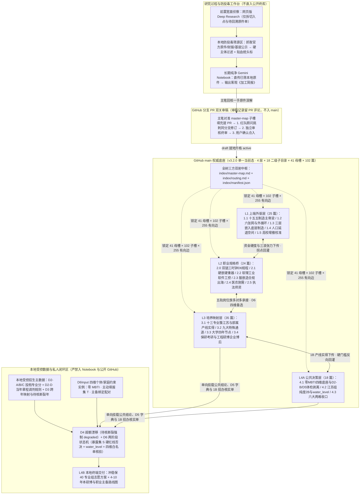

# 知途研究 v3.2（Pathwise v3.2.0）总体实现框架蓝图

**核心结论（置信度：高）**：知途研究 `v3.2.0` 彻底根除人口、政策与多行业平铺罗列的“词条拼盘”结构，确立以**「《“十五五”规划纲要》第二篇实体制造主脊梁 → “六张网”等四条向外延伸链 → 『硬嵌硬 / 软嵌硬·理嵌工 / 服嵌造』三层嵌入 7–10 年制造主队伍 → 人口三浪与 2025 渐进延退反向极化重定价 → 江苏院校专业组志愿收口」**为唯一生长主干的四层双向校核架构。公开仓库在 **41 个一级主干母槽（`parent_slot_id`）** 约束下展开为 **4 层 × 18 个中文编号二级专题子目录 × 102 篇细枝提纲占位卡（构成 255 条双向对称无环有向边）**，无损兼容 `1B / 2B / 3B` 风控体系与 `D1–D6`（含 `D2-D` 当年章程调剂规则与 `D6` 正向白名单四维冲击核验）机器契约。

> **表述分类约定**：全文严格区分 **`[已核实事实｜出处]`**（源自官方权威公报、《“十五五”规划纲要》全文及本仓锁定的工程契约）、**`[明示假设]`**（系统运行边界与默认基准前提）、**`[分析推断]`**（社科传导机制与架构设计推演）及 **`[待核未知]`**（留待分批实证或当年招生专刊核定的事项），绝不将转述线索或分析推断冒充已核事实。

---

## 一、A×B×C 三维耦合全景拓扑与核心闭合机制

### 1.1 系统全景生长与公私双模流转图（`v3.2.0`）



### 1.2 六组 A×B×C 交叉化学反应与五处结构咬合

`[分析推断]` `v3.2.0` 将政策（`A`）、产业（`B`）、人口（`C`）三股力量收束为单向传导与交叉重定价：
1. **单主干生长消解平铺堆砌**：以《“十五五”规划纲要》将第二篇（实体经济与先进制造业骨干）置于科技篇、数字篇之前的顶层排位为总源头（`[已核实事实｜纲要目录及第一至四篇]`），依次派生“六张网”协同（国家发改委初步估算 2026 年推进“六张网”及其他重点领域投资预计超 `7万亿元`；“十五五”期间水网预计超 `6万亿`、电网预计超 `5万亿`、地下管网预计约 `5万亿`，三项五年预计合计超 `16万亿元`——两数分属不同期限与范围的预计值，严禁相加或视同已支付金额）、碳双控与中间品/“制造+服务”出海、沪苏同城化与江苏 `16集群50链 / 6,030家`“筑峰强链”企业库、理工农医与重大任务工程硕博倾斜四条延伸链。
2. **三层嵌入制造主队伍切割悬浮泡沫**：全学科按与物理制造过程的耦合度落位——**第一层「硬嵌硬」**（芯片光电通信、母机精仪、电力核能液冷、特材连续石化生物放大、船海空天车水工地矿）、**第二层「软嵌硬·理嵌工」**（EDA/CAE 求解器、PLC/RTOS 具身控制、跨网网安、SPC 良率与计算光刻物理，以**现场硬件联调+安全签字责任**切开纯 CRUD 与桌面调包中层）、**第三层「服嵌造」**（中试 TIC 碳足迹、多级 BOM 业财金融租赁、两用物项出口管制 SEP 专利、铁水联运驻外交付，诚实标注**精兵窄池**分母并切开悬浮文商柜面）。
3. **人口三浪与 2025 新制延退反向极化重定价**：底部出生下落（2025 年 `792 万`、小学在校单年减 `-406.08 万`）按三档队列传导，在 2031/2034 严峻挤压城区小学与传统主科教编（科学/信息/心理/特教/职本师资呈结构分化）；中部普通、职业本专科及研究生年毕业总计 `1,221.75 万`（其中本硕博合计 `648.39 万`、高职专科 `573.36 万`；职本招 `+40.6%`、在学博士 `75.36 万`）使泛本科溢价归零并推动博士转向企业研发；顶部老龄化（`60+` 占 `23.0%`）与 `13` 号渐进延退决定在“法定不可外包现场工程岗（按 2025 新表平移并扣返聘/高职分流后释放净接班）”与“机关文职控编退多补少”间形成剪刀差。
4. **`1B` 结构代理（冲突转未知）+ `403` 两路交叉降级 + 招办十问闭环**：高校缺同届普通班细分分母时，以必修实验学分、流片/中试平台与链主拟录用公示作保守排序线索（多项代理指标冲突一律标 `[待核未知]`），官网 `403` 时须两路权威第三方交叉核验并标明降级，统一沉淀为填报前招办核实单。
5. **`3B` 公私解耦 + 绑定 `D2-D` 的 `2B` 水位风控 + `D6` 正向白名单四维冲击核验**：公开库零私人偏好、零 MBTI；严分 `D2-B` 高校章程退档码与 `D5` 按岗位记录的用工体检风险提示（严禁凭 `D5` 误否决整个专业组）；本地端按 `D2-D` 分支裁定暴露集 `S`（全组 `S = G` / 已核子集 `S = T ∪ (A \ E)` / 已核书面不调剂 `S = T`）并区分主动目标集 `T` 与 `S` 执行硬红线否决、区间未锁定即 `unknown` 硬阻断保底，且对 `Rank 3` 备选执行正向白名单四级优先序核验。

---

## 二、四层 × 18 二级子目录架构职责与四道填卡硬护栏

`[明示假设]` 系统默认锚定**江苏生源高三考生、全国在苏招生本科院校（“院校专业组”平行志愿模式）及 4–10 年本硕博培养周期**；外省生源仅需在本地受控区替换 `D2/D3` 省域招生插件，`L1–L3` 主干 100% 通用。

| 层级目录 | 规模 | 二级专题子目录构成 | 阶段四正文填充强制护栏 |
| --- | --- | --- | --- |
| **L1 外驱层**<br>[research/l1-drivers/](../research/l1-drivers/README.md) | `15 母槽`<br>`5 子目录`<br>`25 篇` | `1.1` 十五五主轴与制造脊梁（5）· `1.2` 六张网协同与外循环（6）· `1.3` 产业规律与三层嵌入（6）· `1.4` 人口全队列与延退接续（5）· `1.5` 高校超常规布局与增撤（3） | 严守 2026 初步估算超 `7万亿`与“十五五”水电管网三项预计超 `16万亿`的预测时态及期限分界（禁相加或当已付）；三档出生队列按 `2026-11-27` 严拆；江苏 `15–64岁+20万`并列同年约 `+22.7万`含迁移与统计调整近似余额及 `1960` 低谷出界算术双因子 |
| **L2 职业桥**<br>[research/l2-careers/](../research/l2-careers/README.md) | `11 母槽`<br>`6 子目录`<br>`24 篇` | `2.0` 双链三时钟与四维规程（3）· `2.1` 硬嵌硬重器与六张网岗（6）· `2.2` 软嵌硬理嵌工工业软件工控岗（4）· `2.3` 服嵌造业财法务碳核查出海岗（4）· `2.4` 医疗药械与农食刚需岗（4）· `2.5` 公职执法与师资重估岗（3） | 实核「资本→人力→本科正式编」转化（缺证标资本强/编制待核禁入 `Rank 1`）；计入 `2030–2033` 拥挤折扣；切分内外资晶圆厂许可敞口（标待核未知）；单列 `D5` 用工体检提示 |
| **L3 培养层**<br>[research/l3-pathways/](../research/l3-pathways/README.md) | `9 母槽`<br>`4 子目录`<br>`35 篇` | `3.1` 本科专业簇与江苏及部属院校实得（13）· `3.2` 多元与特殊招生通道（9）· `3.3` 大学四年关键节点执行（6）· `3.4` 保研考研与工程硕博企业博后出口（7） | 评估普通批普通本科生实得；覆盖 `080701/080703` 电子通信、`0812/0814/0815` 测绘地矿油气保底、`0828` 五年建筑排雷、`1004` 预防混编排雷、`0503` 新传排雷与 `3.2.1` 强基双轴分类 |
| **L4 决策层**<br>[research/l4-decisions/](../research/l4-decisions/README.md) | `6 母槽`<br>`3 子目录`<br>`18 篇` | `4.1` 个体家庭四维约束与防偏底座（6）· `4.2` 江苏新高考机制与组内水位风控（6）· `4.3` 江苏分科分段核心两难收口（6） | 零 MBTI；严禁凭 `D5` 硬否决招生组；`4.3` 全部 `Rank 3` 定位为「待经 D6 四维逐对冲击核验的异构备选候选」（区分单维未知与整对优先序：合法绑定已知共损先判 `warn_shared_failure_points` 并披露未知维，零已知共损含未知维置 `unknown_blocked`，仅四维全 `pass` 标独立） |

---

## 三、纵向端到端穿行验证与双向回灌链路

| 传导环节 | 穿行链一：江苏物理+化学考生（算电协同 / 半导体与硬制造链） | 穿行链二：江苏历史/兼报考生（少子化与制造出海下的文商避险链） |
| --- | --- | --- |
| **L1 外驱锚定** | `1.1.3` 六大超常规攻关 + `1.2.2` 电网 `5万亿+`/算力 `8+10+3` + `1.4.4` 2025 新制退龄平移复算 + `1.4.5` 江苏常住韧性与双因子拆解 | `1.2.6` 中间品/保税维修/制造+服务出海 + `1.3.4` 服嵌造窄池 vs 悬浮文商出清 + `1.4.1` 小学减 `406万`挤压城区主科教编 + `1.4.4` 文职控编 |
| **L2 规格转换** | 锁 `2.1.1` 晶圆 PIE（区分内外资许可敞口）与射频硬件、`2.1.3` 两网液冷（单列 `D5` 色觉提示）、`2.2.1` EDA/CAE 现场签字岗；切 `2.2.4` 表层 CRUD | 避 `2.5.2` 城区小学传统主科与 `2.3.2` 银行基层柜面；锚 `2.5.1` 公安税海执法、`2.3.2` 深度制造业财审计与 `2.3.3` 涉外管制 SEP 法务（窄池预警） |
| **L3 培养兑现** | 对位 `3.1.1` 流片/通信强校、`3.1.3` 原电力部院校，或 `3.1.7` 强数理经 `3.4.2` 重大任务工程硕博联培转入；排雷 `1.5.2/3.1.6` 挂名凑数 AI | 对位 `3.2.4` 公安联考、`3.1.9` 南审/电力交通校业财物流、`3.1.8` 理工+涉外法治或 `3.1.13` 外语+工贸，配 `3.3.6` 法考/CPA；排雷 `0503` 新传 |
| **D2-D / D5 / D6 → L4** | `4.1.1` 核 `D2-B` 无退档限报并保留 `D5` 职业提示，`4.2.4` 剔五年建筑/生化混编低水位组，`4.3.1–4.3.3` 按 `D6` 正向白名单锁定非同池备选 | `4.1.4` 化解“唯师范”惯性，`4.2.4` 否决公管/泛营销混编组，`4.3.5` 拦截共卡 `LIC_LEGAL_BAR` 假双保险，完成执法/审计/涉外工贸收口 |

- **下游硬门槛反向回灌规程**：在 `Batch 3 / Batch 4` 实证中，若发现某方向实际全员卡死刚性读硕、或江苏在苏招生组普遍将目标专业与高危硬红线专业不可隔离混编，严禁仅在下游单卡掩盖，须在同一 PR 内逆向沿 `upstream_ids` 联立修订上游 `L1/L2` 卡片或在 [index/manifest.json](../index/manifest.json) 将上游置为 `needs_reverify`（不在 DAG 中建反向环路）。

---

## 四、`v3.2.0` 仓库三级目录树与 `D1–D6` 机器契约总览

### 4.1 公开仓库定型目录结构（单一当前态，零隐私，零审稿过程文件堆积）

```text
pathwise-research/                 # GitHub main：v3.2.0 社科研究权威底座（4层×18子目录×41母槽×102篇）
├── .gitignore                     # 本地受控招生表、私有约束实例与临时文件忽略规则（数据工程师维护）
├── README.md                      # FW-002：项目总纲与 18 子目录 × 102 篇可点击全景导航树
├── AGENTS.md                      # FW-003：六岗职责、防投毒采集 + GitHub PR 双审工作流与公私红线
├── docs/
│   └── architecture-v3.md         # FW-001：总体实现框架蓝图（本文档）
├── index/
│   ├── master-map.md              # FW-004：41 母槽汇总表 + 102 行五元组子槽映射总表 + 立题三问闸门
│   ├── routing.md                 # FW-005：三类核心场景按需加载最小文件集路由表
│   └── manifest.json              # D1：12 条 FW/TPL + 102 条叶子卡三方双射与 255 条边 DAG 索引（数据工程师维护）
├── research/                      # 核心社科知识资产库（仅允许 .md 卡片与 README.md）
│   ├── l1-drivers/                # L1 上端外驱层（15 母槽 · 5 子目录 · 25 篇）
│   ├── l2-careers/                # L2 职业规格桥（11 母槽 · 6 子目录 · 24 篇）
│   ├── l3-pathways/               # L3 培养映射层（9 母槽 · 4 子目录 · 35 篇）
│   └── l4-decisions/              # L4 公共决策层（6 母槽 · 3 子目录 · 18 篇）
├── templates/                     # TPL-001..005：5 份绑定母子槽位的单态模板
├── data/
│   └── README.md                  # FW-006：D2（A/B/C/D）/ D3 / D5 字段级数据结构与公私存储隔离契约
└── scripts/
    ├── README.md                  # FW-007：D4 超额漂移 / D6 水位与四维冲击接口契约及门禁说明
    └── validate_framework.py      # 纯标准库静态门禁（三方双射、14键YAML、双向图一致性、死链与零泄漏扫描）
```

### 4.2 `D1–D6` 数据结构与计算接口契约总表（详见 [data/README.md](../data/README.md) 与 [scripts/README.md](../scripts/README.md)）

| 契约编号 | 对象名称 | 核心职责与 `v3.2.0` 关键升级点 | 存储与公开权限 |
| --- | --- | --- | --- |
| **D1** | `index/manifest.json`（`schema_version: "3.2.0"`） | 强制校验 12 个 `FW/TPL` 系统槽与 **41 个一级母槽** 100% 覆盖，锁定磁盘 `research/` 102 张叶子卡、14 键 YAML 与 `master-map.md` §3 五元组全列 1:1 双射及 3 色 DFS 无环图 | **公开入库** |
| **D2** | 江苏在苏招生底表簇（`D2-A/B/C/D`） | 拆分组投档表（`D2-A`）、组内专业明细表（`D2-B`，`physical_limit_codes` 中 `[]` 表无受限、`null` 表未知，与 `D5` 用工体检严格剥离）、一分一段表（`D2-C`）及**当年章程与组内调剂规则表（`D2-D`）** | **严格留存本地受控区**（公开库仅放字段契约与示例） |
| **D3** | 跨年组号拆并映射与政策断裂年表（`D3-A/B`） | 识别同组号偷换冷门高费成员；`D3-B` 仅对具备省考试院一手原件核实的转换对置 `exclude_from_drift_window=true`（江苏物化 `2022->2023` 与 `2023->2024` 核定前保持 `pending_verification` `[待核未知]`） | 明细**留存本地受控区**；规则与待核示例公开 |
| **D4** | 位次分段超额漂移与跨省多样性接口 | 拆解考生规模增长贡献与段内超额漂移；窗口覆盖任何 `pending_verification` 候选断裂对时强制置 `calculation_status="degraded"` 并回退保守上界；省内/长三角超阈值触发外省同档召回 | 接口契约公开；实跑在本地受控区 |
| **D5** | 国标专业↔L2/L3 与逐路径主备映射字典 | 以 6 位 `moe_major_code` 为主键，用 `primary_routes[]` 与 `backup_routes[]`（含跨专业 `paired_primary_refs[]` 与三键 `co_failure_status_by_dim`）逐路径记录付款人、门槛、执照与分岗位职业风险提示 | **允许公开入库**（零商业考分与个人数据） |
| **D6** | 四维约束输入与 `2B` 水位 + 四维备选冲击接口 | 按 `D2-D` 三分支裁定 `S`（仅已核子集调剂用 `S = T ∪ (A \ E)`）并区分 `T` 与 `S` 执行阶段一硬红线否决（`bachelor_direct_only` 仅当 `T` 全部目标专业全主路径均须深造才否决全组）与阶段二 `water_level` 区间核定（仅知最低位次与人数致区间跨档或字段缺失一律置 `unknown` 拦出保底池）；按正向白名单与四级优先序（非法绑定 > 已知共损 `warn_shared_failure_points` > 含单维未知 `unknown_blocked` > 全 `pass`）执行四维核验 | 空白模板与契约公开；实填实例 **100% 留本地受控区** |

---

## 五、跨版本演进取舍、成立边界与推翻条件

### 5.1 架构演进冲突采信说明（从前序版本到 `v3.2.0` 定型）

| 架构维度 | 早期历史版本痛点（`Prajna v1` / `Pathwise v2` / 前序 `v3.1` 草案） | `Pathwise v3.2.0` 锁版采信方案与社会科学依据 |
| --- | --- | --- |
| **宏观顶层组织方式** | 前序草案仍按人口、政策、九行业平行起笔，缺乏国家资源配置主次与跨层传导树干 | 依据《纲要》18 篇 62 章第二篇居首排位，重构为**「实体制造主脊梁 → 四延伸链 → 三层嵌入制造 → 人口延退重定价」**单主干（精炼为 `18 子目录 × 41 母槽 × 102 篇`） |
| **计算机与文商定位** | 表层互联网 CRUD 与工业软件混谈，泛商科出清与高壁垒生产性服务窄池边界模糊 | 在 `L1/L2/L3` 贯通**「软嵌硬·理嵌工（以现场联调+签字切桌面调包）」**与**「服嵌造（诚实标注精兵窄池分母）」** |
| **体检限制与独立备选判定** | 易将企业招聘岗位色弱/夜班偏好误作高考退档红线，或把双电网等同池路径误当独立保底 | 严格剥离 `D2-B` 章程退档码与 `D5` 职业风险提示；`D6` 废除“否则→pass”兜底，实行正向白名单四维核验与四级优先序（非法绑定置 `unknown_blocked`；合法绑定已知共损先判 `warn_shared_failure_points` 并披露未知维，零已知共损含未知维置 `unknown_blocked`） |

### 5.2 成立边界条件与推翻（重审）条件

- **成立边界条件（`[明示假设]`）**：① 超长期特别国债、两网资本开支、制造业“反内卷”与首台（套）/首版次采购机制在“十五五”期间持续兑现；② `13` 号决定双向弹性退休按法定边界执行；③ 江苏维持 `3+1+2` 院校专业组平行志愿投档规则。
- **推翻与调整条件**：① 若水网/地下管网实际开工落地率跌破规划额 `50%`、或细分制造子行业产能利用率连续两年 `<75%` 且链主年降致专精特新研发校招连缩，对应子赛道移出稳态复利区；② 若工业 AI 突破跨工况零样本硬件自联调，下调 `2.2` 桌面仿真岗安全垫；③ 若江苏省统计局公布常住人口机械增长 `≤0` 或 `20–39 岁`青年组净减，撤回省际净迁入缓冲判断；④ 若中央一次性大幅下调生师比或单列扩充紧缺教编，按分学科实绩动态重排 `2.5.2`。
