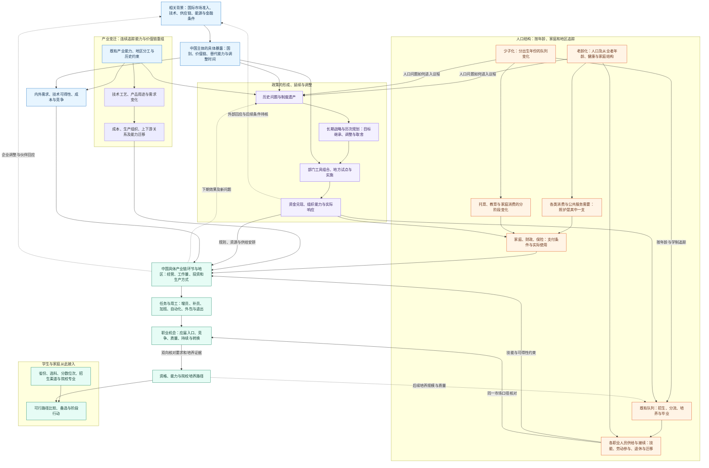

# 知途研究：自上而下的研究总图

## 与完整框架的分工（2026-10-26）
本总图继续负责三条主线的连续对象、机制与相互作用；[完整研究框架](research-framework.md)负责研究单元、来源判断、职业培养应用、覆盖、版本更新及产物落点。本次由方法试水转入完整设计，不以小框架作为最终范围；不表示下述现实关系已经验证。旧日期的阶段说明保留作历史。

初稿日期：2026-10-18；2026-10-23 补充目标与方法边界。状态：研究布局提案，尚未完成整体框架建设或行业预测验证。

研究对象是中国未来十年的产业、职业与教育路径。本文整理本轮架构讨论，明确人口变化、政策回应与职业影响的连接，不包含既有本地知识库的研究正文、原件或数据。文中的机制是研究问题与待检验关系，尚未通过政策原文、统计及行业案例完成实证。协作与审核方式见[多 Agent 协作](agent-workflow.md)和[审核模块](../reviews/README.md)。

## 研究目标与主次

最终落点是未来十年的学业、职业选择，以及当前高考志愿与培养路径比较。**三条主线为政策、产业变迁、人口结构变化**（2026-10-25用户明确纠偏）。三条线是研究组织轴，不是互斥分类，也不与三个实验一一对应。国际环境仅在影响具体机制时作为背景接入，不再单列主线。旧分类和修订依据见[本次决定](decisions/2026-10-25-three-research-lines.md)。先用有界思维实验检验推导和信息采集方法，再逐步固定框架，不因本次纠偏预建完整系统。

### 三条主线各自追踪什么

| 主线 | 连续研究对象 | 决策连接 |
| --- | --- | --- |
| 政策 | 问题形成与历史、目标取舍、工具与主体、执行资源、反馈调整 | 激励或约束怎样改变产业活动、公共服务、资格及培养入口 |
| 产业变迁 | 技术工艺、产品需求、成本与生产组织、上下游关系、能力形成／扩散／迁移／替代 | 哪些环节及任务增加、收缩或重组，由谁承接，需要什么能力，哪些入口对新人开放 |
| 人口结构变化 | 规模、年龄队列、家庭及地区分布，需求、劳动供给和人员接续 | 需求怎样变成工作量，供给怎样影响竞争，何时传到目标毕业年 |

同一材料可连接多条线，但须说明改变了哪条判断。政策不是产业变化的唯一起点，技术、市场和组织变化也会引发政策回应。既有产业基础是产业变迁的起点之一，不能替代变化过程本身。国际因素只在具体对象存在相关渠道时进入，不为凑分类另开国际实验。

先解释中国当前结构是怎样形成的：政策继承了哪些历史问题，人口处于哪些年龄与家庭结构，产业已有怎样的能力和约束，国际关系通过何种渠道影响国内主体。再研究这些条件在未来十年怎样相互作用、传导到行业与职业，最后核对培养路径并接入学生条件。

人口研究的落点是老龄化、少子化怎样影响全社会的职业需求、人员供给、任务和进入路径。养老与儿童服务是其中的需求分支；各职业从业者的年龄结构、岗位接续、生产方式调整，以及国家应对人口问题的政策选择，都须进入研究。

自上而下是分析层次，不意味着政策是所有变化的起因。产业困难、人口变化和国际约束也会引发政策调整。研究必须同时解释政策为何出现，以及政策实施后发生什么。

公共研究布局依据变化的重要性、影响范围、关键未知及研究成本安排。考生的省份、选科、分数位次与招生渠道决定一次规划的适用范围，再结合院校专业、培养路径与职业入口比较方案；不把性格、兴趣画像或家庭照护责任设为学生规划输入。

## 总图

实线表示须说明前提、机制及当前证据状态的研究关系，不表示已经证实因果，也不要求每条连接先取得独立实证才可条件推演。取证优先针对影响方向、强弱或选择的关键节点。虚线表示下期反馈或依据新观察修正判断；反馈必须标时间，不能用循环引用证明当期因果。十年情景由这些关系的条件与证据共同构成，不能预先当作下游事实。

图为总览，省略了部分交叉边。国内政策也可直接改变支付制度、教育和参与条件；服务支付与财政约束、工资与迁移留任之间的反馈，按下文和专题稿展开。箭头不表示每个行业都必须暴露于所有因素。

## 政策研读：建立跨期的政策谱系

政策不等于能源政策，能源案例不能收窄政策主线。用户提出“十五五”规划作为政策分析例子：仅取得一份规划文本或相关新闻，还不能直接判断它影响哪些职业。先作条件推演：政策目标/措施 → 激励、资源配置或约束变化 → 产业活动与工作任务 → 职业入口、能力需求 → 学业/职业选择，再反向决定应收集哪些政策及配套材料、如何收集。

信息收集随关键节点组织：目标和优先级找正式规划原文；适用对象、工具和执行责任找配套细则；资金与组织落实找预算/执行材料；预期与观察不一致时再找产业和用工变化。记录发布者、时效、范围、对应链条节点与改判用途，而不是堆积新闻。目标不等于工具，文件发布不等于实施，实施不等于岗位必然增长。本次只记录分析方法，不核读或断言“十五五”实际内容和落实情况；不新建完整政策框架。

### 用户提出的能源政策推导案例（2026-10-23）

用户以太阳能、风能转型作为政策情景起点，提出条件路径：出力波动及某些时段/地区的富余电力 → 寻找本地消纳用途 → 在条件合适时用于二氧化碳制淀粉的耗能过程 → 可能改变相关生产成本、产业布局、工作任务和培养需求。西部本地利用是一种待检验路径；若可用绿电与大量 CO2 工业排放源邻近，用户设想共址可能更有收益。这里记录的是用户提出的机制假设，不是已核实的产能、收益或政策效果。

本地消纳可与部分外送需求比较，不推出“不再需要特高压/西电东送”，也不把“某些时段有富余电”当成“全年低价稳定电”。真正改变判断的节点是电力时间结构能否适配工艺、含制氢与 CO2 捕集/处理等环节的全流程成本、产品质量与需求，以及共址条件。只有这些节点影响职业/培养方向时才补证，不在本次文档更新中开展技术或成本研究。

政策入口首先是问题的历史，而非最近一份文件。需要区分现实问题何时出现、官方何时将其表述为治理问题，以及何时采取某种工具。随后对照相关长期战略、历次规划、部门文件、地方试点、预算执行和效果评价。

每次比较抓住五项：问题对象是否变了；目标与目标之间的排序是否变了；工具作用于谁、改变什么收益或约束；执行主体和实际资源是否到位；观察结果是否迫使政策修订。同名目标、反复出现的措辞和文件数量，不能代替这种比较。文件间的延续、替代、扩围或纠偏关系应有文本或执行依据，不凭相近标题自动建立。

研读成果应能并排展示同一问题在各阶段的变化：**当时的问题与证据—政策目标及取舍—工具及适用主体—地方执行与资源—观察到的结果—下一轮修订依据**。同时保留发布日期、生效与终止日期；缺少执行资料时，不用后来的文件替代当时的落实记录。这样才能追问某项调整是长期路线延续、工具纠偏，还是应对新约束，而不是只做文件摘要。

稳定性必须分别判断：**目标延续、工具变化、执行强弱、结果不确定性**。目标持续不保证某项补贴长期保留，工具调整也不自动代表目标反转。国际冲击可能影响其中不同层次，不用一个主观分数概括。

需要检验的反向解释是：行业困难先促成政策加码，随后经营仍承压。这个序列既不能证明政策带来增长，也不能单凭承压证明政策无效。应区分是否真正实施、谁实际受到影响、政策前差异和同期变化。政策成功的某项目标也未必是增员，例如生产率目标可通过自动化实现。

## 产业变迁研读：从变化来源到上下游与工作任务

产业主线的连续单位是“某种变化怎样重组一条产品／服务价值链”，不是单条技术消息。先辨明技术工艺进步、产品用途扩展、成本约束、生产组织调整、产业成熟或原料路线替换，再追踪投入与客户关系、能力扩散迁移及替代，最后连接任务、人员和新人入口。

成熟产业的运维改造、尚未商业成熟技术的研发验证、跨行业能力迁移，都可以进入这条线。每份局部材料须定位它支持的环节、上游输入、下游用途及尚未接通的关系；汇总时回答同一个产业变化问题，不能把相似的“检测、控制、协作能力”清单当成完整产业研究。

技术可行、可重复工程运行、客户采用与规模扩散分开判断。方向性推演可以先行，阶段和成立条件须明示；商业化不是研究训练价值的必需前提，也不证明就业必增。以下规模、收益和用工核对用于校准连续路径，不把产业降为其他专题结果的汇总栏。

### 把规模、收益与就业拆开

每个行业先按具体产品、价值链环节和地区找出终端用户及付费方，再核订单销量、价格、收入、利润和回款，追踪投资的实际用途及生产方式变化，最后识别任务和人员安排。

研究应能区分几种竞争解释：规模增加来自数量还是价格；龙头增长来自整体扩张还是份额集中；投资用来扩产、研发、并购还是自动化；持续招人来自业务扩张还是高流失补员。相同的行业增长数字可以对应不同的职业结果。

对于公共机构，采用职责、预算执行、支付、服务量和承接方式等相应证据，不强套商业利润链。涉及公共资金时分别核资金方、服务提供方、劳动合同主体和用工形式。退休、离职与岗位新增分账，并核哪些退出岗位实际补招、哪些对新人开放。

这一层逐环标明事实、假设和推断，已有证据据实登记；缺口限制相应判断的确定性与适用范围，不自动禁止继续条件推演。只在会改变职业/学业选择的节点追加取证，不能用无限细化替代方向判断。

## 人口研读：老龄化、少子化及不同时间尺度

先按职业研究从业者年龄结构与接续、客户和服务对象变化、任务与生产方式调整、政策回应及地区分化，再连接学生毕业年份。老龄化研究不能收窄为养老服务市场，少子化研究也不能停在儿童消费或学生人数。

老龄化的需求分支应结合年龄结构、健康与失能状态、服务需求及地区差异展开。先解释哪些需要发生，再核服务是否可获得、由谁支付、实际使用多少，最后连接机构工作量和用工方式。另一分支要核各职业实际退出、经验传承和补招方式，以及雇主是否通过自动化、外包或岗位重组应对接续问题。老年人口占比不能独自回答这些问题。

人口存量、流量和比例分别记录。老年占比上升可能同时包含其他年龄人口减少；退休人数也须核实际离岗、岗位取消或合并、返聘和补招。地方税费与社保实缴、转移支付和实际收支共同约束公共服务；不能只用年龄比例推算财政承受力。

少子化需要同时追踪服务需求和未来供给。托育、学前、义务教育、高中与高等教育受到不同出生队列的影响，传导时间各不相同。未来十年的大学毕业供给要从相关的既有队列、入学与分流、实际学制、完成和升学等环节推演；不能把今天的出生变化直接变成几年后的大学毕业人数。今后的生育变化也可能较早改变家庭支出和劳动参与，这与其子女以后进入劳动力市场是不同机制。

**教育职业案例：人口变化与政策回应共同作用。** 假设某地区、某学段学生减少，要核学校是否减少新招、合并机构、调配教师，或通过改变班额与服务标准保留工作量。编制核定数、实际在岗人数与年度新招人数分列；在岗人数稳定，也可能伴随新人入口收窄。再核师范及其他合资格求职者的供给是否同步调整，最终判断目标毕业年的教师、教研、管理等具体入口。

国家应对少子化也可能改变教育与培训的政策选择。这是一条需要独立取证的链：人口问题进入议程→生育养育成本、教育公平、儿童保护等多目标权衡→公共供给、补贴、布局或监管工具选择→执行与组织响应→职业影响。教培政策调整的方向不能预设为放松；不同工具可能改变校内外服务的分工、付费来源和用人主体。应回看历次政策的问题认定与目标，再查正式规则及实施证据，不能从少子化直接推断某类教培岗位将增长。

人口迁移及服务标准变化可能使全国总量与某地区、某类服务的工作量方向不同；应沿地区、时间和服务对象推演对职业入口的影响。

## 相关国际背景：按具体机制接入，不单列主线

用户当前关心的重点是中美竞争。按市场、技术与设备、供应链、能源/金融等具体暴露渠道推到中国主体，再推职业与培养影响；不预设每个行业同向受影响，也不把机器人题目强行归为中美竞争的单一例子。

仅在已有问题需要时记录相关国际条件。它可影响三条主线，但不独立组织为第四或替代主线，不要求每场实验补齐国际部分，也不能给所有行业统一加减分。

先建立相关国别规则与产业分工的历史，再核具体主体的直接及间接暴露，随后估计调整所需条件与时间。库存缓冲、替代品验证、客户转换和新基地投产有不同周期，突发冲击的当期反应不能直接外推十年。国外经验用于提出机制假设时，也须比较制度与支付责任、人口阶段、家庭结构和产业位置。

| 渠道 | 追问中国哪些主体真正暴露 | 传到国内的中间变化 |
| --- | --- | --- |
| 外需与市场准入 | 哪些产品、客户和地区的收入依赖相应市场？ | 订单、价格、市场替代、合规与回款 |
| 技术、设备与标准 | 哪些环节依赖特定技术、部件、软件或许可？ | 可获得性、验证周期、替代成本、良率与任务要求 |
| 供应链与跨境投资 | 哪个环节扩建、迁移或重新配置，决策与投产有何差距？ | 中国境内的产能、投资、服务任务与实际用工 |
| 能源、原材料与金融条件 | 哪些主体的投入、融资和结算受到影响，能否缓冲或转嫁？ | 经营成本、现金流、投资安排及生存约束 |

限制、合作、新市场与新技术均纳入条件情景。中国政策和企业调整还可能引发下一期外部反应，应追踪时间顺序。不能把海外产能、国内企业全球收入或国外就业变化直接当作中国境内新人岗位。

## 合成时怎样避免重新变浅

政策、产业变迁和人口结构变化三条线不是三张结论表相加。合成单位应落在同一产业链环节或服务、同一地区与主体、同一观察期及目标毕业群体。先问某个因素在该对象上是否相关，再核它通过哪条机制改变哪个判断。

例如，假设一个地区照护需要增加：支付覆盖和实际到账决定多少需要转成可使用服务；服务使用与支付条件影响实际工作量；机构可通过增员、加班、外包或技术应对；国际因素只有在设备、投入或融资等暴露得到确认时才进入该案例。不能为了让总图完整，给每个专题强行加一段国际影响。

各层还须对齐不同的时钟：政策公布与生效、预算与到账、技术可得与实际部署、投资与投产、出生与入学毕业、培养与求职。未来十年情景按这些真实滞后组织，不把同一年发布的资料拼成同期发生的完整传导链。

验证重点是能否解释相反结果并指出可区分它们的观察。若已有观察同时符合两种解释，保留分歧，优先补查会改变关键判断的材料。新情景可以调整原结论、收窄适用范围或维持未知，不能以专题篇数或图的节点数评价研究深度。

## 逐层交付索引

| 层次 | 必须回答的问题 | 可复用成果 |
| --- | --- | --- |
| 历史基础与变化来源 | 政策为何形成并怎样实施？老龄化、少子化怎样按队列传导？国内市场、技术与国际条件怎样影响具体主体？ | 跨期政策比较、人口队列与地区账户、国际暴露记录及待检验机制 |
| 十年情景 | 哪些产业链环节、服务和地区可能扩张、收缩或重组？依赖哪些条件，多久传导？ | 基准、上行、下行情景，以及支持、反对证据和失效信号 |
| 实际主体 | 谁支付、谁承接、谁签约用人？收入、现金流、预算或工作量是否变化？ | 具体主体的经营、服务和人员证据；企业与公共用人分别核验 |
| 任务与岗位 | 工作由增员、加班、自动化或外包完成？是新增岗位还是离职、退休后的补员？ | 分开记录任务变化、实际用工和招聘；没有净增也可能有进入机会 |
| 职业机会 | 哪些岗位对目标毕业群体开放？有哪些合资格竞争者，条件和后续发展怎样？ | 入口、竞争边界、劳动质量、持续性与转换条件；不合成无依据的前景总分 |
| 培养路径 | 岗位要求什么？学校实际教了什么？课程、实践和考核能证明什么？ | 多对多的专业、院校、培养、能力和职业连接；明确断点与成本 |
| 个人选择 | 学生能否进入、能否承担、是否愿意投入？失败或条件变化后有哪些备选？ | 带依据的可行路径集合、个人取舍和阶段行动 |

人口的需求端与供给端独立研究。服务需要只有经过使用和支付等环节，才能讨论机构工作量；毕业生数量也只有核对就业目的地、资格、参与和时期后，才可能用于讨论竞争。

## 横贯全图的四项要求

1. **时间与地区。** 以2026—2036作为本版十年观察窗口，后续滚动更新；区分近期可观察变化、中期传导和远期条件情景，并回到实际学生的入学、毕业及求职年份。全国变化必须核对地区与具体主体的差异。
2. **证据与反证。** 分清历史事实、机制推断、未来情景和个人价值选择。每条重要关系记录支持材料、相反证据、成立条件与当前未知；某一环节未知只限制依赖它的推断。
3. **多对多映射。** 行业、职业、专业与院校培养不能一一对应。跨行业职能要保留多个行业去向；课程名称、专业热度和学历本身都不替代能力或雇主接受的证据。
4. **复核与分流。** 真实经营、用工和培养结果用于复核公共判断；个人偏好和能力变化用于重新比较个人路径。个案可以提出新研究问题，不能直接升级为行业规律。预测保留当时信息和条件，结果出现后核误差原因。

## 行业覆盖与建设顺序

整体框架建设前，先用少子化、二氧化碳制淀粉、机器人替代劳动力等有界实验检验推演怎样帮助职业与学业选择。实验比较完成后，再逐步形成行业及公共服务的覆盖底图，纳入成熟、增长、收缩和转型方向。行业分类用于检查覆盖，职业任务用于跨行业连接，专业目录用于培养路径定位；三类目录分别维护对应关系，不把热门专业名单当作产业全景。

行业发展图应同时描述业务规模、盈利或支付能力、生产率、地区分布和结构变化，岗位变化另行取证。产值增加、技术突破或政策支持，均不能自动推出就业增加；行业总量收缩也不能自动推出所有细分任务和新人入口消失。

建设时先建立各领域可比较的概览与未知，再根据变化的重要性、影响范围、关键断点和可取得证据，选择有限的纵向链深入。图中七层不意味着先完成所有行业的十年研究，才能核验任何具体培养路径。

## 研究职责与仓库落点

| 职责 | 本仓库如何承接 |
| --- | --- |
| 政策、产业变迁、人口结构变化 | 在 `research/` 下连续追踪各主线；国际条件仅作相关背景；每项研究返回职业影响接口 |
| 跨主线连接任务与职业机会 | 在连续产业研究基础上，按价值链、地区、主体及时期连接政策和人口证据，保留反例与未知 |
| 培养路径与个人选择 | 先核公共研究及院校培养证据，再应用个人条件；个人资料保留本地 |
| 来源与研究输出 | `sources/` 登记允许上传的来源索引；`reports/` 保存经审核的输出 |
| 任务协作与独立审核 | Issue、分支、PR 与 `reviews/` 共同承接，详见协作约定 |

此表分配研究职责，不预建所有专题目录。通过有限案例检验后再固定必要字段与模块。目录存在、文档合并或审核通过均不代表现实趋势已经得到证实。

