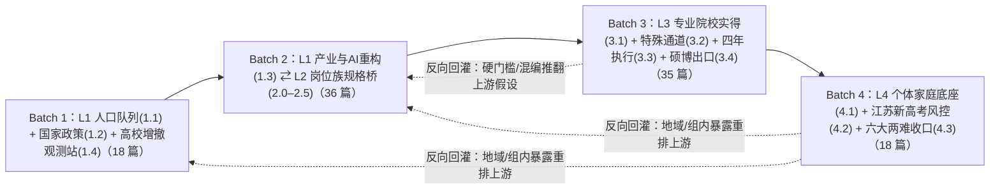

# 知途研究 v3.1 主干防走偏版图与三级细枝子槽总表（Master Map · v3.1.0）

**核心结论（置信度：高）**：本文件是知途研究 `v3.1.0` 兼具「宏观—微观防跑偏总闸门」与「第一代细枝分叉直观可读性」的**唯一立题与路由总表**。全库公共研究在 **43 个一级主干母槽（`parent_slot_id`：`L1` 20 槽、`L2` 9 槽、`L3` 8 槽、`L4` 6 槽）** 的刚性边界内，按 **4 层 × 17 个中文编号二级专题子目录**精细拆解为 **107 篇层级叶子子槽（`slot_id`：`L*-***-dd.dd`）单篇提纲占位卡**，全面覆盖《“十五五”规划纲要（2026—2030）》八大重合任务组合、三大人口队列拐点、教育部《普通高等学校本科专业目录（2026 年）》核心门类、多元特殊招生通道、大学四年执行节点、本硕博深造出口及江苏生源六大志愿取舍两难；一切后续课题必须按 **`Batch 1 → Batch 4` 严格顺序对槽填充**，凡通不过「立题防细枝三问硬闸门」的议题一律拒不立项。

> **状态与三方双射维护约定（`v3.1.0`）**：当前 107 篇叶子卡片均已预置定制化提纲占位卡（`status: "draft"` 表示提纲已就位、待填充核实正文）。每张叶子卡片顶部 YAML Frontmatter 声明全局唯一的 `card_id`、`slot_id` 与 `parent_slot_id`，与本文件 §三「全量层级叶子子槽映射总表」及机器索引 [manifest.json](manifest.json)（收录 12 条 `FW-*/TPL-*` 系统条目 + 107 条 `research/` 业务叶子卡片条目）严格保持 **三方 1:1 双射**。各层 `README.md` 与 17 个二级子目录 `README.md` 承担目录导览与勾选索引职责，由静态门禁脚本校验相对链接与目录完整性。未经用户明确批准修改本版图，任何角色不得私自增设表外野槽。

---

## 一、「防细枝末节」立题三问硬闸门（逻辑 `AND` · 开题必检）

任何新研究填充、Deep Research 前置侦察或资料采集启动前，必须**同时满足（逻辑 `AND`）**以下三道硬闸门；**任一题不满足，立即一票否决**：

| 闸门序号 | 硬核必答问题（三问必须同时满足 `AND`） | 放行标准（全部达标方可推进叶子卡成稿） | 直接拒止的“细枝末节/平行野卡”反例 |
| --- | --- | --- | --- |
| **闸门 1：母子槽位归属** | 本课题精确对应本文件 §三 **107 个叶子 `slot_id`**（隶属 **43 个 `parent_slot_id` 母槽**）中的哪一个，且符合当前 `Batch` 批次与上游基线要求？ | 唯一指向 1 个既有 `slot_id`，且关键上游依赖已就绪（或属下游硬门槛触发的反向回灌联立修订） | 顺着突发商业新闻、单条科技视频或冷僻概念词临时起意开表外新坑；跳过 L1/L2 底盘孤立写单校单专业卡片 |
| **闸门 2：付款与培养机制排重** | 对照 [manifest.json](manifest.json) 同簇卡片，是否聚焦于**本卡专属的付款方、地域/队列存量接续机制、通道规则或本硕/执照硬门槛**？ | 边界清晰无重叠；跨行业通用岗位统一归入所属 `L2-CAR-*` 主岗位篇内横向对比不同甲方行业，不拆平行矛盾卡 | 同一机制已在主岗位卡写透，却按承接行业重复复制多张相互矛盾的软件/财会/法务平行卡 |
| **闸门 3：江苏可及性与改判力** | 能否写清受影响的**江苏可及生源分段/通道、适用 `graduation_cohort` 与 `target_regions`**，并实质改变「专业组取舍、组内调剂服从、特殊通道锁档、本硕分流、大学节点、四维独立备选」之一的默认判断？ | 具备现实志愿或培养决策改判力；仅涉极少数人特殊班微细则或冷门小证书的事项，**一律只作既有叶子卡内附注或招办核实项，严禁单独开卡** | 包装某校极小众实验班冷僻条款、商业机构自封证书或无招生落点的纯概念炒作充当独立课题 |

---

## 二、43 个一级主干母槽汇总表（`parent_slot_id` 全景边界）

> **格式说明**：下表按 `01–43` 汇总全部一级主干母槽（`parent_slot_id`），每个母槽均在 §三 展开至少 `1` 个层级叶子子槽（`L*-***-dd.dd`），无任何悬空母槽。横向交叉标签 `TAG-SCI`（数理化生基础科学向工程转化）、`TAG-SEC`（安全生产、防灾应急与系统韧性）、`TAG-MAR`（船舶海工与涉海空间）按需内嵌于关联产业与培养卡内，不另立平行母槽。

| 序号 | 母槽编号（`parent_slot_id`） | 层级与批次 | 一级主干母槽名称 | 展开子槽范围（篇数） | 核心穿透对象与上下游传导锚点 |
| --- | --- | --- | --- | --- | --- |
| 01 | `L1-DEM-01` | `L1 · Batch 1` | 出生与婴幼队列坍缩传导 | `L1-DEM-01.01`–`01.02`（2 篇） | 出生队列基准 × 母婴财报/妇产科撤并/托幼关停 + 江苏与长三角城市净流入分化 → `L2-CAR-06/07/08` |
| 02 | `L1-DEM-02` | `L1 · Batch 1` | 学龄教育梯次达峰与师资余缺调配 | `L1-DEM-02.01`–`02.02`（2 篇） | 学前至高中（2029）及高教（2032）梯次拐点 × 教编员额跨学段调配与本硕供给洪峰 → `L2-CAR-08` 及全簇分母 |
| 03 | `L1-DEM-03` | `L1 · Batch 1` | 老龄抚养队列、社保医保收支与退休接续 | `L1-DEM-03.01`–`03.02`（2 篇） | 60+/失能队列 × 医保长护险决算边界 + 在岗骨干退休潮 vs 退一不补存量挤压 → `L2-CAR-03/05/07/08` |
| 04 | `L1-POL-01` | `L1 · Batch 1` | 产业升级、科技自立与新型举国体制投入 | `L1-POL-01.01`–`01.02`（2 篇） | 战新与未来产业研发投入、央国企考核指挥棒及双一流急需学科动态布局 → `L1-IND-01/02/04`、`L3` |
| 05 | `L1-POL-02` | `L1 · Batch 1` | 数智基础设施、数据要素与治理生态 | `L1-POL-02.01`（1 篇） | 算力电力协同、政企数智化采购预算上限、数据安全与算法合规强监管 → `L1-IND-01~09` |
| 06 | `L1-POL-03` | `L1 · Batch 1` | 能源安全、新型电力系统与绿色低碳转型 | `L1-POL-03.01`（1 篇） | 主配网与新型储能资本开支、双碳能耗双控、工业安环强制准入牌照 → `L1-IND-02/03/04` |
| 07 | `L1-POL-04` | `L1 · Batch 1` | 粮食安全、生物育种与现代农食支持体系 | `L1-POL-04.01`（1 篇） | 高标准农田与种业振兴预算、海关及农业动植物检疫体制、食药安全强检 → `L1-IND-04/06` |
| 08 | `L1-POL-05` | `L1 · Batch 1` | 区域格局、综合交通与城市存量更新 | `L1-POL-05.01`（1 篇） | 长三角都市圈分工、现代化综合交通网、地下管网更新与房建转型制度 → `L1-IND-02/03/05` |
| 09 | `L1-POL-06` | `L1 · Batch 1` | 健康中国、三医协同与老龄服务支付制度 | `L1-POL-06.01`（1 篇） | 医保 DRG/DIP 支付改革、药耗集采、县域医共体与长期护理保险试点决算 → `L1-IND-04/07` |
| 10 | `L1-POL-07` | `L1 · Batch 1` | 教育强国、文化传播与基本公共服务供给 | `L1-POL-07.01`–`07.03`（3 篇） | 理工农医扩招、县管校聘控编及教育部高校本科专业备案/审批/撤销四年时滞观测 → `L1-IND-08`、`L3` |
| 11 | `L1-POL-08` | `L1 · Batch 1` | 统一大市场、开放贸易、财税化债与法治 | `L1-POL-08.01`–`08.02`（2 篇） | 地方化债与一般公共预算约束、出海经贸法治及政策五步穿透与户籍编制信号甄别 → `L1-IND-09`、全财政赛道 |
| 12 | `L1-IND-01` | `L1 · Batch 2` | 信息数字与软件系统 | `L1-IND-01.01`–`01.02`（2 篇） | AI 编码重构初级工时 vs 系统交付/嵌入式/网安运维 + 产业周期与 AI 任务颗粒度通用框架（`TAG-SCI/SEC`） |
| 13 | `L1-IND-02` | `L1 · Batch 2` | 装备制造、工控自动化与综合交通 | `L1-IND-02.01`（1 篇） | 智能产线集成、现场测控联调、具身机器人与车企/轨交/船海出海维保（`TAG-MAR/SEC`） |
| 14 | `L1-IND-03` | `L1 · Batch 2` | 能源电力、资源开发与环境工程 | `L1-IND-03.01`（1 篇） | 电网与新能源从抢装扩建转入调度消纳与存量巡检、矿产采选冶与工业危废运营（`TAG-SEC/MAR`） |
| 15 | `L1-IND-04` | `L1 · Batch 2` | 材料、化工过程与生物制造 | `L1-IND-04.01`（1 篇） | 实验室配方 vs 连续化工过程放大、EHS 合规壁垒、生物制造与创新药许可转化（`TAG-SCI/SEC`） |
| 16 | `L1-IND-05` | `L1 · Batch 2` | 建筑更新、市政水务与城市空间运营 | `L1-IND-05.01`（1 篇） | 房建退潮后的市政供排水/燃气热力生命线运营、工业洁净厂房与特种改造（`TAG-SEC/MAR`） |
| 17 | `L1-IND-06` | `L1 · Batch 2` | 现代农业、种业植保与食品供应链 | `L1-IND-06.01`（1 篇） | 生物育种商业化、规模养殖动保刚需、食品工业品控与大宗粮油储运（`TAG-SCI/SEC`） |
| 18 | `L1-IND-07` | `L1 · Batch 2` | 医疗诊疗、医技康复与健康消费分工 | `L1-IND-07.01`（1 篇） | 公立医院控费下的临床/医技/检验分工 vs 口腔/视光商业自付及银发经济真伪需求（`TAG-SCI/SEC`） |
| 19 | `L1-IND-08` | `L1 · Batch 2` | 分学段教育、文化传媒与公共服务承接 | `L1-IND-08.01`（1 篇） | 公办中小学峰后存量调配、工业企业技训分流、AIGC 重构传媒内容与政府购买服务收缩（`TAG-SEC`） |
| 20 | `L1-IND-09` | `L1 · Batch 2` | 商贸物流、财会审计、金融与法律服务 | `L1-IND-09.01`（1 篇） | 跨境制造供应链履约、AI 替代基础记账/文书后的业财内控法务兜底与金融网点风控转型（`TAG-SEC`） |
| 21 | `L2-CAR-01` | `L2 · Batch 2` | 数智研发、系统交付与网安数据运维入口簇 | `L2-CAR-01.01`–`01.05`（5 篇） | 双链对口总纲 + 算法数科（硕）vs 软件嵌入式交付 vs 芯片通信硬件 vs 网安运维跨行业对比 |
| 22 | `L2-CAR-02` | `L2 · Batch 2` | 装备研发、现场工控验证与交通维保入口簇 | `L2-CAR-02.01`–`02.03`（3 篇） | 三只时钟与四维备选核验规程 + 机械新能源车机器人研发 vs 工业自动化联调与交通专有维保 |
| 23 | `L2-CAR-03` | `L2 · Batch 2` | 电力电网、能源动力与环保安全运营入口簇 | `L2-CAR-03.01`–`03.03`（3 篇） | 央国企校招五步反推法 + 国网南网五大六小发电校招梯度 vs 储能风光设备周期与工业安环运营 |
| 24 | `L2-CAR-04` | `L2 · Batch 2` | 材料化工工艺、生物制造与药械注册入口簇 | `L2-CAR-04.01`–`04.02`（2 篇） | 院所材料硕博 vs 大型石化工艺工程师驻地倒班 + 生物制造创新药 CMC/QA/RA 注册与临床监察 |
| 25 | `L2-CAR-05` | `L2 · Batch 2` | 市政水务运营、工业更新与工程造价入口簇 | `L2-CAR-05.01`（1 篇） | 本地水司燃气热力运行存量接班挤压 vs 工业洁净更新施工驻场 vs 全过程工程造价审计 |
| 26 | `L2-CAR-06` | `L2 · Batch 2` | 种业农技、动医检疫与食品品控供应链入口簇 | `L2-CAR-06.01`–`06.02`（2 篇） | 海关动植物检疫公考壁垒、规模农牧动保与宠物自付医疗 + 食品工业品控研发与检测认证 |
| 27 | `L2-CAR-07` | `L2 · Batch 2` | 临床诊疗、医技康复检验与自付健康入口簇 | `L2-CAR-07.01`–`07.03`（3 篇） | 公立临床硕士规培漏斗 vs 口腔视光消费自付与器械支持 vs 影技检验康复护理疾控支付上限 |
| 28 | `L2-CAR-08` | `L2 · Batch 2` | 公办师资、企业技训与体制基层治理入口簇 | `L2-CAR-08.01`–`08.03`（3 篇） | 国省考选调生政法税务硬目录 + 2031/2034 峰后师资缩编与企业技训 + 科研事业编与国企党务社工 |
| 29 | `L2-CAR-09` | `L2 · Batch 2` | 财会内控、法务合规、金融与出海商贸入口簇 | `L2-CAR-09.01`–`09.04`（4 篇） | 业财内控审计税务 + 律所法务知识产权法考留存 + 银行保险证券风控 + 制造出海商务物流关务 |
| 30 | `L3-PTH-01` | `L3 · Batch 3` | 电子信息、计算机与数理统计培养簇 | `L3-PTH-01.01`–`01.07`（7 篇） | 计软网安、电信集成电路光电、数理统计培养实得 + 八学期总轴、白名单竞赛科研、保研全流程与自划线 408 烈度 |
| 31 | `L3-PTH-02` | `L3 · Batch 3` | 机械自动化、电气能动与交通运输培养簇 | `L3-PTH-02.01`–`02.05`（5 篇） | 电气能动电力校壁垒、机械自动化兵工航空交通实得 + GPA 辅修微专业、实习秋春招卡位、学硕 vs 专硕 |
| 32 | `L3-PTH-03` | `L3 · Batch 3` | 材料化工、环境安全与生物制药培养簇 | `L3-PTH-03.01`–`03.03`（3 篇） | 材化环安生药培养与试验班混编排雷 + 大类分流绩点战与转专业硬门槛 + 博士延毕率与非升即走评估 |
| 33 | `L3-PTH-04` | `L3 · Batch 3` | 土建水务、测绘地矿与城乡空间培养簇 | `L3-PTH-04.01`–`04.02`（2 篇） | 土木给排水水利地矿与建筑城规五年制分化 + 跨专业考研可行性边界与调剂机制排雷 |
| 34 | `L3-PTH-05` | `L3 · Batch 3` | 现代农林、动物医学与食品科学培养簇 | `L3-PTH-05.01`–`05.02`（2 篇） | 农林种业、动物医学五年制兽医资格与食品培养 + 硕士分行业起薪溢价回本周期与研期实习冲突 |
| 35 | `L3-PTH-06` | `L3 · Batch 3` | 临床口腔、公卫药学与医技护理培养簇 | `L3-PTH-06.01`–`06.02`（2 篇） | 临床口腔预防中医学制与省内医科大附院规培 + 药学医学技术护理生医工执业医师资格硬边界 |
| 36 | `L3-PTH-07` | `L3 · Batch 3` | 法学、财会金融与工商管理商贸培养簇 | `L3-PTH-07.01`–`07.04`（4 篇） | 法学知产纪检、财会金融经贸物流与行业特色财会 + 执业考证与行业外语路径 + 硕博考公选调定级收益 |
| 37 | `L3-PTH-08` | `L3 · Batch 3` | 师范人文外语与特殊招生通道通则簇 | `L3-PTH-08.01`–`08.10`（10 篇） | 逐篇独立拆透强基、江苏综评 A/B、军校、公安司法警校、五大官校海关海事、公费定向、三大招飞、中外合作、港澳专项 + 师范人文外语公管培养 |
| 38 | `L4-DEC-01` | `L4 · Batch 4` | 顶尖与高分段：名校平台光环 vs 王牌专业组纯度 | `L4-DEC-01.01`–`01.04`（4 篇） | 物理高分段 985 大类 vs 次档电计直录收口 + CHC 能力环境适配底座 + 平行志愿退档红线 + 2B 红线与 `water_level` 水位指南 |
| 39 | `L4-DEC-02` | `L4 · Batch 4` | 中高分段：主流硬工科内部排序与外省替代 | `L4-DEC-02.01`–`02.04`（4 篇） | 物理中高分段硬工科与外省性价比收口 + 十大志愿认知防偏 + 就读与就业地域三维矩阵 + 断裂年核验与位次超额漂移 |
| 40 | `L4-DEC-03` | `L4 · Batch 4` | 中分段：省属本科现场工程 vs 行业专有渠道 | `L4-DEC-03.01`–`03.03`（3 篇） | 物理中分段通用省属本科 vs 电力水务审计特色校收口 + 院校层次与原部属血统重估 + 压线进组与招办核实十问 |
| 41 | `L4-DEC-04` | `L4 · Batch 4` | 医疗健康全谱系：跨学制、跨资格与跨付款方取舍 | `L4-DEC-04.01`（1 篇） | 临床长周期读硕规培 vs 口腔/视光个人自付商业化 vs 医技/检验/康复/预防/药学/护理/动医全分段收口 |
| 42 | `L4-DEC-05` | `L4 · Batch 4` | 历史类与物理兼报带：考公法务财会与峰后师范重排 | `L4-DEC-05.01`–`05.03`（3 篇） | 历史类与文商兼报带考公法务财会出海商务及峰后师范重排 + 江苏 3+1+2 选科补救 + 体制内外十维对照与亲子协商 |
| 43 | `L4-DEC-06` | `L4 · Batch 4` | 高约束特殊通道 vs 普通批常规自由路径收口 | `L4-DEC-06.01`–`06.03`（3 篇） | 提前批/强基/综评/公费定向/中外合作隐性锁死成本 vs 普通批收口 + 家庭本硕预算回本与低薪缓冲 + 多批次锁档协同 |

---

## 三、全量层级叶子子槽映射总表（17 二级子目录 × 107 篇单篇提纲卡）

> **机器校验契约**：以下各子表每行第一列严格采用 ``| `L*-***-dd.dd` |`` 格式（匹配 `^\|\s*`(L[1-4]-[A-Z]{3}-\d{2}\.\d{2})`\s*\|`），与磁盘 `research/` 下全部叶子 `.md` 文件及 [manifest.json](manifest.json) 业务条目构成 **107 : 107 : 107 严格双射**。

### 3.1 L1 上端外驱层（[research/l1-drivers/](../research/l1-drivers/README.md)，4 个二级子目录 · 28 篇叶子卡）

#### （1.1）[1.1-人口队列与存量接续](../research/l1-drivers/1.1-人口队列与存量接续/README.md)（6 篇）

| `slot_id` | `parent_slot_id` | `card_id` | 单篇提纲卡片（点击跳转） | 所属批次 | 核心问题边界与防越界说明 |
| --- | --- | --- | --- | --- | --- |
| `L1-DEM-01.01` | `L1-DEM-01` | `l1-1-1-1-birth-infant-collapse` | [1.1.1-出生与婴幼队列坍缩及母婴妇产旁证](../research/l1-drivers/1.1-人口队列与存量接续/1.1.1-出生与婴幼队列坍缩及母婴妇产旁证.md) | `Batch 1` | 穿透出生人口队列基准与奶粉/纸尿裤财报、妇产儿科撤并、托幼园关停微观旁证；不直接跳推具体高校志愿 |
| `L1-DEM-02.01` | `L1-DEM-02` | `l1-1-1-2-k12-peak-teacher-reallocation` | [1.1.2-学前至高中梯次达峰与教编跨学段调配](../research/l1-drivers/1.1-人口队列与存量接续/1.1.2-学前至高中梯次达峰与教编跨学段调配.md) | `Batch 1` | 锁定小学→初中（2026）→高中（2029）梯次达峰退潮与县管校聘、员额制、初高中内部调配挤出外招机制 |
| `L1-DEM-02.02` | `L1-DEM-02` | `l1-1-1-3-higher-ed-2032-supply-surge` | [1.1.3-高等教育2032达峰与本硕毕业生供给洪峰](../research/l1-drivers/1.1-人口队列与存量接续/1.1.3-高等教育2032达峰与本硕毕业生供给洪峰.md) | `Batch 1` | 测算 2026–2035 高教适龄队列达峰与本硕毕业生连续供给高位对白领起薪与学历贬值的总量挤压 |
| `L1-DEM-03.01` | `L1-DEM-03` | `l1-1-1-4-aging-care-insurance-boundary` | [1.1.4-老龄失能慢病队列与医保养老年金收支边界](../research/l1-drivers/1.1-人口队列与存量接续/1.1.4-老龄失能慢病队列与医保养老年金收支边界.md) | `Batch 1` | 区分 60+/失能生理照护需求与职工医保、城乡居保、长期护理险决算及养老空置率构成的真实有效支付上限 |
| `L1-DEM-03.02` | `L1-DEM-03` | `l1-1-1-5-retirement-wave-attrition-gap` | [1.1.5-在岗骨干退休潮与退一不补存量接续分化](../research/l1-drivers/1.1-人口队列与存量接续/1.1.5-在岗骨干退休潮与退一不补存量接续分化.md) | `Batch 1` | 辨析机关事业、公立医疗、电网水务60后/70初退休潮中“法定运维刚性补员”与“化债控编退一不补/带教断层”分化 |
| `L1-DEM-01.02` | `L1-DEM-01` | `l1-1-1-6-jiangsu-yrdelta-migration-divergence` | [1.1.6-长三角与江苏设区市人口净流入及财政抚养分化](../research/l1-drivers/1.1-人口队列与存量接续/1.1.6-长三角与江苏设区市人口净流入及财政抚养分化.md) | `Batch 1` | 校准全国人口收缩与苏南/南京/苏北及长三角核心城市常住净流入、学龄余量与财政自给率的结构差异 |

#### （1.2）[1.2-国家政策与财政工具](../research/l1-drivers/1.2-国家政策与财政工具/README.md)（9 篇）

| `slot_id` | `parent_slot_id` | `card_id` | 单篇提纲卡片（点击跳转） | 所属批次 | 核心问题边界与防越界说明 |
| --- | --- | --- | --- | --- | --- |
| `L1-POL-01.01` | `L1-POL-01` | `l1-1-2-1-tech-self-reliance-soe-kpi` | [1.2.1-产业升级科技自立与央国企战新考核工具](../research/l1-drivers/1.2-国家政策与财政工具/1.2.1-产业升级科技自立与央国企战新考核工具.md) | `Batch 1` | 深解“十五五”科技自立经费投向、设备更新补贴与央国企战新产业营收/研发考核指标，严分设备采购与招人现金流 |
| `L1-POL-02.01` | `L1-POL-02` | `l1-1-2-2-digital-infra-data-governance` | [1.2.2-数智基础设施算电协同与数据治理预算边界](../research/l1-drivers/1.2-国家政策与财政工具/1.2.2-数智基础设施算电协同与数据治理预算边界.md) | `Batch 1` | 穿透算力电力协同基建、信创替代节奏、数据要素合规强监管与地方政务信息化预算审减边界 |
| `L1-POL-03.01` | `L1-POL-03` | `l1-1-2-3-power-grid-carbon-safety-gate` | [1.2.3-新型电力系统资本开支与双碳安环强检准入](../research/l1-drivers/1.2-国家政策与财政工具/1.2.3-新型电力系统资本开支与双碳安环强检准入.md) | `Batch 1` | 拆解特高压/配网改造与储能核准机制、碳排放双控及危化矿山安全生产/环保强制持证准入制度 |
| `L1-POL-04.01` | `L1-POL-04` | `l1-1-2-4-food-security-breeding-quarantine` | [1.2.4-粮食安全生物育种与农食防疫监管体制](../research/l1-drivers/1.2-国家政策与财政工具/1.2.4-粮食安全生物育种与农食防疫监管体制.md) | `Batch 1` | 穿透高标准农田与生物育种专项投入、海关与农业农村动植物疫病防控编制及食品药品抽检监管工具 |
| `L1-POL-05.01` | `L1-POL-05` | `l1-1-2-5-regional-transport-urban-renewal` | [1.2.5-长三角空间格局综合交通与城市生命线更新](../research/l1-drivers/1.2-国家政策与财政工具/1.2.5-长三角空间格局综合交通与城市生命线更新.md) | `Batch 1` | 深解长三角一体化产业分工、铁路水运航空网投资、城市地下管网生命线专项债与房地产新模式边界 |
| `L1-POL-06.01` | `L1-POL-06` | `l1-1-2-6-healthcare-drg-ltci-payment` | [1.2.6-三医协同医保DRG集采与长护险支付边界](../research/l1-drivers/1.2-国家政策与财政工具/1.2.6-三医协同医保DRG集采与长护险支付边界.md) | `Batch 1` | 拆解 DRG/DIP 付费改革、药耗与检验集采、公立医院薪酬制度、紧密型县域医共体与长护险筹资边界 |
| `L1-POL-07.01` | `L1-POL-07` | `l1-1-2-7-edu-strong-nation` | [1.2.7-教育强国理工农医扩招与县管校聘控编机制](../research/l1-drivers/1.2-国家政策与财政工具/1.2.7-教育强国理工农医扩招与县管校聘控编机制.md) | `Batch 1` | 穿透双一流理工农医本科与专硕扩招政策、拔尖创新选拔导向及基础教育事业编“控总量、盘存量”硬约束 |
| `L1-POL-08.01` | `L1-POL-08` | `l1-1-2-8-local-debt-fiscal-trade-law` | [1.2.8-地方财政化债一般公共预算约束与涉外经贸法治](../research/l1-drivers/1.2-国家政策与财政工具/1.2.8-地方财政化债一般公共预算约束与涉外经贸法治.md) | `Batch 1` | 评估地方化债与“三保”预算刚性对体制外包/城投基建的压缩，及企业出海合规、反制裁与涉外法治制度需求 |
| `L1-POL-08.02` | `L1-POL-08` | `l1-1-2-9-policy-five-step-method` | [1.2.9-政策驱动五步穿透法与就业户籍编制信号甄别](../research/l1-drivers/1.2-国家政策与财政工具/1.2.9-政策驱动五步穿透法与就业户籍编制信号甄别.md) | `Batch 1` | 常青方法卡：建立官文层级→预算科目→执行主体→时滞校准五步穿透流与人才落户/政策性岗位信号甄别（废除主观赋权） |

#### （1.3）[1.3-产业变迁与AI重构](../research/l1-drivers/1.3-产业变迁与AI重构/README.md)（10 篇）

| `slot_id` | `parent_slot_id` | `card_id` | 单篇提纲卡片（点击跳转） | 所属批次 | 核心问题边界与防越界说明 |
| --- | --- | --- | --- | --- | --- |
| `L1-IND-01.01` | `L1-IND-01` | `l1-1-3-1-digital-software-ai-coding` | [1.3.1-信息数字软件系统与AI编码重构周期](../research/l1-drivers/1.3-产业变迁与AI重构/1.3.1-信息数字软件系统与AI编码重构周期.md) | `Batch 2` | 分析 AI 辅助编程对初级 CRUD 编码工时的压缩 vs 复杂系统架构、端侧嵌入式、半导体软硬协同与网安运维刚需 |
| `L1-IND-02.01` | `L1-IND-02` | `l1-1-3-2-equipment-robotics-transport` | [1.3.2-装备制造工控具身机器人与综合交通出海](../research/l1-drivers/1.3-产业变迁与AI重构/1.3.2-装备制造工控具身机器人与综合交通出海.md) | `Batch 2` | 穿透高端数控产线、工业测控现场调试、具身机器人工程化瓶颈及智能网联汽车/轨交/船海装备出海与全周期维保 |
| `L1-IND-03.01` | `L1-IND-03` | `l1-1-3-3-energy-power-stock-operation` | [1.3.3-能源电力从抢装扩建到调度消纳与环境运营](../research/l1-drivers/1.3-产业变迁与AI重构/1.3.3-能源电力从抢装扩建到调度消纳与环境运营.md) | `Batch 2` | 追踪风光储设备产能洗牌后向电网柔性调度、虚拟电厂、存量电力巡检、海外矿产采选冶与工业危废运营的结构转移 |
| `L1-IND-04.01` | `L1-IND-04` | `l1-1-3-4-materials-chemical-biomanuf` | [1.3.4-先进材料连续化工过程放大与生物制造转化](../research/l1-drivers/1.3-产业变迁与AI重构/1.3.4-先进材料连续化工过程放大与生物制造转化.md) | `Batch 2` | 区分实验室发文章配方与大型石化/电子化学品连续过程放大壁垒、EHS 责任硬门槛及合成生物/原料药 CDMO 周期 |
| `L1-IND-05.01` | `L1-IND-05` | `l1-1-3-5-municipal-lifeline-industrial-retrofit` | [1.3.5-房建退潮后的市政水务燃热生命线与工业更新](../research/l1-drivers/1.3-产业变迁与AI重构/1.3.5-房建退潮后的市政水务燃热生命线与工业更新.md) | `Batch 2` | 剖析传统地产新建退潮与市政供排水、燃气热力管网运维、半导体/医药洁净厂房机电及海外基建的存量分化 |
| `L1-IND-06.01` | `L1-IND-06` | `l1-1-3-6-modern-agri-vet-food-chain` | [1.3.6-现代农业生物育种规模动保与食品供应链](../research/l1-drivers/1.3-产业变迁与AI重构/1.3.6-现代农业生物育种规模动保与食品供应链.md) | `Batch 2` | 穿透商业化育种集中度、集团化养殖疫病防控刚需、伴侣动物诊疗消费分层及预制/功能食品工业标准化供应链 |
| `L1-IND-07.01` | `L1-IND-07` | `l1-1-3-7-medical-division-silver-economy` | [1.3.7-公立医院控费分工医技商业化与银发经济真伪需求](../research/l1-drivers/1.3-产业变迁与AI重构/1.3.7-公立医院控费分工医技商业化与银发经济真伪需求.md) | `Batch 2` | 对比公立医院床位增速放缓下的临床/医技分工、口腔视光及家用器械自付消费，证伪“银发万亿规模直推高薪新岗”幻觉 |
| `L1-IND-08.01` | `L1-IND-08` | `l1-1-3-8-education-training-aigc-media` | [1.3.8-分学段教育企业技训与AIGC文化传媒重构](../research/l1-drivers/1.3-产业变迁与AI重构/1.3.8-分学段教育企业技训与AIGC文化传媒重构.md) | `Batch 2` | 解析 K12 生源退潮后教育服务转向职业技训/企业内训，以及 AIGC 对广告文案、初级视效与新闻采编的替代冲击 |
| `L1-IND-09.01` | `L1-IND-09` | `l1-1-3-9-trade-finance-audit-legal-service` | [1.3.9-跨境制造供应链业财内控金融网点与涉外法商](../research/l1-drivers/1.3-产业变迁与AI重构/1.3.9-跨境制造供应链业财内控金融网点与涉外法商.md) | `Batch 2` | 拆解长三角制造B2B出海本地化履约、AI 替代基础记账/合同初审后的签字合规责任池及银行券商物理网点/研究岗收缩 |
| `L1-IND-01.02` | `L1-IND-01` | `l1-1-3-10-industry-cycle-ai-resilience` | [1.3.10-产业周期判断与AI任务颗粒度替代增强通用框架](../research/l1-drivers/1.3-产业变迁与AI重构/1.3.10-产业周期判断与AI任务颗粒度替代增强通用框架.md) | `Batch 2` | 常青方法卡：建立新建资本开支期 vs 存量运维期五步判别法，及“数字闭环易替代 vs 物理现场交互+法定签字难替代”AI韧性标尺 |

#### （1.4）[1.4-高校专业增撤观测站](../research/l1-drivers/1.4-高校专业增撤观测站/README.md)（3 篇）

| `slot_id` | `parent_slot_id` | `card_id` | 单篇提纲卡片（点击跳转） | 所属批次 | 核心问题边界与防越界说明 |
| --- | --- | --- | --- | --- | --- |
| `L1-POL-07.02` | `L1-POL-07` | `l1-1-4-1-major-addition-expansion-lag` | [1.4.1-高校专业备案审批新增扩招信号与四年时滞校准](../research/l1-drivers/1.4-高校专业增撤观测站/1.4.1-高校专业备案审批新增扩招信号与四年时滞校准.md) | `Batch 1` | 区分教育部国控审批与普通备案新增专业：甄别国家战略急需真扩招 vs 普通高校蹭热点一哄而上导致的 `T+4` 毕业供给踩踏 |
| `L1-POL-07.03` | `L1-POL-07` | `l1-1-4-2-major-revocation-red-ocean-alert` | [1.4.2-高校专业撤销停招预警与存量红海饱和度识别](../research/l1-drivers/1.4-高校专业增撤观测站/1.4.2-高校专业撤销停招预警与存量红海饱和度识别.md) | `Batch 1` | 统计近五年大批量撤销、停招或隔年招生的本科专业簇，区分“需求枯竭真淘汰”与“师资不足被动撤点/并入大类” |
| `L1-POL-01.02` | `L1-POL-01` | `l1-1-4-3-double-first-class-discipline-shift` | [1.4.3-双一流动态调整学科评估与急需紧缺布局观测](../research/l1-drivers/1.4-高校专业增撤观测站/1.4.3-双一流动态调整学科评估与急需紧缺布局观测.md) | `Batch 1` | 追踪双一流建设学科动态调整、一级博士点增列与国家卓越工程师学院/集成电路/网安学院资源倾斜信号 |

---

### 3.2 L2 中游传导与职业规格桥（[research/l2-careers/](../research/l2-careers/README.md)，6 个二级子目录 · 26 篇叶子卡）

> **跨行业通用岗位归口提醒**：软件交付、工业联调、财会审计、法务合规、人力资源与商务等跨行业通用职能，一律归入下方所属主岗位篇内横向对比不同甲方行业的付款方、地域与门槛，**严禁按行业复制平行野卡**。

#### （2.0）[2.0-双链逻辑与校招反推法](../research/l2-careers/2.0-双链逻辑与校招反推法/README.md)（3 篇）

| `slot_id` | `parent_slot_id` | `card_id` | 单篇提纲卡片（点击跳转） | 所属批次 | 核心问题边界与防越界说明 |
| --- | --- | --- | --- | --- | --- |
| `L2-CAR-01.01` | `L2-CAR-01` | `l2-2-0-1-major-career-dual-chain-logic` | [2.0.1-专业与职业三层对口双链逻辑及跨专业迁移实况](../research/l2-careers/2.0-双链逻辑与校招反推法/2.0.1-专业与职业三层对口双链逻辑及跨专业迁移实况.md) | `Batch 2` | 常青方法卡：拆解严格执业对口、广义学科对口与通用能力跨界三层双链结构，厘清不可逆单向跨界壁垒（如非医禁考医师） |
| `L2-CAR-03.01` | `L2-CAR-03` | `l2-2-0-2-campus-hiring-reverse-deduction` | [2.0.2-头部央国企与上市公司校招名单五步反推法](../research/l2-careers/2.0-双链逻辑与校招反推法/2.0.2-头部央国企与上市公司校招名单五步反推法.md) | `Batch 2` | 常青方法卡：从国央企拟录用公示与龙头校招简章反向核验目标院校血统、精确专业代码、本硕学历线与真实驻地 |
| `L2-CAR-02.01` | `L2-CAR-02` | `l2-2-0-3-three-clocks-four-dim-backup-gate` | [2.0.3-三只时钟对齐与四维独立备选冲击核验操作规程](../research/l2-careers/2.0-双链逻辑与校招反推法/2.0.3-三只时钟对齐与四维独立备选冲击核验操作规程.md) | `Batch 2` | 常青方法卡：固化三只时钟（政策/毕业窗/复利窗）对齐表与四维独立备选冲击核验（付款×同组隔离×学历执照×地域单点） |

#### （2.1）[2.1-数智软件半导体与通信](../research/l2-careers/2.1-数智软件半导体与通信/README.md)（4 篇）

| `slot_id` | `parent_slot_id` | `card_id` | 单篇提纲卡片（点击跳转） | 所属批次 | 核心问题边界与防越界说明 |
| --- | --- | --- | --- | --- | --- |
| `L2-CAR-01.02` | `L2-CAR-01` | `l2-2-1-1-ai-algorithm-data-science-roles` | [2.1.1-AI算法大模型数据科学与数理统计研发岗规格](../research/l2-careers/2.1-数智软件半导体与通信/2.1.1-AI算法大模型数据科学与数理统计研发岗规格.md) | `Batch 2` | 横向对比科技大厂、量化金融与高端制造甲方的算法/数据科学岗：锁定名校硕博与顶会硬门槛，严防普通本科生误判直达 |
| `L2-CAR-01.03` | `L2-CAR-01` | `l2-2-1-2-enterprise-software-embedded-roles` | [2.1.2-企业软件系统交付嵌入式软硬协同与工业软件岗](../research/l2-careers/2.1-数智软件半导体与通信/2.1.2-企业软件系统交付嵌入式软硬协同与工业软件岗.md) | `Batch 2` | 跨行业对比互联网原厂、智能车企/工控嵌入式、银行金融科技与工业软件研发交付岗：甄别本科受监督入口与外包陷阱 |
| `L2-CAR-01.04` | `L2-CAR-01` | `l2-2-1-3-semiconductor-ic-telecom-roles` | [2.1.3-半导体芯片设计制造封测与通信网络硬件工程岗](../research/l2-careers/2.1-数智软件半导体与通信/2.1.3-半导体芯片设计制造封测与通信网络硬件工程岗.md) | `Batch 2` | 拆清数字/模拟 IC 设计（刚性读硕）vs 晶圆厂工艺设备（本科可进但倒班）vs 通信设备商与硬件射频岗的长三角分布 |
| `L2-CAR-01.05` | `L2-CAR-01` | `l2-2-1-4-cybersecurity-ops-digital-tech-roles` | [2.1.4-网络安全数据合规运维与数字交互技术岗规格](../research/l2-careers/2.1-数智软件半导体与通信/2.1.4-网络安全数据合规运维与数字交互技术岗规格.md) | `Batch 2` | 对比三大运营商、政企网安合规运维、安全厂商攻防交付及游戏引擎/工业三维数字技术岗的付款稳定度与本科转化率 |

#### （2.2）[2.2-装备工控能源电力与基建](../research/l2-careers/2.2-装备工控能源电力与基建/README.md)（6 篇）

| `slot_id` | `parent_slot_id` | `card_id` | 单篇提纲卡片（点击跳转） | 所属批次 | 核心问题边界与防越界说明 |
| --- | --- | --- | --- | --- | --- |
| `L2-CAR-02.02` | `L2-CAR-02` | `l2-2-2-1-smart-mfg-ev-robotics-roles` | [2.2.1-智能制造机械研发新能源汽车与机器人具身工程岗](../research/l2-careers/2.2-装备工控能源电力与基建/2.2.1-智能制造机械研发新能源汽车与机器人具身工程岗.md) | `Batch 2` | 对比车企主机厂/核心零部件、高端机床、具身机器人本体结构与电机热管理研发：拆清读硕研发岗与本科工艺制造岗边界 |
| `L2-CAR-02.03` | `L2-CAR-02` | `l2-2-2-2-industrial-control-field-maint-roles` | [2.2.2-工业自动化现场联调测控验证与低空交通专有维保岗](../research/l2-careers/2.2-装备工控能源电力与基建/2.2.2-工业自动化现场联调测控验证与低空交通专有维保岗.md) | `Batch 2` | 横向对比 PLC/运动控制现场联调（出差补贴与实物排障复利）及铁路局机辆信号、船舶海事、民航机务、低空装备专有运维入口 |
| `L2-CAR-03.02` | `L2-CAR-03` | `l2-2-2-3-state-grid-power-generation-roles` | [2.2.3-国家电网南方电网与五大六小发电集团校招入口簇](../research/l2-careers/2.2-装备工控能源电力与基建/2.2.3-国家电网南方电网与五大六小发电集团校招入口簇.md) | `Batch 2` | 穿透江苏电力与外省电网一批/二批院校及电工类专业硬门槛、省市局硕士线 vs 县域运维本科入口，及五大六小核电火电水电驻地 |
| `L2-CAR-03.03` | `L2-CAR-03` | `l2-2-2-4-new-energy-storage-ehs-roles` | [2.2.4-新型储能氢能风光设备商与工业安环EHS运营岗](../research/l2-careers/2.2-装备工控能源电力与基建/2.2.4-新型储能氢能风光设备商与工业安环EHS运营岗.md) | `Batch 2` | 对比竞争性风光储逆变器/电池大厂出海交付（高波动高弹性）与工业园区注册安全工程师/危废水处理运营（法定刚需稳态） |
| `L2-CAR-04.01` | `L2-CAR-04` | `l2-2-2-5-materials-petrochem-process-roles` | [2.2.5-先进材料研发大型石化新材料工艺与连续制造岗](../research/l2-careers/2.2-装备工控能源电力与基建/2.2.5-先进材料研发大型石化新材料工艺与连续制造岗.md) | `Batch 2` | 拆清半导体/新能源材料研发（硕博门槛）与三桶油炼化/化工龙头基地本科工艺工程师（高稳现金流但伴随化工园驻地与倒班） |
| `L2-CAR-05.01` | `L2-CAR-05` | `l2-2-2-6-municipal-water-gas-cost-roles` | [2.2.6-市政水务燃气热力运营工业洁净更新与工程造价岗](../research/l2-careers/2.2-装备工控能源电力与基建/2.2.6-市政水务燃气热力运营工业洁净更新与工程造价岗.md) | `Batch 2` | 核验城投水司/燃气集团运行岗（防存量内部调配挤出外招）、洁净厂房机电/海外工程驻场及工程造价决算审计的存量承接力 |

#### （2.3）[2.3-医疗卫生药械与现代农食](../research/l2-careers/2.3-医疗卫生药械与现代农食/README.md)（6 篇）

| `slot_id` | `parent_slot_id` | `card_id` | 单篇提纲卡片（点击跳转） | 所属批次 | 核心问题边界与防越界说明 |
| --- | --- | --- | --- | --- | --- |
| `L2-CAR-07.01` | `L2-CAR-07` | `l2-2-3-1-clinical-physician-residency-funnel` | [2.3.1-公立医院临床诊疗序列硕士规培硬周期与带教漏斗](../research/l2-careers/2.3-医疗卫生药械与现代农食/2.3.1-公立医院临床诊疗序列硕士规培硬周期与带教漏斗.md) | `Batch 2` | 锁定 `T+8~10`（五年本科+专硕四证合一或博后）毕业窗下省市三甲 vs 苏南苏北县市医院临床招聘门槛、DRG 控费与科室分化 |
| `L2-CAR-07.02` | `L2-CAR-07` | `l2-2-3-2-stomatology-optometry-medtech-roles` | [2.3.2-口腔眼视光消费医疗与医疗器械临床技术支持岗](../research/l2-careers/2.3-医疗卫生药械与现代农食/2.3.2-口腔眼视光消费医疗与医疗器械临床技术支持岗.md) | `Batch 2` | 穿透居民家庭自付驱动的连锁口腔/眼视光配镜诊疗（留意种牙集采与执业医师限制）及医疗器械原厂研发/临床应用支持岗 |
| `L2-CAR-07.03` | `L2-CAR-07` | `l2-2-3-3-imaging-lab-rehab-nursing-cdc-roles` | [2.3.3-医学影像检验康复护理与疾控公卫支付上限分析](../research/l2-careers/2.3-医疗卫生药械与现代农食/2.3.3-医学影像检验康复护理与疾控公卫支付上限分析.md) | `Batch 2` | 逐一穿透影技（AI 辅助阅片与设备技师定位）、医检（集采与第三方外送挤压）、康复（医保限额与带教缺口）、临床护理刚需及疾控编制 |
| `L2-CAR-04.02` | `L2-CAR-04` | `l2-2-3-4-biomanuf-pharma-ra-cra-roles` | [2.3.4-生物制造创新药合成生物与药械注册临床监察岗](../research/l2-careers/2.3-医疗卫生药械与现代农食/2.3.4-生物制造创新药合成生物与药械注册临床监察岗.md) | `Batch 2` | 聚焦长三角药谷生态：区分靶点发现（博士门槛）与发酵纯化 CMC 工艺、QA/QC 质控、RA 国内外药械注册及 CRA 临床监查本科/硕士入口 |
| `L2-CAR-06.01` | `L2-CAR-06` | `l2-2-3-5-seed-vet-customs-quarantine-roles` | [2.3.5-现代种业农技规模动保执业兽医与海关检疫入口簇](../research/l2-careers/2.3-医疗卫生药械与现代农食/2.3.5-现代种业农技规模动保执业兽医与海关检疫入口簇.md) | `Batch 2` | 对比海关/农业局动植物检疫公务员（专业代码窄门红利）、种业央企与大型养殖集团驻场技术服务、城市宠物医院执业兽医自付市场 |
| `L2-CAR-06.02` | `L2-CAR-06` | `l2-2-3-6-food-qc-rd-grain-supply-roles` | [2.3.6-食品工业品控研发大宗粮油供应链与检测认证岗](../research/l2-careers/2.3-医疗卫生药械与现代农食/2.3.6-食品工业品控研发大宗粮油供应链与检测认证岗.md) | `Batch 2` | 对比中粮/省粮集团储运检验、大型食品饮料企业研发品控、TIC 第三方检测机构与市场监管局食品药品检验事业编 |

#### （2.4）[2.4-财会法务金融与出海商贸](../research/l2-careers/2.4-财会法务金融与出海商贸/README.md)（4 篇）

| `slot_id` | `parent_slot_id` | `card_id` | 单篇提纲卡片（点击跳转） | 所属批次 | 核心问题边界与防越界说明 |
| --- | --- | --- | --- | --- | --- |
| `L2-CAR-09.01` | `L2-CAR-09` | `l2-2-4-1-corporate-finance-audit-tax-roles` | [2.4.1-企业业财内控国央企财务审计与税务鉴证岗规格](../research/l2-careers/2.4-财会法务金融与出海商贸/2.4.1-企业业财内控国央企财务审计与税务鉴证岗规格.md) | `Batch 2` | 跨行业对比会计师事务所审计（高强度跳板）、制造业业财成本内控、能源基建央国企财务共享中心及 CPA 签字权壁垒 |
| `L2-CAR-09.02` | `L2-CAR-09` | `l2-2-4-2-law-firm-inhouse-ip-compliance-roles` | [2.4.2-律所非诉诉讼企业法务合规与涉外知识产权岗规格](../research/l2-careers/2.4-财会法务金融与出海商贸/2.4.2-律所非诉诉讼企业法务合规与涉外知识产权岗规格.md) | `Batch 2` | 穿透法考 A 证硬门槛下红圈/精品律所留用率下降、长三角大厂与国企法务社招偏好，及“理工本+法硕+专利代理师”复合护城河 |
| `L2-CAR-09.03` | `L2-CAR-09` | `l2-2-4-3-banking-insurance-quant-risk-roles` | [2.4.3-商业银行保险证券风控与金融科技中后台岗规格](../research/l2-careers/2.4-财会法务金融与出海商贸/2.4.3-商业银行保险证券风控与金融科技中后台岗规格.md) | `Batch 2` | 严分头部投行资管量化（清北复交财经名校硕门槛）与国有大行/江苏城农商行基层管培及柜面客户经理（背负存款考核）真实落差 |
| `L2-CAR-09.04` | `L2-CAR-09` | `l2-2-4-4-overseas-b2b-logistics-customs-roles` | [2.4.4-制造业跨境出海商务国际物流关务与小语种履约岗](../research/l2-careers/2.4-财会法务金融与出海商贸/2.4.4-制造业跨境出海商务国际物流关务与小语种履约岗.md) | `Batch 2` | 横向整合制造企业海外大客户销售/售前商务、跨境供应链计划关务、小语种驻外履约及企业 HRBP/组织发展职能的应届转化 |

#### （2.5）[2.5-公职选调师资与公共服务](../research/l2-careers/2.5-公职选调师资与公共服务/README.md)（3 篇）

| `slot_id` | `parent_slot_id` | `card_id` | 单篇提纲卡片（点击跳转） | 所属批次 | 核心问题边界与防越界说明 |
| --- | --- | --- | --- | --- | --- |
| `L2-CAR-08.01` | `L2-CAR-08` | `l2-2-5-1-civil-service-xuandiao-tax-roles` | [2.5.1-国考省考公务员定向选调生与基层政法税务入口簇](../research/l2-careers/2.5-公职选调师资与公共服务/2.5.1-国考省考公务员定向选调生与基层政法税务入口簇.md) | `Batch 2` | 拆解江苏名校优生选调高校名录、国考税务/海关/统计/金融监管与省考法检公安乡镇岗的专业目录覆盖度、党员学干条件与报录比分化 |
| `L2-CAR-08.02` | `L2-CAR-08` | `l2-2-5-2-public-teacher-attrition-corp-training` | [2.5.2-公办中小学高职师资峰后缩编与企业内训技训分流](../research/l2-careers/2.5-公职选调师资与公共服务/2.5.2-公办中小学高职师资峰后缩编与企业内训技训分流.md) | `Batch 2` | 对齐 2031 本 / 2034 硕毕业窗：穿透公办中小学教编收紧、员额备案制、高职专任教师硕博门槛，及工业企业技术培训/教研产品转轨路径 |
| `L2-CAR-08.03` | `L2-CAR-08` | `l2-2-5-3-public-inst-party-admin-social-roles` | [2.5.3-科研院所国有企事业单位文宣党务与社区公共治理岗](../research/l2-careers/2.5-公职选调师资与公共服务/2.5.3-科研院所国有企事业单位文宣党务与社区公共治理岗.md) | `Batch 2` | 评估事业单位员额与分类改革、央国企党建纪检综合管理岗（文史哲马理论对口出口）、官媒融媒体缩招及街道社工/心理服务购买边界 |

---

### 3.3 L3 培养兑现与路径映射层（[research/l3-pathways/](../research/l3-pathways/README.md)，4 个二级子目录 · 35 篇叶子卡）

#### （3.1）[3.1-本科专业簇与江苏院校实得](../research/l3-pathways/3.1-本科专业簇与江苏院校实得/README.md)（13 篇）

| `slot_id` | `parent_slot_id` | `card_id` | 单篇提纲卡片（点击跳转） | 所属批次 | 核心问题边界与防越界说明 |
| --- | --- | --- | --- | --- | --- |
| `L3-PTH-01.01` | `L3-PTH-01` | `l3-3-1-1-cs-se-ai-cyber-training` | [3.1.1-计算机软件人工智能与网安培养簇及江苏院校实得](../research/l3-pathways/3.1-本科专业簇与江苏院校实得/3.1.1-计算机软件人工智能与网安培养簇及江苏院校实得.md) | `Batch 3` | 绑定 `0809` 计算机类代码：对比在苏 985/211/南邮/省属校普通班系统实验学分、ACM/CTF 实训、大三高学费说明与拔尖班分母差异 |
| `L3-PTH-01.02` | `L3-PTH-01` | `l3-3-1-2-ee-ic-telecom-opto-training` | [3.1.2-电子信息集成电路通信与光电培养簇及江苏院校实得](../research/l3-pathways/3.1-本科专业簇与江苏院校实得/3.1.2-电子信息集成电路通信与光电培养簇及江苏院校实得.md) | `Batch 3` | 绑定 `0807` 电子信息类代码：区分数模电硬件流片实训、通信协议栈与传统偏光学材料的物理光电方向，排查电子大类混编分流 |
| `L3-PTH-01.03` | `L3-PTH-01` | `l3-3-1-3-math-stat-physics-transfer` | [3.1.3-数学统计物理基础科学培养簇与转工科深造衔接](../research/l3-pathways/3.1-本科专业簇与江苏院校实得/3.1.3-数学统计物理基础科学培养簇与转工科深造衔接.md) | `Batch 3` | 绑定 `0701/0702/0712` 代码：评估基础理科高挂科率下向计算机/金融统计/电子跨保跨考的真实转化率，防误当“万金油跳板” |
| `L3-PTH-02.01` | `L3-PTH-02` | `l3-3-1-4-electrical-energy-power-colleges` | [3.1.4-电气工程能源动力与原电力部特色院校渠道壁垒](../research/l3-pathways/3.1-本科专业簇与江苏院校实得/3.1.4-电气工程能源动力与原电力部特色院校渠道壁垒.md) | `Batch 3` | 绑定 `0806/0805` 代码：核验电气四虎二龙与原电力部直属本科（南工院/上电/三峡等）进江苏及外省电网一批的渠道溢价 vs 弱电伪电气识别 |
| `L3-PTH-02.02` | `L3-PTH-02` | `l3-3-1-5-mech-auto-instrument-transport` | [3.1.5-机械自动化测控仪器与国防兵工航空交通院校实得](../research/l3-pathways/3.1-本科专业簇与江苏院校实得/3.1.5-机械自动化测控仪器与国防兵工航空交通院校实得.md) | `Batch 3` | 绑定 `0802/0803/0808/0818–0820` 代码：对比综合工科强校与南航/南理工/铁道/海事特色校在军工院所、车企、铁路海事局的校招壁垒 |
| `L3-PTH-03.01` | `L3-PTH-03` | `l3-3-1-6-mat-chem-env-safety-biopharma` | [3.1.6-材料化工环境安全与生物制药培养簇及大类分流排雷](../research/l3-pathways/3.1-本科专业簇与江苏院校实得/3.1.6-材料化工环境安全与生物制药培养簇及大类分流排雷.md) | `Batch 3` | 绑定 `0804/0813/0825/0829/0830/0703/0710` 代码：拆清安全/化工工程本科直就价值与纯化生材料读研刚性，排雷名校工科试验班生化环材混编 |
| `L3-PTH-04.01` | `L3-PTH-04` | `l3-3-1-7-civil-water-geomining-arch` | [3.1.7-土木水利给排水测绘地矿与建筑城规五年制分化](../research/l3-pathways/3.1-本科专业簇与江苏院校实得/3.1.7-土木水利给排水测绘地矿与建筑城规五年制分化.md) | `Batch 3` | 绑定 `0810/0811/0814/0815/0828` 代码：严辨传统房建设计萎缩与河海水利、给排水、矿大/地大能源资源央企对口保底，核查五年制转出成本 |
| `L3-PTH-05.01` | `L3-PTH-05` | `l3-3-1-8-agri-vet-5yr-food-science` | [3.1.8-现代农林种业动物医学五年制与食品科学培养簇](../research/l3-pathways/3.1-本科专业簇与江苏院校实得/3.1.8-现代农林种业动物医学五年制与食品科学培养簇.md) | `Batch 3` | 绑定 `0901/0903/0904/0827` 代码：核实动物医学四年/五年制执业兽医与检疫考公资格、南农/江南大学食品保研红利及农学基层选调通道 |
| `L3-PTH-06.01` | `L3-PTH-06` | `l3-3-1-9-clinical-dental-preventive-med` | [3.1.9-临床口腔预防中医学制矩阵与省内医科大学附院规培](../research/l3-pathways/3.1-本科专业簇与江苏院校实得/3.1.9-临床口腔预防中医学制矩阵与省内医科大学附院规培.md) | `Batch 3` | 绑定 `1002/1003/1004/1005` 国控代码：对比 5 年制、`5+3` 一体化、8 年制及南医大/苏大/徐医/南中医/通大/扬大直属附院规培与专硕留院率 |
| `L3-PTH-06.02` | `L3-PTH-06` | `l3-3-1-10-pharma-medtech-nursing-bme` | [3.1.10-药学医学技术护理与生物医学工程执业资格硬边界](../research/l3-pathways/3.1-本科专业簇与江苏院校实得/3.1.10-药学医学技术护理与生物医学工程执业资格硬边界.md) | `Batch 3` | 绑定 `1007/1010/1011/0826` 代码：锁死“理学四年制影技/检验/视光/康复/生医工严禁报考执业医师”法定红线，对比中国药科大学等产业出口 |
| `L3-PTH-07.01` | `L3-PTH-07` | `l3-3-1-11-law-ip-supervision-legal-schools` | [3.1.11-法学知识产权纪检监察与财经政法强校实务资源](../research/l3-pathways/3.1-本科专业簇与江苏院校实得/3.1.11-法学知识产权纪检监察与财经政法强校实务资源.md) | `Batch 3` | 绑定 `0301` 法学类代码：核实法考客观/主观题全日制法本新老办法资格边界、五院四系及华政/西政/省内高校在检法公考与长三角律所的圈层梯度 |
| `L3-PTH-07.02` | `L3-PTH-07` | `l3-3-1-12-accounting-finance-trade-logistics` | [3.1.12-会计审计金融经贸物流与理工行业特色财会培养簇](../research/l3-pathways/3.1-本科专业簇与江苏院校实得/3.1.12-会计审计金融经贸物流与理工行业特色财会培养簇.md) | `Batch 3` | 绑定 `0201–0204/1201/1202/1206/1208` 代码：对比两财一贸/南审审计学壁垒、理工院校工程/电力特色财会直就优势及工商管理大类虚化风险 |
| `L3-PTH-08.10` | `L3-PTH-08` | `l3-3-1-13-normal-humanities-lang-pubadmin` | [3.1.13-师范教育汉语言新闻外语公管与复合培养认证边界](../research/l3-pathways/3.1-本科专业簇与江苏院校实得/3.1.13-师范教育汉语言新闻外语公管与复合培养认证边界.md) | `Batch 3` | 绑定 `0401/0501–0503/0303/1204` 代码：厘清师范专业二级认证免试教资与公办招教对口限制、汉语言考公基本盘及“外语+工科/法商”双学位实得 |

#### （3.2）[3.2-多元与特殊招生通道](../research/l3-pathways/3.2-多元与特殊招生通道/README.md)（9 篇 · 逐通道独立拆透）

| `slot_id` | `parent_slot_id` | `card_id` | 单篇提纲卡片（点击跳转） | 所属批次 | 核心问题边界与防越界说明 |
| --- | --- | --- | --- | --- | --- |
| `L3-PTH-08.01` | `L3-PTH-08` | `l3-3-2-1-qiangji-plan` | [3.2.1-强基计划39校入围校测本硕博转段与禁转边界](../research/l3-pathways/3.2-多元与特殊招生通道/3.2.1-强基计划39校入围校测本硕博转段与禁转边界.md) | `Batch 3` | 拆透 39 校四类入围模式（高考入围 vs 复交南校测前置）、本硕博衔接转段分母与转段工科范围，及“原则上禁转专业”锁死代价 |
| `L3-PTH-08.02` | `L3-PTH-08` | `l3-3-2-2-jiangsu-zongping-ab-lock` | [3.2.2-江苏综合评价A类与B类校测计分锁档及三通道协同](../research/l3-pathways/3.2-多元与特殊招生通道/3.2.2-江苏综合评价A类与B类校测计分锁档及三通道协同.md) | `Batch 3` | 专攻江苏综评 A 类高水平校与 B 类省属校 `85:15 / 6:3:1` 计分、入选确认与提前批/普通批锁档先后顺序，防“低分高录错锁弱专业” |
| `L3-PTH-08.03` | `L3-PTH-08` | `l3-3-2-3-military-academies-nudt` | [3.2.3-军队院校与国防科大军检政审有军籍无军籍分配路径](../research/l3-pathways/3.2-多元与特殊招生通道/3.2.3-军队院校与国防科大军检政审有军籍无军籍分配路径.md) | `Batch 3` | 严格区分有军籍生长军官（包分配授衔、边远艰苦地区轮岗与退学违约规定）与国防科大/军医大无军籍地方生（同普通批自由就业考研） |
| `L3-PTH-08.04` | `L3-PTH-08` | `l3-3-2-4-police-judicial-academies-exam` | [3.2.4-公安院校公安联考入警机制与司法警校便捷入警差异](../research/l3-pathways/3.2-多元与特殊招生通道/3.2.4-公安院校公安联考入警机制与司法警校便捷入警差异.md) | `Batch 3` | 严分公安部属/江苏警官学院提前批公安专业（大四参加全国公安联考高入警率、男女分列计划）与中央司法警官/普通法学非公安专业重大差异 |
| `L3-PTH-08.05` | `L3-PTH-08` | `l3-3-2-5-five-official-customs-maritime` | [3.2.5-五大特色党政官校外交海关海事应急提前批专有通道](../research/l3-pathways/3.2-多元与特殊招生通道/3.2.5-五大特色党政官校外交海关海事应急提前批专有通道.md) | `Batch 3` | 逐校核验北电科、国关、外交、上海海关学院（海关管理定向国考对口）、海事院校航海轮机及中国消防救援学院政审体测与真实入编机制 |
| `L3-PTH-08.06` | `L3-PTH-08` | `l3-3-2-6-public-funded-teacher-med-agri` | [3.2.6-国家与地方优师公费师范农村订单定向医农履约违约账](../research/l3-pathways/3.2-多元与特殊招生通道/3.2.6-国家与地方优师公费师范农村订单定向医农履约违约账.md) | `Batch 3` | 精算部属本研衔接公费师范、江苏乡村教师定向、农村订单定向医学生/农科生的编制兑现县域、6 年服务期禁考全日制研与违约记档成本 |
| `L3-PTH-08.07` | `L3-PTH-08` | `l3-3-2-7-airforce-navy-civil-aviation-pilot` | [3.2.7-空军海军民航三大招飞定选复检与停飞转专业停损机制](../research/l3-pathways/3.2-多元与特殊招生通道/3.2.7-空军海军民航三大招飞定选复检与停飞转专业停损机制.md) | `Batch 3` | 穿透空飞/海飞（双学籍联合培养）与民航招飞（航司委培 vs 自费、飞行员供需周期缓滞）的医学选拔淘汰率及入校停飞地面专业接盘规则 |
| `L3-PTH-08.08` | `L3-PTH-08` | `l3-3-2-8-sino-foreign-s10-joint-programs` | [3.2.8-中外合作办学独立法人S10与计划内项目高费禁转核验](../research/l3-pathways/3.2-多元与特殊招生通道/3.2.8-中外合作办学独立法人S10与计划内项目高费禁转核验.md) | `Batch 3` | 区分西浦/昆杜/宁诺/上纽等独立法人院校（全英文申研跳板）与双一流计划内中外合作组（4+0 vs 2+2 强制出国条款、总成本与禁转回普通班铁律） |
| `L3-PTH-08.09` | `L3-PTH-08` | `l3-3-2-9-hk-macau-special-plans-gifted` | [3.2.9-港澳高校独立申请统招提前批与三大专项保送少年班边界](../research/l3-pathways/3.2-多元与特殊招生通道/3.2.9-港澳高校独立申请统招提前批与三大专项保送少年班边界.md) | `Batch 3` | 厘清港大/港中文/港科等独立申请（留位费锁死截止日 vs 统招批次不冲突边界）、澳门高校学历考公认可，及国家/高校/地方专项与少年班保送资格 |

#### （3.3）[3.3-大学四年关键节点执行](../research/l3-pathways/3.3-大学四年关键节点执行/README.md)（6 篇）

| `slot_id` | `parent_slot_id` | `card_id` | 单篇提纲卡片（点击跳转） | 所属批次 | 核心问题边界与防越界说明 |
| --- | --- | --- | --- | --- | --- |
| `L3-PTH-01.04` | `L3-PTH-01` | `l3-3-3-1-eight-semester-decision-timeline` | [3.3.1-大学八学期关键决策时间线与大三下主备分流总控](../research/l3-pathways/3.3-大学四年关键节点执行/3.3.1-大学八学期关键决策时间线与大三下主备分流总控.md) | `Batch 3` | 常青执行卡：铺设大一适应转专业→大二硬课竞赛→大三下（`T+3`）保研/考研/秋招直就/出国四路不可逆决断与止损时间表 |
| `L3-PTH-03.02` | `L3-PTH-03` | `l3-3-3-2-broad-stream-major-transfer-gates` | [3.3.2-大类招生分流绩点战与跨院转专业准出准入硬门槛排雷](../research/l3-pathways/3.3-大学四年关键节点执行/3.3.2-大类招生分流绩点战与跨院转专业准出准入硬门槛排雷.md) | `Batch 3` | 常青执行卡：拆解“转出零门槛但热门学院转入笔面试差额 10:1”、大类分流冷热捆绑比例，严禁拿高难转专业替低水位混编组兜底 |
| `L3-PTH-02.03` | `L3-PTH-02` | `l3-3-3-3-gpa-minor-dual-degree-exchange` | [3.3.3-目标导向GPA管理辅修双学位微专业与海外交流性价比](../research/l3-pathways/3.3-大学四年关键节点执行/3.3.3-目标导向GPA管理辅修双学位微专业与海外交流性价比.md) | `Batch 3` | 常青执行卡：区分保研型（满绩优先）、直就型（及格保实习）GPA 策略，辨析学信网可查双学士学位 vs 校内辅修证/微专业在公考校招中的真实效力 |
| `L3-PTH-01.05` | `L3-PTH-01` | `l3-3-3-4-whitelist-competitions-ug-research` | [3.3.4-教育部白名单学科竞赛本科进组科研与推免综测加分审计](../research/l3-pathways/3.3-大学四年关键节点执行/3.3.4-教育部白名单学科竞赛本科进组科研与推免综测加分审计.md) | `Batch 3` | 对照教育部大学生竞赛白名单：分专业审计 ACM/电赛/数模/机械赛/挑战杯在保研综测加分与企业技术面中的含金量，识破水赛与挂名论文陷阱 |
| `L3-PTH-02.04` | `L3-PTH-02` | `l3-3-3-5-internship-autumn-spring-recruiting` | [3.3.5-本科暑期日常实习阶梯与央国企大厂秋春招时间窗卡位](../research/l3-pathways/3.3-大学四年关键节点执行/3.3.5-本科暑期日常实习阶梯与央国企大厂秋春招时间窗卡位.md) | `Batch 3` | 锁定大二/大三暑期转正实习（70%+ 头部大厂 HC 来源）、大四上 8–11 月秋招黄金窗、国央企一批统考及应届生社保未缴身份红线保护 |
| `L3-PTH-07.03` | `L3-PTH-07` | `l3-3-3-6-professional-licenses-language-path` | [3.3.6-法定执业资格考证时间表与行业工作外语能力构建路径](../research/l3-pathways/3.3-大学四年关键节点执行/3.3.6-法定执业资格考证时间表与行业工作外语能力构建路径.md) | `Batch 3` | 常青执行卡：区分本科在校可考（四六级/软考/教资/大四法考）与毕业年限受限（CPA/注安/注电/一建/执业医）时间表，清退非刚需骗局小证 |

#### （3.4）[3.4-保研考研与硕博出口](../research/l3-pathways/3.4-保研考研与硕博出口/README.md)（7 篇）

| `slot_id` | `parent_slot_id` | `card_id` | 单篇提纲卡片（点击跳转） | 所属批次 | 核心问题边界与防越界说明 |
| --- | --- | --- | --- | --- | --- |
| `L3-PTH-01.06` | `L3-PTH-01` | `l3-3-4-1-baoyan-rate-camp-pre-tuimian` | [3.4.1-高校保研率结构差异与夏令营预推免九推全流程攻坚](../research/l3-pathways/3.4-保研考研与硕博出口/3.4.1-高校保研率结构差异与夏令营预推免九推全流程攻坚.md) | `Batch 3` | 拆解 C9/985/211/双非保研率断层（35%+ vs <5%）、支教团/国优计划专项名额，及夏令营淡化后预推免与 9 月 28 日系统博弈核心规则 |
| `L3-PTH-02.05` | `L3-PTH-02` | `l3-3-4-2-academic-vs-professional-master` | [3.4.2-学硕与专硕培养年限学费奖助读博衔接及用人认可对比](../research/l3-pathways/3.4-保研考研与硕博出口/3.4.2-学硕与专硕培养年限学费奖助读博衔接及用人认可对比.md) | `Batch 3` | 追踪专硕扩招至三分之二且普遍改三年制/高学费/部分不包住宿的新常态，对比临床专硕四证合一刚需、工程专硕产教联培与学硕硕博连读差异 |
| `L3-PTH-01.07` | `L3-PTH-01` | `l3-3-4-3-34-autonomous-lines-408-intensity` | [3.4.3-34所自划线国家线层次与数学一408法硕统考烈度评估](../research/l3-pathways/3.4-保研考研与硕博出口/3.4.3-34所自划线国家线层次与数学一408法硕统考烈度评估.md) | `Batch 3` | 量化 34 所自划线、A/B 区国家线及统考“数学一 + 408 计算机联考 / 法硕非法学 / 306 西医综合”复习时间成本与一战上岸率结构 |
| `L3-PTH-04.02` | `L3-PTH-04` | `l3-3-4-4-cross-major-kaoyan-adjustment-risks` | [3.4.4-跨专业考研可行性边界本科第一学历折损与调剂机制排雷](../research/l3-pathways/3.4-保研考研与硕博出口/3.4.4-跨专业考研可行性边界本科第一学历折损与调剂机制排雷.md) | `Batch 3` | 常青执行卡：界定可行跨考组合（理转工、工转法硕/经管）与禁区，揭示考研调剂一级学科代码锁死及部分央国企/选调严查本科专业与第一学历现实 |
| `L3-PTH-03.03` | `L3-PTH-03` | `l3-3-4-5-phd-delay-tenure-track-rd-market` | [3.4.5-分学科博士延毕率高校非升即走与企业博后研发出口评估](../research/l3-pathways/3.4-保研考研与硕博出口/3.4.5-分学科博士延毕率高校非升即走与企业博后研发出口评估.md) | `Batch 3` | 穿透直博/硕博连读高延毕率、2032 高教生源达峰后高校青椒“非升即走”淘汰压力，对比工科博士进华为/央企研究院与基础文理博士出路分化 |
| `L3-PTH-05.02` | `L3-PTH-05` | `l3-3-4-6-master-roi-payback-internship-gap` | [3.4.6-硕士学历分行业起薪溢价回本周期与研一研二实习冲突](../research/l3-pathways/3.4-保研考研与硕博出口/3.4.6-硕士学历分行业起薪溢价回本周期与研一研二实习冲突.md) | `Batch 3` | 核算读硕 3 年机会成本+学费与起薪差额的真实回本年数，预警“导师横向纵向压榨禁放暑期实习导致硕士秋招不如有经验本科”的结构风险 |
| `L3-PTH-07.04` | `L3-PTH-07` | `l3-3-4-7-grad-degree-civil-service-grading` | [3.4.7-硕博学历在国省考定向选调与事业单位定级中的边际收益](../research/l3-pathways/3.4-保研考研与硕博出口/3.4.7-硕博学历在国省考定向选调与事业单位定级中的边际收益.md) | `Batch 3` | 核对硕士转正定四级主任科员、博士定二级主任科员、部委省级机关“仅限硕士及以上”门槛，及研究生专业目录与本科专业目录不一引发的报名细节 |

---

### 3.4 L4 下端志愿工程与决策收口层（[research/l4-decisions/](../research/l4-decisions/README.md)，3 个二级子目录 · 18 篇叶子卡）

> **公私隔离提醒**：本层仅沉淀去个案化的公共方法、江苏新高考风控机制与锚定「默认基准前提包」的六大两难收口卡；任何真实考生成绩、位次、体检受限与家庭实填预算一律留在本地受控区处理。

#### （4.1）[4.1-个体家庭约束与防偏底座](../research/l4-decisions/4.1-个体家庭约束与防偏底座/README.md)（6 篇）

| `slot_id` | `parent_slot_id` | `card_id` | 单篇提纲卡片（点击跳转） | 所属批次 | 核心问题边界与防越界说明 |
| --- | --- | --- | --- | --- | --- |
| `L4-DEC-01.02` | `L4-DEC-01` | `l4-4-1-1-chc-ability-physical-env-fit` | [4.1.1-CHC学科能力底线体检受限代码与真实工作环境适配评估](../research/l4-decisions/4.1-个体家庭约束与防偏底座/4.1.1-CHC学科能力底线体检受限代码与真实工作环境适配评估.md) | `Batch 4` | 常青方法卡：用数理抽象/空间动手/记忆表达硬能力底线、教育部体检限报代码（色弱/视力等）与倒班驻场承受力替代 MBTI 通俗心理标签 |
| `L4-DEC-05.02` | `L4-DEC-05` | `l4-4-1-2-jiangsu-subject-combo-remedy` | [4.1.2-江苏3加1加2选科组合覆盖率边界与选科受限补救路径](../research/l4-decisions/4.1-个体家庭约束与防偏底座/4.1.2-江苏3加1加2选科组合覆盖率边界与选科受限补救路径.md) | `Batch 4` | 拆解江苏“物化双选”刚性覆盖率与“物生/物政/物地”及历史类组合的专业组受限清单，提供信管/金融工程/统计/工业工程等交叉补救出口 |
| `L4-DEC-06.02` | `L4-DEC-06` | `l4-4-1-3-family-budget-roi-lowpay-buffer` | [4.1.3-家庭本硕学费上限教育回本周期与3至5年低薪期缓冲测算](../research/l4-decisions/4.1-个体家庭约束与防偏底座/4.1.3-家庭本硕学费上限教育回本周期与3至5年低薪期缓冲测算.md) | `Batch 4` | 常青方法卡：建立家庭现金流四档容错边界（公办直就 / 国内读硕 / 中外合作年 6–12 万 / 医学法学前 5 年低薪贴补），剪除超财务承受力分支 |
| `L4-DEC-05.03` | `L4-DEC-05` | `l4-4-1-4-system-vs-market-family-consensus` | [4.1.4-体制稳态与市场弹性十维对照及高三亲子分歧结构化协商](../research/l4-decisions/4.1-个体家庭约束与防偏底座/4.1.4-体制稳态与市场弹性十维对照及高三亲子分歧结构化协商.md) | `Batch 4` | 常青方法卡：从现金流下限、上限弹性、地域锁死、中年折旧等十维客观对照体制内外，提供高三家庭填报前化解父母经验主义冲突的议事清单 |
| `L4-DEC-02.02` | `L4-DEC-02` | `l4-4-1-5-ten-cognitive-biases-debias-list` | [4.1.5-志愿填报十大高频认知偏差识别与反唯最低分锚定清单](../research/l4-decisions/4.1-个体家庭约束与防偏底座/4.1.5-志愿填报十大高频认知偏差识别与反唯最低分锚定清单.md) | `Batch 4` | 常青方法卡：系统拦截“一分不浪费掉进混编坑、拿往年单年最低分当稳录线、幸存者偏差、盲信大一轻松转专业、把大类名字当王牌专业”十大陷阱 |
| `L4-DEC-02.03` | `L4-DEC-02` | `l4-4-1-6-city-tier-employment-region-matrix` | [4.1.6-就读城市与目标就业地三维选择矩阵及防长三角盲目扎堆](../research/l4-decisions/4.1-个体家庭约束与防偏底座/4.1.6-就读城市与目标就业地三维选择矩阵及防长三角盲目扎堆.md) | `Batch 4` | 常青方法卡：构建“院校平台 × 实习产业密度 × 毕业回苏认可度”三维矩阵，对接 `D4` 跨省多样性规则（省内 >40% 或长三角 >65% 强制扫描东北西北华中强校） |

#### （4.2）[4.2-江苏新高考机制与组内风控](../research/l4-decisions/4.2-江苏新高考机制与组内风控/README.md)（6 篇）

| `slot_id` | `parent_slot_id` | `card_id` | 单篇提纲卡片（点击跳转） | 所属批次 | 核心问题边界与防越界说明 |
| --- | --- | --- | --- | --- | --- |
| `L4-DEC-01.03` | `L4-DEC-01` | `l4-4-2-1-jiangsu-parallel-admission-redlines` | [4.2.1-江苏院校专业组平行志愿投档顺位与单科体检退档红线](../research/l4-decisions/4.2-江苏新高考机制与组内风控/4.2.1-江苏院校专业组平行志愿投档顺位与单科体检退档红线.md) | `Batch 4` | 详解江苏 40 个院校专业组平行投档同分排序、提档比例、组内专业分配（分数优先 vs 专业级差）及不服从调剂/体检受限/外语单科退档死线 |
| `L4-DEC-03.02` | `L4-DEC-03` | `l4-4-2-2-college-tiers-ministry-heritage` | [4.2.2-985与211双一流省重点层次辨析及原部属行业院校价值重估](../research/l4-decisions/4.2-江苏新高考机制与组内风控/4.2.2-985与211双一流省重点层次辨析及原部属行业院校价值重估.md) | `Batch 4` | 常青方法卡：厘清 C9/985/211/双一流学科校/省部共建/老牌原部属（电力、兵工、邮电、铁道、海关、审计、财经政法）在选调、保研与行业直招中的权重差异 |
| `L4-DEC-02.04` | `L4-DEC-02` | `l4-4-2-3-shock-year-isolation-excess-drift` | [4.2.3-江苏报考规模一分一段政策断裂年核验与位次超额漂移指南](../research/l4-decisions/4.2-江苏新高考机制与组内风控/4.2.3-江苏报考规模一分一段政策断裂年核验与位次超额漂移指南.md) | `Batch 4` | 对接 `D3/D4` 契约：规范江苏历年高考报名规模、一分一段等效位次换算、物化选科断裂年一手原件核验隔离与跨年组号拆并比对，拒绝裸看三年平均位次 |
| `L4-DEC-01.04` | `L4-DEC-01` | `l4-4-2-4-group-purity-2b-redline-water-level` | [4.2.4-专业组纯度分级2B硬红线整组否决与water-level水位指南](../research/l4-decisions/4.2-江苏新高考机制与组内风控/4.2.4-专业组纯度分级2B硬红线整组否决与water-level水位指南.md) | `Batch 4` | 常青方法卡：对接 `D2-D/D6` 契约，执行客观组纯度分级、`2B` 硬红线整组否决与非红线 `water_level` 四档水位法（缺失成员分位或规则即置 `unknown` 禁入保底池） |
| `L4-DEC-06.03` | `L4-DEC-06` | `l4-4-2-5-multi-batch-lock-coordination` | [4.2.5-强基综评提前批专项与普通批多批次锁档时序协同策略](../research/l4-decisions/4.2-江苏新高考机制与组内风控/4.2.5-强基综评提前批专项与普通批多批次锁档时序协同策略.md) | `Batch 4` | 梳理江苏 6–7 月投档时间轴（强基先锁→提前批军警公费招飞综评 A→高校/国家专项→普通批→综评 B 等当年以专刊为准），定立“低于普通批稳妥上限绝不提前锁档”纪律 |
| `L4-DEC-03.03` | `L4-DEC-03` | `l4-4-2-6-borderline-entry-admissions-ten-questions` | [4.2.6-压线进组得失权衡征集补录风险与填报前招办核实十问](../research/l4-decisions/4.2-江苏新高考机制与组内风控/4.2.6-压线进组得失权衡征集补录风险与填报前招办核实十问.md) | `Batch 4` | 常青方法卡：界定何时适合“压线冲纯净名校组”、何时严禁“压线进大杂烩组”，并沉淀面向高校江苏招生组的标准化线下/电话核实十问话术 |

#### （4.3）[4.3-江苏分科分段核心两难收口](../research/l4-decisions/4.3-江苏分科分段核心两难收口/README.md)（6 篇 · 锚定默认基准前提包）

| `slot_id` | `parent_slot_id` | `card_id` | 单篇提纲卡片（点击跳转） | 所属批次 | 核心问题边界与防越界说明 |
| --- | --- | --- | --- | --- | --- |
| `L4-DEC-01.01` | `L4-DEC-01` | `l4-4-3-1-physics-top-tier-985-vs-pure-cs-ee` | [4.3.1-物理高分段两难收口-综合985混编大类vs次档名校电计直录](../research/l4-decisions/4.3-江苏分科分段核心两难收口/4.3.1-物理高分段两难收口-综合985混编大类vs次档名校电计直录.md) | `Batch 4` | 锚定默认前提包收口 `L4-DEC-01`：权衡顶流 985 工科试验班/理科基础混编组（保研光环 vs 分流风险）与次一档 985/两电一邮计算机电子直录纯净组，输出 `Rank 1–3` |
| `L4-DEC-02.01` | `L4-DEC-02` | `l4-4-3-2-physics-midhigh-stem-outprovince` | [4.3.2-物理中高分段两难收口-主流硬工科排序与外省同档性价比替代](../research/l4-decisions/4.3-江苏分科分段核心两难收口/4.3.2-物理中高分段两难收口-主流硬工科排序与外省同档性价比替代.md) | `Batch 4` | 锚定默认前提包收口 `L4-DEC-02`：在省内外 211/双一流/省重点头部带横向排序计软、电气、自动化机械与中外合作组，并用外省同档强校破解长三角溢价 |
| `L4-DEC-03.01` | `L4-DEC-03` | `l4-4-3-3-physics-mid-provincial-vs-specialty` | [4.3.3-物理中分段两难收口-通用省属本科工科vs电力水务审计特色校](../research/l4-decisions/4.3-江苏分科分段核心两难收口/4.3.3-物理中分段两难收口-通用省属本科工科vs电力水务审计特色校.md) | `Batch 4` | 锚定默认前提包收口 `L4-DEC-03`：权衡省属公办通用计算机/机械现场工程交付路径与电力、水务、铁道、海关、警校、审计等专有渠道入口，完成四维备选验真 |
| `L4-DEC-04.01` | `L4-DEC-04` | `l4-4-3-4-medical-health-full-spectrum-tradeoff` | [4.3.4-医疗健康全分段两难收口-临床长学制口腔视光自付与医技药护取舍](../research/l4-decisions/4.3-江苏分科分段核心两难收口/4.3.4-医疗健康全分段两难收口-临床长学制口腔视光自付与医技药护取舍.md) | `Batch 4` | 锚定默认前提包收口 `L4-DEC-04`：跨学制、跨执业医师资格、跨医保/自付付款方统一收口临床、口腔、眼视光、影技检验康复、预防、药学、护理与动医主备排序 |
| `L4-DEC-05.01` | `L4-DEC-05` | `l4-4-3-5-history-humanities-law-fin-teacher` | [4.3.5-历史类与物理兼报带收口-考公法务财会出海商务与峰后师范重排](../research/l4-decisions/4.3-江苏分科分段核心两难收口/4.3.5-历史类与物理兼报带收口-考公法务财会出海商务与峰后师范重排.md) | `Batch 4` | 锚定默认前提包收口 `L4-DEC-05`：基于 2029 高中达峰后教编挤压重估师范，输出法学、财会审计、汉语言考公与制造出海商贸/复合外语的 `Rank 1–3` 配对 |
| `L4-DEC-06.01` | `L4-DEC-06` | `l4-4-3-6-high-constraint-channels-vs-regular` | [4.3.6-高约束特殊通道vs普通批常规自由路径锁死成本与止损收口](../research/l4-decisions/4.3-江苏分科分段核心两难收口/4.3.6-高约束特殊通道vs普通批常规自由路径锁死成本与止损收口.md) | `Batch 4` | 锚定默认前提包收口 `L4-DEC-06`：统一核算提前批军警公费定向（6 年基层履约）、强基（禁转）、中外合作（高费）与普通批自由路径的隐性期权折价与决断红线 |

---

## 四、分批研究填充路线图（`Batch 1 → Batch 4` 推进与反向回灌机制）

为彻底杜绝“上端分母未清就乱写个案、或钻进单一行业写十篇细枝”，107 篇提纲占位卡的正文填充按 **4 个批次由上而下推进**，同时内置**下游硬门槛反向回灌触发器**（非僵化单行道）：

| 批次 | 目标母槽与二级子目录范围（篇数） | 本批完成标志（准入下一批的门禁） | 防跑偏硬约束 |
| --- | --- | --- | --- |
| **Batch 1（宏观与制度底盘批）** | `L1-DEM-01~03` + `L1-POL-01~08`（对应 `1.1`、`1.2`、`1.4`，共 **18 篇**） | 锁定 2026–2037 出生/学龄/老龄三队列拐点、基层商业旁证、财政工具与教育部专业增撤四年时滞，校准 `target_regions` 分化 | 禁止在本批直接给出“推荐报某专业”结论；禁止把政策资本深化投入直接等同于应届生人力扩招 |
| **Batch 2（产业与岗位族多对多穿透批）** | `L1-IND-01~09` + `L2-CAR-01~09`（对应 `1.3`、`2.0–2.5`，共 **36 篇**） | 完成九大产业变迁与九大岗位族的多对多交叉映射，穿透 `target_regions × graduation_cohort` 应届转化与四维独立备选冲击核验 | 跨行业通用岗位统一归入所属 `L2-CAR-*` 主岗位篇内横向对比不同甲方，严禁按行业复制平行矛盾卡 |
| **Batch 3（培养实得与本硕执行批）** | `L3-PTH-01~08`（对应 `3.1–3.4`，共 **35 篇**） | 锁定教育部 2026 精确专业代码、本硕/执照刚性边界、江苏普通批院校实得（`1B` 冲突即标 `[待核未知]`）、9 大特殊通道与本硕执行全节点 | 禁止逐校堆砌招生宣传套话；禁止将严苛转专业当作低水位混编组的保底借口 |
| **Batch 4（下端风控与决策收口批）** | `L4-DEC-01~06`（对应 `4.1–4.3`，共 **18 篇**） | 完成四维家庭约束底座（零 MBTI）、江苏新高考 `2B + water_level` 组内风控及锚定「默认基准前提包」的六大两难 `Rank 1–3` 收口 | 禁止隐瞒基准前提伪装无条件普适排序；禁止退回无主次的多分支防御性平铺 |

### 下游硬门槛反向回灌触发器（Upstream Back-Propagation）
- **触发条件**：当 `Batch 3` 或 `Batch 4` 实证发现下游硬门槛使上游既有排序前提失效时——例如：① 某岗位入口实证普遍刚性要求对口硕士（推翻 `L2` 本科直就假设）；② 目标高校在苏专业组混编高费/冷门专业且严控转出（击穿主备同组隔离）；③ 江苏或目标就业地局部净流入、编制或支付规则推翻 `L1` 全国单向推断。
- **强制动作**：提交 PR 时**严禁仅在下游单卡文案里硬圆矛盾**，必须在同一 PR 分支内**联立修订受影响的上游 `L1/L2/L3` 对应 `slot_id` 叶子卡**，或在 [manifest.json](manifest.json) 中将受影响上游卡片的 `status` 标记为唯一合法的待复核枚举值 `needs_reverify`，直至上下游因果链重新闭合。

> **紧急定向特例规则**：若用户在 `Batch 1–4` 全量铺完前，因真实高三窗口期需针对某单一赛道提前打通闭环，允许在总控登记后按**「最小纵向切片」**（提取关联的 `L1-DEM + L1-POL + L1-IND ⇄ L2-CAR ⇄ L3-PTH ⇄ L4-DEC` 叶子卡序列，含跨行业岗位对比与四维冲击核验）垂直贯通，将切片内卡片由 `draft` 升级为 `active`，绝不另建表外野卡。
