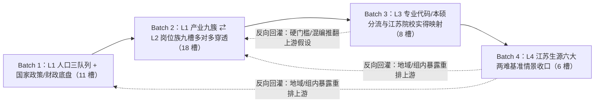

# 知途研究 v3 主干防走偏版图与分批填充总表（Master Map）

**核心结论（置信度：高）**：本文件是知途研究 v3 防止研究发散与细枝空转的**唯一立题总闸门**。全库公共研究严格收敛于 **43 个主干槽位（`L1` 20 槽、`L2` 9 槽、`L3` 8 槽、`L4` 6 槽）**，覆盖《“十五五”规划纲要（2026—2030）》八大重合任务组合、三大人口队列拐点、教育部《普通高等学校本科专业目录（2026 年）》九大覆盖领域及江苏生源六大核心志愿取舍带；一切后续课题必须按 **`Batch 1 → Batch 4` 严格顺序对槽填充**，凡通不过「立题防细枝三问硬闸门」的议题一律拒不立项。

> **状态与维护约定**：当前全表槽位状态均为 `骨架就绪·待填充`。每张定稿合入 `main` 的公共卡片必须在顶部元数据声明唯一归属的 `slot_id`，并同步登记于机器索引 [manifest.json](manifest.json)（`manifest.json` 仅保留 `FW-*` 框架契约与 `TPL-*` 模板两类系统前缀，全部研究卡片严格收敛于下表 43 个主干 `slot_id`，严禁增设表外槽位前缀）。未经用户明确批准修改本版图，任何角色不得私自增设平行槽位。

---

## 一、「防细枝末节」立题三问硬闸门（逻辑 `AND` · 开题必检）

任何新研究分支、Deep Research 侦察或资料采集启动前，必须**同时满足（逻辑 `AND`）**以下三道硬闸门；**任一题不满足，立即一票否决立项**：

| 闸门序号 | 硬核必答问题（三问必须同时满足 `AND`） | 放行标准（全部达标方可开主干卡） | 直接拒止的“细枝末节/个例后门”反例 |
| --- | --- | --- | --- |
| **闸门 1：主干槽位归属** | 本课题精确落入下表 **43 个主干 `slot_id`** 中的哪一个，且符合当前 `Batch` 批次与上游基线要求？ | 唯一指向 1 个主干 `slot_id`，且关键上游依赖已就绪（或属下游硬门槛触发的反向回灌联立修订） | 顺着突发商业新闻、单条科技视频或冷僻概念词临时起意开新坑；跳过 L1/L2 底盘孤立写单校单专业卡片 |
| **闸门 2：付款与培养机制排重** | 对照 [manifest.json](manifest.json) 已有卡片，是否揭示了**尚未覆盖的付款方、地域/队列存量接续机制或本硕/执照硬门槛**？ | 存在实质传导机制差异或关键未知断点，无法靠既有岗位族/培养簇卡片直接推演合成 | 同一机制已写透，仅换一个相近细分行业热词或将跨行业通用岗位按行业重复拆出平行野卡 |
| **闸门 3：江苏普通批可及性与改判力** | 能否写清受影响的**江苏普通批可及生源分段、适用 `graduation_cohort` 与 `target_regions`**，并实质改变「专业组取舍、组内调剂服从、本硕分流、大学节点、四维独立备选」之一的默认排序？ | **必须具备江苏普通批次现实可及性**且产生明确换序或锁死关键红线；仅涉极少数人特殊班细则、冷门小证书或极端个例的事项，**一律只作既有主干卡内附注或招办核实项，严禁单独开卡** | 包装某校极小众实验班冷僻条款、某细分机构小众证书或尚未在苏普通批招生的早期概念专业充当独立主干课题 |

---

## 二、L1–L4 主干槽位全景版图（共 43 槽）

`[已核实事实｜吸收 mythpan1/pathwise-research @ v2-archive 八组合×九领域主图与 Prajna v1 行业/招生模块]` 以下槽位将上端宏观外驱与下端江苏本科志愿精准咬合：

### 2.1 L1 上端外驱主干槽位（`research/l1-drivers/`，共 20 槽）

#### （A）人口结构与财政抚养队列槽位（3 槽 · 官方基准锚 + 商业财报/基层行政旁证双轨蒸馏）

| `slot_id` | 主干槽位名称 | 核心穿透对象与必验旁证锚点 | 主要下游传导簇 |
| --- | --- | --- | --- |
| `L1-DEM-01` | 出生与婴幼队列坍缩传导 | 出生人口队列基准 × 奶粉/纸尿裤/母婴龙头财报销量、医院妇产科/新生儿科撤并缩床、托幼园所关停批复 | `L2-CAR-07`、`L2-CAR-08`、`L2-CAR-06` |
| `L1-DEM-02` | 学龄教育梯次达峰与师资余缺调配 | 小学→初中（2026）→高中（2029）→高教（2032）梯次拐点 × 各地教师缩编、员额制、跨学段调配与民办校退出公告 | `L2-CAR-08`、全簇本硕供给分母 |
| `L1-DEM-03` | 老龄抚养队列、社保医保收支与退休接续 | 60+/失能慢病队列 × 医保/长护险基金收支决算、养老机构空置率、体制与行业中老年骨干退休潮 vs 退一不补 | `L2-CAR-07`、`L2-CAR-03`、`L2-CAR-05`、`L2-CAR-08` |

#### （B）国家政策与制度预算工具槽位（8 槽 · 对齐《“十五五”规划纲要》八大任务组合 + 官媒/《求是》深解）

| `slot_id` | 主干槽位名称 | 对应规划重点与预算/准入硬工具拆解点 | 主要耦合产业槽位 |
| --- | --- | --- | --- |
| `L1-POL-01` | 产业升级、科技自立与新型举国体制投入 | 传统产业技改、新兴未来产业培育、国家科研经费投向、央国企战新产业考核权重 | `L1-IND-01`、`L1-IND-02`、`L1-IND-04` |
| `L1-POL-02` | 数智基础设施、数据要素与治理生态 | 算力电力协同建设、政企数智化采购预算边界、数据安全与算法合规强监管 | `L1-IND-01`、赋能 `L1-IND-02~09` |
| `L1-POL-03` | 能源安全、新型电力系统与绿色低碳转型 | 主网/配网与新型储能资本开支、双碳能耗考核、工业环保与安全生产强制准入 | `L1-IND-03`、`L1-IND-04`、`L1-IND-02` |
| `L1-POL-04` | 粮食安全、生物育种与现代农食支持体系 | 高标准农田与种业振兴投入、动植物防疫检疫体制、食品药品安全监管体系 | `L1-IND-06`、`L1-IND-04` |
| `L1-POL-05` | 区域格局、综合交通与城市存量更新 | 长三角及重点都市圈空间布局、现代化综合交通网、城市地下管网更新与房地产转型制度 | `L1-IND-05`、`L1-IND-02`、`L1-IND-03` |
| `L1-POL-06` | 健康中国、三医协同与老龄服务支付制度 | 医保 DRG/DIP 支付改革、医药耗材集采、县域医共体、长期护理保险与公共卫生投入 | `L1-IND-07`、`L1-IND-04` |
| `L1-POL-07` | 教育强国、文化传播与基本公共服务供给 | 高校理工农医扩招与学科调整机制、县管校聘与基层编制控总量、基本公共服务均等化 | `L1-IND-08`、反作用于 `L3` 全簇供给 |
| `L1-POL-08` | 统一大市场、开放贸易、财税化债与法治 | 地方政府化债与一般公共预算刚性约束、制造业出海贸易规则、金融监管与涉外法治 | `L1-IND-09`、跨簇约束全部财政付费赛道 |

#### （C）核心产业变迁与价值链分工槽位（9 槽 · 对齐九大覆盖领域 + 内嵌三项横向标签）

> **横向交叉标签约定**（在关联槽位内显式挂载，不另立平行行业队列）：`TAG-SCI`（数理化生基础科学向工程/研发转化）、`TAG-SEC`（安全生产、防灾应急与系统韧性责任）、`TAG-MAR`（船舶海工、海洋资源与涉海空间）。

| `slot_id` | 主干槽位名称 | 价值链重组、甲乙方分工与 AI/自动化冲击核心看点 | 必挂横向标签 |
| --- | --- | --- | --- |
| `L1-IND-01` | 信息数字与软件系统 | AI 编程压缩初级编码工时 vs 复杂业务交付、嵌入式软硬协同、网安合规与政企数据运维 | `TAG-SCI`、`TAG-SEC` |
| `L1-IND-02` | 装备制造、工控自动化与综合交通 | 智能产线集成、工业测控现场调试验证、轨交/船舶海工/车企出海交付与全周期维保 | `TAG-MAR`、`TAG-SEC` |
| `L1-IND-03` | 能源电力、资源开发与环境工程 | 电网与新能源从抢装扩建转向调度消纳与存量巡检、战略矿产采选冶、工业水气固危废运营 | `TAG-SEC`、`TAG-MAR` |
| `L1-IND-04` | 材料、化工过程与生物制造 | 实验室配方 vs 连续化工过程放大、EHS 高危合规壁垒、原料药/生物制品集采承压与对外许可 | `TAG-SCI`、`TAG-SEC` |
| `L1-IND-05` | 建筑更新、市政水务与城市空间运营 | 房建新建退潮后的市政供排水/燃气热力生命线运营、工业洁净厂房/特种结构改造 | `TAG-SEC`、`TAG-MAR` |
| `L1-IND-06` | 现代农业、种业植保与食品供应链 | 生物育种商业化、规模化养殖动保刚需、食品工业标准化品控与大宗农产品储运 | `TAG-SCI`、`TAG-SEC` |
| `L1-IND-07` | 医疗诊疗、医技康复与健康消费分工 | 公立医院床位扩张放缓与控费下的临床/医技/检验分工 vs 眼视光/口腔/器械商业化自付市场 | `TAG-SCI`、`TAG-SEC` |
| `L1-IND-08` | 分学段教育、文化传媒与公共服务承接 | 公办中小学峰后存量调配、工业企业内训与成人技训、AIGC 重构传媒内容与基层购买服务收缩 | `TAG-SEC` |
| `L1-IND-09` | 商贸物流、财会审计、金融与法律服务 | 跨境制造供应链履约、AI 替代基础记账/文书后的业财内控法务责任兜底、金融机构网点与风控转型 | `TAG-SEC` |

---

### 2.2 L2 中游传导与职业岗位族规格桥槽位（`research/l2-careers/`，共 9 槽 · 多对多岗位族归口）

> **多对多岗位族（Role Family）归口铁律**：`L2-CAR-01~09` 是按**职业岗位族**而非单一产业划分的主干槽位，与上游 `L1-IND-01~09`（产业变迁）及下游 `L3-PTH-01~08`（本科专业簇）均为**多对多映射关系**。跨行业通用职能（如软件开发交付、工业自动化联调、财会审计、法务合规）统一归入对应 `L2-CAR-*` 主槽内，在卡内横向对比不同承接行业（如软件原厂 vs 制造甲方 vs 医疗/公共机构）及不同 `target_regions` 的付款方、学历门槛与应届名额转化，**严禁按行业复制拆出多张相互矛盾的平行岗位卡**。每个槽位同时执行三只时钟对齐与**四维独立备选冲击核验（付款主体 × 同组调剂隔离 × 学历/执照门槛 × 地域/组织单点）**：

| `slot_id` | 职业岗位族（Role Family）主干槽位 | 跨行业承接对比、应届转化分化与四维独立备选核验点 | 多对多主要关联上游槽位 |
| --- | --- | --- | --- |
| `L2-CAR-01` | 数智研发、系统交付与网安数据运维入口簇 | 核心算法岗（对口硕硬门槛）vs 企业软件可靠交付/嵌入式/网安运维（本科可达）；防甲乙双方共享同一客户 IT 削支 | `L1-POL-01/02`、`L1-IND-01` |
| `L2-CAR-02` | 装备研发、现场工控验证与交通维保入口簇 | 电机/控制算法（读硕门槛）vs 自动化现场联调/测试交付（本科受监督实物反馈）vs 铁路/海事/民航专有运维入口 | `L1-POL-01/05`、`L1-IND-02` |
| `L2-CAR-03` | 电力电网、能源动力与环保安全运营入口簇 | 国网/南网及五大六小发电校招梯度、县域基层供电运维刚需 vs 竞争性新能源设备商周期波动 | `L1-POL-03`、`L1-IND-03`、`L1-DEM-03` |
| `L2-CAR-04` | 材料化工工艺、生物制造与药械注册入口簇 | 院所材料研发（高学历内卷）vs 大型石化/新材料基地工艺工程师（本科可进但有倒班/地域门槛）vs 药械 QA/RA | `L1-POL-01/03/06`、`L1-IND-04` |
| `L2-CAR-05` | 市政水务运营、工业更新与工程造价入口簇 | 水司/燃气/水务集团运行岗（留意存量团队接班挤压外招）vs 施工局异地驻场 vs 全过程造价审计 | `L1-POL-05/08`、`L1-IND-05`、`L1-DEM-03` |
| `L2-CAR-06` | 种业农技、动医检疫与食品品控供应链入口簇 | 海关/农业农村局动植物检疫公考壁垒、大型农牧集团技术服务、宠物诊疗消费自付 vs 食品大厂品控 | `L1-POL-04`、`L1-IND-06`、`L1-DEM-01` |
| `L2-CAR-07` | 临床诊疗、医技康复检验与自付健康入口簇 | 临床执业医师（硕士+规培硬周期）vs 康复/影技/医检/护理（医保支付上限与带教瓶颈）vs 眼视光/医疗器械技术支持 | `L1-POL-06`、`L1-IND-07`、`L1-DEM-01/03` |
| `L2-CAR-08` | 公办师资、企业技训与体制基层治理入口簇 | 2031 本 / 2034 硕撞上初高中峰后退潮的教编挤压、跨学段调配优先挤出外招 vs 基层公考/选调硬资格 | `L1-POL-07/08`、`L1-IND-08`、`L1-DEM-02/03` |
| `L2-CAR-09` | 财会内控、法务合规、金融与出海商贸入口簇 | 律所/法务与审计初级案头被 AI 压缩后的留存门槛、国企工业财务/银行基层岗 vs 制造业出海商务关务履约 | `L1-POL-08`、`L1-IND-09` |

---

### 2.3 L3 培养兑现与路径映射槽位（`research/l3-pathways/`，共 8 槽）

每个 `L3-PTH-*` 槽位绑定教育部 2026 本科专业精确代码，打通**本硕准入分流 + 江苏重点招生院校项目实得训练（含 `1B` 结构代理与 `403` 第三方交叉降级 + 招办核实单） + 大学 4–7 年执行节点**：

| `slot_id` | 本科培养与院校梯度映射簇 | 核心覆盖专业代码族（示例） | 培养核验重点与特殊通道边界 |
| --- | --- | --- | --- |
| `L3-PTH-01` | 电子信息、计算机与数理统计培养簇 | `0807` 电子信息类、`0809` 计算机类、`0701` 数学类、`0712` 统计学类 | 普通专业组 vs 拔尖基地 vs 中外合作高费组；408/推免分流、硬件/系统实验学分实得与数学转工科成本 |
| `L3-PTH-02` | 机械自动化、电气能动与交通运输培养簇 | `0802` 机械、`0803` 测控、`0805` 能动、`0806` 电气、`0808` 自动化、`0818/0819` 交通船海 | 原电力部/兵工/铁道/交通/航空特色校行业认可壁垒 vs 综合 985/211 大类分流风险；物理实验与工程联调条件 |
| `L3-PTH-03` | 材料化工、环境安全与生物制药培养簇 | `0804` 材料、`0813` 化工制药、`0825` 环境、`0829` 安全、`0830` 生物工程、`0703/0710` 化生 | 区分“必须读研进研发”与“本科可进生产/EHS/质控”；核查名校工科试验班内混编生化环材的分流比例与转出难度 |
| `L3-PTH-04` | 土建水务、测绘地矿与城乡空间培养簇 | `0810` 土木给排水、`0811` 水利、`0814/0815` 地矿、`0828` 建筑城规 | 严辨传统建工萎缩与给排水/水利/智能电网土建/矿业海外资源的结构分化；核查五年制学制成本与转专业限制 |
| `L3-PTH-05` | 现代农林、动物医学与食品科学培养簇 | `0901` 植物生产、`0904` 动物医学、`0827` 食品科学与工程类 | 动物医学五年制执业兽医资格独占性、涉农双一流高保研率红利 vs 公考基层目录适配度 |
| `L3-PTH-06` | 临床口腔、公卫药学与医技护理培养簇 | `1002` 临床、`1003` 口腔、`1004` 预防、`1007` 药学、`1010` 医学技术、`1011` 护理、`0826` 生医工 | 严守执业医师资格边界（四年制理学医技/生医工不可考医师）；省内医科大学直属附院规培与县市医共体定向培养对比 |
| `L3-PTH-07` | 法学、财会金融与工商管理商贸培养簇 | `0301` 法学、`0201–0204` 经金国贸、`1202` 会计工商、`1206` 物流管理 | 法考客观/主观题通过门槛、考公大户专业代码覆盖面、财经强校实务实习资源 vs 理工院校行业特色财会（电力/工程财会） |
| `L3-PTH-08` | 师范人文外语与特殊招生通道通则簇 | `0401` 教育学、`0501–0503` 文外新、`0303/1204` 社工公管 + 强基/综评/公费定向/军警招飞/中外合作通则 | 师范认证与教资免试边界、语言+工科/法商复合路径；强基禁转出、公费违约金与服务期、军警招飞身体政审淘汰停损机制 |

---

### 2.4 L4 下端跨路径公共决策收口槽位（`research/l4-decisions/`，共 6 槽）

每个 `L4-DEC-*` 槽位面向江苏生源真实填报两难，显式声明所依托的**「默认基准前提包」**（防把特定前提下的基准序误作无条件普适结论），收口输出 **`Rank 1 默认主推 → Rank 2 同簇稳健替代 → Rank 3 经四维冲击核验的独立备选` + 可观测换序信号 + 线下招办核实单**：

| `slot_id` | 江苏生源核心决策两难收口槽位 | 覆盖位次/梯度带特征 | 重点解决的跨簇/跨院校取舍矛盾 |
| --- | --- | --- | --- |
| `L4-DEC-01` | 顶尖与高分段：名校平台光环 vs 王牌专业组纯度 | 985 / 头部 211 / 强基综评交界带 | 综合 985 混编理科/大类组（含冷门分流风险）vs 次一档 985/顶尖行业 211 电类计算机直录纯净组 |
| `L4-DEC-02` | 中高分段：主流硬工科内部排序与外省替代 | 省内外 211 / 双一流 / 省重点头部组 | 计算机软件 vs 电气能动 vs 自动化机械 vs 中外合作高费组；破解长三角高溢价扎堆与外省同分高性价比替代 |
| `L4-DEC-03` | 中分段：省属本科现场工程 vs 行业专有渠道 | 省属一本 / 原部属特色本科主力带 | 通用省属院校计算机/机械 vs 电力/水务/审计/邮电/海关/铁道特色院校对口入口（院校信号 vs 专业硬准备） |
| `L4-DEC-04` | 医疗健康全谱系：跨学制、跨资格与跨付款方取舍 | 医科大学与综合校医科各分段 | 临床长周期读硕规培 vs 口腔/眼视光个人自付商业化 vs 医技/检验/康复/预防/药学/动医稳态与瓶颈比较 |
| `L4-DEC-05` | 历史类与物理兼报带：考公法务财会与峰后师范重排 | 历史类全段及物理类文商兼报带 | 高中 2029 达峰后师范路径全面重估；法学、财会审计、汉语言考公与制造出海商务/小语种的主备配对 |
| `L4-DEC-06` | 高约束特殊通道 vs 普通批常规自由路径收口 | 提前批、强基、综评、中外合作、农村专项 | 降分红利背后的隐性锁死成本（每年数万元高学费、禁转专业、6 年基层定向服务期、招飞停飞转出）边界判定 |

---

## 三、分批研究填充路线图（`Batch 1 → Batch 4` 推进与反向回灌机制）

为彻底杜绝“上端分母未清就乱写个案、或钻进单一行业写十篇细枝”，首次铺底按 **4 个批次由上而下推进**，同时内置**下游硬门槛反向回灌触发器**（非僵化单行道）：

| 批次 | 目标槽位范围 | 本批完成标志（准入下一批的门禁） | 防跑偏硬约束 |
| --- | --- | --- | --- |
| **Batch 1（宏观与人口底盘批）** | `L1-DEM-01~03`（全 3 槽）+ `L1-POL-01~08`（全 8 槽） | 锁定 2026–2037 出生/学龄/老龄三队列拐点與商业基层旁证，区分全国总量与 `target_regions` 地方财政/净流入/退休补员分化 | 禁止在本批直接给出“推荐报某专业”结论；禁止把政策投入直接等同于应届扩招（须防资本深化与自动化替代） |
| **Batch 2（产业与岗位族多对多穿透批）** | `L1-IND-01~09`（9 槽）× 多对多穿透 `L2-CAR-01~09`（9 岗位族槽） | 完成九大产业变迁与九大岗位族的多对多交叉映射，穿透 `target_regions × graduation_cohort` 下的实际应届校招转化与四维独立备选核验 | 跨行业通用岗位统一归入所属 `L2-CAR-*` 岗位族卡内分行业横向对比，严禁按行业复制平行野卡 |
| **Batch 3（培养实得与院校梯度批）** | `L3-PTH-01~08`（全 8 槽） | 八大培养簇锁定教育部 2026 专业代码、本硕/执照刚性边界、江苏普通批可及院校实得（`1B` 冲突项如实降级为 `[待核未知]`）及大学 4–7 年节点 | 禁止逐校堆砌宣传简介；特殊班微细则或小众证书仅作卡内附注，禁单独开卡 |
| **Batch 4（下端公共决策收口批）** | `L4-DEC-01~06`（全 6 槽） | 六大两难全部锚定「默认基准前提包」，产出 `Rank 1–3` 主序、换序信号与招办核实总单，且 `Rank 3` 通过四维冲击核验（非同组捆绑、非共卡单一考研门槛） | 禁止隐瞒基准前提伪装无条件普适排序；禁止退回无主次的多分支平铺 |

### 下游硬门槛反向回灌触发器（Upstream Back-Propagation）
- **触发条件**：当 `Batch 3` 或 `Batch 4` 实证发现下游硬门槛使上游既有排序前提失效时——例如：① 某岗位入口实证普遍刚性要求对口硕士（推翻 `L2` 本科直就假设）；② 目标高校在苏专业组混编高费/冷门专业且严控转出（击穿主备同组隔离）；③ 江苏或目标就业地局部净流入、编制或支付规则推翻 `L1` 全国单向推断。
- **强制动作**：提交 PR 时**严禁仅在下游单卡文案里硬圆矛盾**，必须在同一 PR 分支内**联立修订受影响的上游 `L1/L2/L3` 对应 `slot_id` 卡片**，或在 [manifest.json](manifest.json) 中将受影响上游卡片的 `status` 标记为唯一合法的待复核枚举值 `needs_reverify`，直至上下游因果链重新闭合。

> **紧急定向特例规则**：若用户在 `Batch 1–4` 全量铺完前，因真实高三窗口期需针对某单一赛道提前打通闭环，允许在总控登记后按**「最小纵向切片」**（提取关联的 `L1-DEM + L1-POL + L1-IND ⇄ L2-CAR ⇄ L3-PTH ⇄ L4-DEC`，含跨行业岗位对比与四维冲击核验）垂直贯通，每一环仍必须精准落入上表既有 `slot_id`，绝不另建表外野卡。
