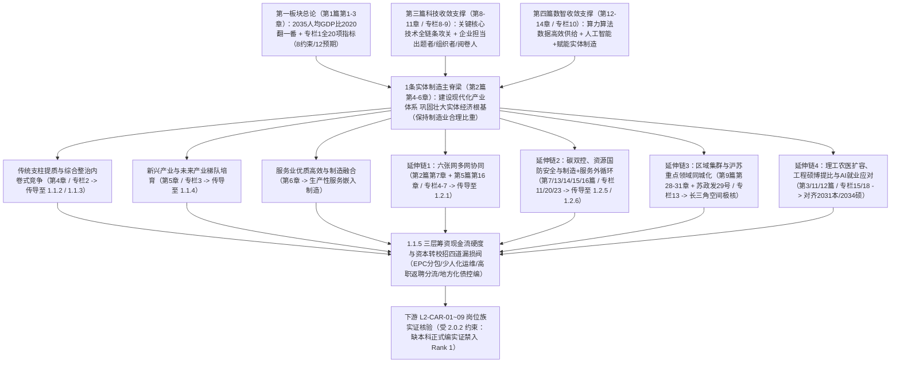

# 1.1.1 纲要18篇62章顶层结构与实体制造主脊梁（`L1-POL-01.01`）

**核心结论（置信度：高）**：国家“十五五”《纲要》（全 18 篇 62 章 171 节）打破“十四五”先创新篇后产业篇的排位顺序，将第二篇《建设现代化产业体系 巩固壮大实体经济根基》（第 4–7 章）提至第二板块 16 项重大战略任务之首、前置在科技篇（第三篇）与数字篇（第四篇）之前，确立了以先进制造业为骨干的「1 条实体制造主脊梁 + 4 条向外延伸传导链」国家资源配置总树 `[已核实事实｜S1, S3, S5]`。但顶层资源配置优先级绝不等于就业总人数普涨：在专栏 1“全员劳动生产率增长高于 GDP 增长”、江苏省制造业占 GDP `33.5%` 保持“基本稳定”、第 4 章整治“内卷式”竞争退出低效产能及第 40 章渐进式延迟法定退休年龄多重约束下，全口径制造业总用工呈“总量稳中趋降、内部向高研发与现场工程岗结构置换”态势 `[已核实事实｜S1, S12]` `[分析推断]`。面向全国及江苏/长三角的 `2027_in_2031_bachelor` 与 `2027_in_2034_master` 队列，本卡识别的主脊梁及延伸链方向在 `L1` 层统一界定为**「外驱张力候选方向（资本强 / 编制待核）」**——在完成下游 `1.1.5` 四道漏损阀折算、`1.4.4` 新制退龄平移复算与 `2.0.2` 链主校招分母核验前，一律严禁越级预判应届本科正式编净增量或直接赋予 `Rank 1` `[分析推断]`。

> **四类表述与 `v3.2.0` 静态门禁约定**：本卡为知途研究（Pathwise v3.2.0）全树顶层源头首卡，槽位与主干拓扑严格对齐根索引 [manifest.json](../../../index/manifest.json) 与 [主干版图 Master Map](../../../index/master-map.md)。全文严格区分 `[已核实事实｜出处]`、`[明示假设]`、`[分析推断]`、`[待核未知]`，严禁将二手转述或分析推断冒充已核事实；作为 `L1` 上端外驱张力信号卡，本卡仅输出宏观资源与制度张力候选信号，严禁越级跳推具体高校志愿，任何战略排位或预计投资规模均须经 `1.1.5` 资本转校招四道漏损阀、`1.4.4` 延退替补折算、`2.0.2` 三段核验及 `2.0.3` 扩招拥挤与 `D6` 四维独立性核验，缺乏应届本科正式编分母实证的方向一律禁入下游 `Rank 1`。

---

## 一、立题过闸核验（逻辑 AND 三问必填）

1. **绑定母槽、子槽与批次**：隶属一级母槽 `L1-POL-01`（十五五制造主脊梁、传统筑峰与六大攻关）下首张叶子子槽 `L1-POL-01.01`（对应细章 `1.1.1`，二级子目录 `1.1`「十五五顶层主轴与实体制造脊梁」），所属批次为 `Batch 1`，无前置上游卡片（`upstream_ids: []`），直接承接国家与江苏省“十五五”规划《纲要》及配套部委权威原件 `[已核实事实｜S1, S12]`。
2. **单主干位置、排重增量与 In/Out 不越界声明**：在 [主干版图 Master Map](../../../index/master-map.md) 单主干树中，本卡位居全树总根部，唯一排重增量是实证拆解《纲要》18 篇 62 章 171 节跨期排位变革、第一篇专栏 1 全 20 项主要指标（8 项约束性 vs 12 项预期性）刚柔分工，以及「1 条实体制造主脊梁 + 4 条向外延伸传导链」宏观资源配置骨架 `[已核实事实｜S1, S5]`。**In/Out 边界声明**：本卡**纳入（In）**第 1–4 篇主从收敛机制、官方 PDF 单行本专栏 1–23 框表实核、顶层财政金融与学科扩招指挥棒、全国与江苏/苏州制造业统计底盘及分母口径校准；**严格排除（Out）**且绝不抢跑传统支柱反内卷细则与江苏省 `6,030 家`“筑峰强链”企业库（归 `1.1.2`）、产业基础再造与六大超常规核心技术攻关细目（归 `1.1.3`）、八大新兴与六大未来产业放量/验证分界（归 `1.1.4`）、三层筹资现金流硬度与资本转校招四道漏损阀定量模型（归 `1.1.5`），以及“六张网”分网建设细目与防土木过剩标尺（归 `1.2.1`–`1.2.6`）。
3. **江苏可及波及范围与下游传导槽位**：在全国宏观基准之上，精准锚定江苏省《纲要》（苏政发〔2026〕29号，共 16 篇 61 章）`33.5%` 的制造业增加值占 GDP 比重底盘、“1650”产业体系及沪苏重点领域同城化极核，同时切分苏南（以苏州 `48,966.4 亿元`规上工业总产值为代表）研发与高端制造极核同苏中苏北链主基地、一般收缩县域的承接梯度 `[已核实事实｜S12, S13, S14]` `[分析推断]`。本卡外驱信号经同层 `1.1.2`–`1.1.5` 及 `1.2.*` 分流后，向下游传导至 `L2-CAR-01`（三段转化核验总则）、`L2-CAR-02~06`（硬嵌硬芯片、母机、电力能源、特材石化生物、船海空天车与水网管网重器岗簇）、`L2-CAR-07~08`（软嵌硬工业软件工控与跨网数字孪生数理岗簇）及 `L2-CAR-09`（服嵌造 TIC 碳核查、制造业财、涉外管制与出海窄池岗簇），覆盖 `全国 / 江苏 / 长三角 × 2027_in_2031_bachelor / 2027_in_2034_master` `[分析推断]`。

---

## 二、结构变量深解、三线耦合与地域分化校准

### 2.1 18 篇 62 章三大板块排位逻辑：第二篇居首与科技/数字向制造根基收敛

国家发展改革委副主任郑备在国新办吹风会上明确阐释，“十五五”《纲要》共设 **18 篇、62 章、171 节**，分为**三大板块**：第一板块为总论（第一篇，第 1–3 章），阐述发展环境、指导方针并提出 20 项主要指标；第二板块为重大战略任务（第二篇至第十七篇，第 4–60 章），分 16 个方面部署战略任务和重大举措；第三板块为规划实施保障（第十八篇，第 61–62 章），部署坚持和加强党中央集中统一领导与健全规划实施全周期推进机制 `[已核实事实｜S1, S5]`。

对比《“十四五”规划和2035年远景目标纲要》（全 19 篇 65 章）与《“十五五”规划纲要》（全 18 篇 62 章，序言及审查报告明载系“根据《中共中央关于制定国民经济和社会发展第十五个五年规划的建议》编制”，中央《建议》全文篇序对照原件未单列入库属 `[待核未知]`），法定五年规划顶层篇章次序发生了决定未来五年至十年国家资源倾斜方向的结构性重排 `[已核实事实｜S1, S3, S4, S5]`：

| 跨期排位维度 | 《“十四五”规划纲要》（19 篇 65 章，2021-03） | 《“十五五”规划纲要》（18 篇 62 章，2026-03） | 资源配置主从关系与结构收敛含义 |
| :--- | :--- | :--- | :--- |
| **重大任务首篇（第二篇）** | 第二篇《坚持创新驱动发展 全面塑造发展新优势》（第 4–7 章） `[已核实事实｜S3]` | 第二篇《建设现代化产业体系 巩固壮大实体经济根基》（第 4–7 章） `[已核实事实｜S1]` | 实体经济与先进制造跃居 16 项重大战略任务之首，兼具宏观“防过快去工业化稳底盘”与内部“制造场景定义研发投向”双重指挥棒功能 `[分析推断]` |
| **产业与科技先后次序** | 先创新驱动篇（第二篇），后现代产业体系篇（第三篇，第 8–11 章） `[已核实事实｜S3]` | 先现代化产业体系篇（第二篇），后《加快高水平科技自立自强 引领发展新质生产力》（第三篇，第 8–11 章） `[已核实事实｜S1]` | 防止科研脱离工程化与产业链薄弱环节空转，强制科技攻关与学科资源向实体制造链条收敛 `[分析推断]` |
| **数字中国篇章位置** | 第五篇《加快数字化发展 建设数字中国》（第 15–18 章，列国内市场篇之后） `[已核实事实｜S3]` | 第四篇《深入推进数字中国建设 提升数智化发展水平》（第 12–14 章，独立成篇并前移至第五篇国内市场之前） `[已核实事实｜S1, S5]` | 算力、算法、数据与“人工智能+”紧贴制造篇与科技篇，优先赋能实体工业研发与生产全流程 `[分析推断]` |
| **人口与教育人力资本** | 分散编排于民生福祉与新型城镇化等相关篇章 `[已核实事实｜S3]` | 第十一篇《完善人口发展战略 促进人口高质量发展》（第 37–40 章）单独成篇，与第十二篇就业民生（第 41–46 章）咬合 `[已核实事实｜S1, S5]` | 正视少子老龄化、学龄排浪与渐进延退拐点，以理工农医扩容及工程硕博提比重组人力资本结构 `[分析推断]` |

**科技篇与数字篇向实体制造根基收敛的制度枢纽及本硕职能分层**：第二篇开篇即明确“坚持把发展经济的着力点放在实体经济上，坚持智能化、绿色化、融合化方向……保持制造业合理比重，构建以先进制造业为骨干的现代化产业体系” `[已核实事实｜S1]`。国家发改委创新和高技术发展司司长白京羽在吹风会上进一步指明第三篇（科技）向第二篇（产业）收敛的关键抓手——落脚于第 10 章《强化企业科技创新主体地位》，支持企业担当科技创新的**“出题者”、“组织者”和成果产出的“阅卷人”**，将企业评价作为科技项目验收的重要依据，真正做到**“谁使用、谁评价”**（江苏《纲要》第 11 章亦同步推行“企业出题、政府立题、科研解题、市场判题”模式） `[已核实事实｜S1, S5, S12]`；同时，第 11 章明确“强化科研机构、创新平台、企业、科技计划人才集聚培养功能，招生指标向重大科技任务承担单位倾斜……加强基础学科、交叉学科和战略急需领域本硕博衔接培养”，第 12–13 章及专栏 10 部署“人工智能+”行动推进数智技术赋能工业设计、中试、生产、运营全环节 `[已核实事实｜S1]`。这一制度闭环具有双重含义：一方面，脱离物理制造工艺验证、缺乏多级 BOM 采购承接的纯实验室论文型研究或悬浮型表层消费应用，其政策与资本溢价将持续收敛；另一方面，在企业主导关键核心技术攻关且研究生指标向重大任务单位倾斜的机制下，**链主核心研发攻关岗将优先吸纳有经验工程师与产教联培硕博，应届普通本科在制造主脊梁中的主承接面将下沉聚焦于工艺实现、设备联调、测试验证与质量管理环节**（链主研发岗新招人员中应届本科占比年度序列属 `[待核未知]`） `[分析推断]`。

**第一篇 2035 远景锚点与专栏 1 全 20 项主要指标刚柔分工**：第一篇第 3 章确立“为到 2035 年人均国内生产总值比 2020 年翻一番、达到中等发达国家水平打好基础”的远景定量锚点（与 `2027_in_2034_master` 毕业次年直接重合），并在专栏 1《“十五五”时期经济社会发展主要指标》中设置五大类 20 项指标，严格区分为 **12 项预期性指标**与 **8 项约束性指标** `[已核实事实｜S1]`：

| 类别 | 序号与指标名称（按 `S1` 专栏 1 原文） | 2025 年基期 | 2030 年目标 / 5 年累计 | 属性 |
| :--- | :--- | :---: | :---: | :---: |
| **经济发展** | 1. 国内生产总值（GDP）增长（%） | 5 | 保持在合理区间、各年度视情提出 | 预期性 `[已核实事实｜S1]` |
| **经济发展** | 2. 全员劳动生产率增长（%） | 6.1 | 高于 GDP 增长 | 预期性 `[已核实事实｜S1]` |
| **经济发展** | 3. 常住人口城镇化率（%） | 67.9 | 71 | 预期性 `[已核实事实｜S1]` |
| **创新驱动** | 4. 全社会研发经费投入增长（%，按不变价格计算） | 9.1 | 年均 ＞7 | 预期性 `[已核实事实｜S1]` |
| **创新驱动** | 5. 每万人口高价值发明专利拥有量（件） | 16 | ＞22 | 预期性 `[已核实事实｜S1]` |
| **创新驱动** | 6. 数字经济核心产业增加值占 GDP 比重（%） | 10.5* | 12.5 | 预期性 `[已核实事实｜S1]` |
| **民生福祉** | 7. 城镇调查失业率（%） | 5.2 | ＜5.5 | 预期性 `[已核实事实｜S1]` |
| **民生福祉** | 8. 居民人均可支配收入增长（%） | 5 | 与 GDP 增长同步 | 预期性 `[已核实事实｜S1]` |
| **民生福祉** | 9. 劳动年龄人口平均受教育年限（年） | 11.3 | 11.7 | **约束性** `[已核实事实｜S1]` |
| **民生福祉** | 10. 每千人口拥有医护人员数（执业医师数 / 注册护士数，人） | 3.1 / 4.3 | 3.7 / 5.1 | 预期性 `[已核实事实｜S1]` |
| **民生福祉** | 11. 养老机构护理型床位占比（%） | 68 | 73 | 预期性 `[已核实事实｜S1]` |
| **民生福祉** | 12. 3 岁以下婴幼儿入托率提高（百分点） | — | 〔6〕（5 年累计数） | 预期性 `[已核实事实｜S1]` |
| **民生福祉** | 13. 人均预期寿命（岁） | 79.25 | 80 | 预期性 `[已核实事实｜S1]` |
| **绿色低碳** | 14. 单位 GDP 二氧化碳排放降低（%） | 〔17.7〕 | 〔17〕（5 年累计数） | **约束性** `[已核实事实｜S1]` |
| **绿色低碳** | 15. 非化石能源占能源消费总量比重（%） | 21.7 | 25 | **约束性** `[已核实事实｜S1]` |
| **绿色低碳** | 16. 地级及以上城市细颗粒物（PM2.5）浓度（微克/立方米） | 28 | ＜27 | **约束性** `[已核实事实｜S1]` |
| **绿色低碳** | 17. 优良水体比例（%） | 80 | 85 | **约束性** `[已核实事实｜S1]` |
| **绿色低碳** | 18. 森林覆盖率（%） | 25.1* | 25.8 | **约束性** `[已核实事实｜S1]` |
| **安全保障** | 19. 粮食综合生产能力（万亿斤） | 1.39 | 1.45 左右 | **约束性** `[已核实事实｜S1]` |
| **安全保障** | 20. 能源综合生产能力（亿吨标准煤） | 51.3 | 58 | **约束性** `[已核实事实｜S1]` |

*注：表中 `〔 〕` 为五年累计数（第 14 项基期 `〔17.7〕` 为“十四五”五年累计降幅），`*` 为 2024 年数据 `[已核实事实｜S1]`。*

从指标性质审视，政府刚性考核问责的 **8 项约束性指标**全部锚定绿色低碳底线（5 项：单位 GDP 碳排放累计降 `17%`、非化石能源占比达 `25%` 等）、安全保障底线（2 项：粮食 `1.45 万亿斤左右`、能源 `58 亿吨标准煤`）与人力资本底座（劳动年龄人口平均受教育年限升至 `11.7 年`）；而经济增长与创新驱动 6 项指标全部设为**预期性指标**（全社会研发经费投入不变价年均增长 `＞7%`、全员劳动生产率增速高于 GDP 增速、数字经济核心产业增加值占 GDP 比重升至 `12.5%`） `[已核实事实｜S1]`。这一“生态安全硬约束 + 研发强度快于 GDP + 全员劳动生产率快于 GDP + 制造业占 GDP 比重基本稳定”的指标组合，不仅封死了高耗能粗放扩产旧路，更在宏观算术上确立了**“制造业全口径总用工稳中趋降、资本与技术密度上升”**的硬约束：当制造业增加值增速与 GDP 大体同步而劳动生产率增速持续高于 GDP 增速时，全行业总用工人数必然持平或温和收缩；所谓制造业人才需求并非总量扩招，而是存量用工内部由低技能操作岗向高技术工程岗的结构性置换，且能否形成应届本科正式编净增，完全取决于工程技术岗占比升幅能否抵消总人数收缩（全国与江苏分行业×本科学历制造业从业人数历史序列当前属 `[待核未知]`） `[分析推断]`。

### 2.2 「1 条实体制造主脊梁 + 4 条向外延伸链」传导总图与专栏框表实核

依据《纲要》全 18 篇 62 章及官方单行本 23 个专栏的咬合关系，国家资源配置形成从第二篇制造主脊梁向四条外延链单向派生的总树结构 `[已核实事实｜S1]` `[分析推断]`：

**4 条向外延伸传导链精确篇章与专栏映射表**：

| 延伸链方向 | 《纲要》精确篇/章号与官方单行本专栏（`S1`） | 核心传导机制与一手定量锚点 | 下游承接卡片与边界 |
| :--- | :--- | :--- | :--- |
| **延伸链①：现代化基础设施“六张网”多网协同链** | 第二篇第 7 章《构建现代化基础设施体系》（专栏 4 国家综合立体交通网建设、专栏 5 新型能源体系建设、专栏 6 现代化水网建设、专栏 7 新型基础设施建设）+ 第五篇第 16 章《扩大有效投资》 `[已核实事实｜S1]` | 为先进制造提供绿电、算力、物流底座并拉动成套机电装备需求；国家发改委**初步估算 2026 年**“六张网”及相关重点领域建设投资规模将**超 `7 万亿元`**，“十五五”时期国家水网（预计**超 `6 万亿元`**）、新型电网（预计**超 `5 万亿元`**）、城市地下管网（预计**约 `5 万亿元`**）三项五年**预计合计超 `16 万亿元`** `[已核实事实｜S10]` | 传导至 `1.2.1`（严卡防传统土木过剩标尺，分网工程细目归 `1.2.2–1.2.4`） |
| **延伸链②：碳排放双控、资源国防安全与“制造+服务”外循环链** | 第十三篇第 47 章（专栏 20 碳达峰碳中和）+ 第十四篇第 52 章《保障国家经济安全》及篇末专栏 23《重点领域安全保障能力提升》（编排于第 54 章后）+ 第十五篇第 56 章《巩固提高一体化国家战略体系和能力》+ 第七篇第 21–22 章（专栏 11 对外开放平台功能提升）+ 第十六篇第 58 章《推进全面依法治国》 `[已核实事实｜S1]` | 全面实施碳排放总量和强度双控，新建和改扩建“两高”项目实施碳排放等量或减量置换；协同能源矿产安全与军民标准通用化；拓展中间品贸易、发展知识密集型服务贸易与涉外法治海外利益保护 `[已核实事实｜S1]` | 传导至 `1.2.5`（碳双控/找矿油气/民参军）与 `1.2.6`（中间品/保税维修/制造加服务出海） |
| **延伸链③：区域产业集群与沪苏重点领域同城化链** | 第九篇第 28 章《增强区域发展协调性》至第 31 章《深入推进以人为本的新型城镇化》（专栏 13 城市更新和都市圈建设）+ 江苏省《纲要》（苏政发〔2026〕29号）第三十三章第一节（版心第 93 页） `[已核实事实｜S1, S12]` | 国家《纲要》第 28 章明确“支持上海与苏州重点领域同城化发展”，江苏《纲要》同步部署推进沪苏重点领域同城化、虹桥国际开放枢纽提质扩围及北向拓展带建设，确立长三角制造研发极核与腹地分工 `[已核实事实｜S1, S12]` | 校准本卡与 `1.1.2`（衔接 `1.3.6` 江苏 1650 体系）及 `L2-CAR-*` 地域弹性 |
| **延伸链④：理工农医扩容、工程硕博提比与 AI 就业应对链** | 第三篇第 11 章《一体推进教育科技人才发展》+ 第十一篇第 38 章《办好人民满意的教育》（专栏 15 高质量教育体系建设）+ 第十二篇第 41 章《促进高质量充分就业》（专栏 18 就业促进与服务提升） `[已核实事实｜S1]` | 第 38 章明确“以理工农医类专业为主有序扩大优质本科教育招生规模和研究生培养规模……提高工程硕博士培养比重”，专栏 15 依托国家卓越工程师学院建强工程师技术中心并建成 `150 个左右`国家产教融合创新平台；专栏 18 建立人工智能对就业影响的调查和应对机制 `[已核实事实｜S1]` | 传导至 `1.1.5` 漏损折算及 `2.0.3` 扩招拥挤折扣与本硕门槛切分 |

**官方单行本专栏框表实核与防脑补边界**：经逐本比对，中国政府网受权播发的 HTML 纯文字版（`S2`）未内嵌任何专栏框表 `[已核实事实｜S2]`；而国家发展改革委公开发布的官方 PDF 单行本（`S1`，单行本版心第 10–123 页）已完整内嵌全书 **专栏 1 至专栏 23**（除上表已列专栏外，还包括第 4 章专栏 2 产业基础能力和竞争力提升、第 5 章专栏 3 新产业新赛道培育发展、第 8 章专栏 8 前沿科技攻关、第 9 章专栏 9 创新基础能力提升、第 13 章专栏 10 “人工智能+”行动、第 26 章专栏 12 农业农村现代化建设、第 36 章专栏 14 社会主义文化繁荣发展、第 39 章专栏 16 健康中国建设、第 40 章专栏 17 “一老一小”服务优化提升、第 46 章专栏 19 社会关爱服务提升、第 48–49 章专栏 21 环境质量提升与专栏 22 生态保护修复） `[已核实事实｜S1]`。与此同时，对比全国人大财经委审查报告核验的“十四五” `102 项`重大工程圆满收官基数（`S4`），郑备副主任在国新办吹风会上披露“十五五”《纲要》提出**“6 个方面 109 项重大工程”**（点名雅下水电工程、三峡水运新通道、卫星互联网等标志性项目） `[已核实事实｜S4, S5]`；但 `S1` 单行本正文并无名为“6 大方面 109 项重大工程”且按 `1–109` 逐一编号的独立汇总矩阵表（具体工程分散嵌入各专栏子项），故 `1–109` 逐项编号母表及分年度投资额切分仍属 `[待核未知]`。

### 2.3 A×B×C 交叉互验：资金与人才指挥棒、漏损边界及全国 vs 江苏/长三角分化

将政策指挥棒（`A` 线）、财政金融与产业资本开支（`B` 线）、高教供给与劳动年龄人口结构（`C` 线）交叉互验，可锁定三重传导规律：

1. **财政、金融与高教指挥棒同向聚焦先进制造硬核环节（附资金分流与供给拥挤校准）**：
   - **财政与准财政资金及非制造分流边界**：2026 年国家安排的 `1.3 万亿元`超长期特别国债与 `7,550 亿元`中央预算内投资已于 2026 年 6 月底前基本下达完毕 `[已核实事实｜S10]`。需严守两道口径边界：其一，国家发改委对 2026 年推进“六张网”及相关重点领域建设投资**初步估算超 `7 万亿元`**（单年宽口径预计值），对“十五五”期间国家水网（超 `6 万亿元`）、新型电网（超 `5 万亿元`）、城市地下管网（约 `5 万亿元`）三项五年投资**预计合计超 `16 万亿元`**——两数分属不同期限与统计范围的官方预计值，**严禁直接相加，更严禁视同已支付财政拨款** `[已核实事实｜S10]`；其二，按《纲要》第 15–16 章及国新办吹风会部署，存量与增量财政资金统筹覆盖“两重”建设、“两新”政策（含促进消费品更新换代补贴）及民生基础设施（第 16 章明确“提高民生类政府投资比重”） `[已核实事实｜S1, S5]`，**其中直接形成制造业技术改造与核心装备研发岗位的精确资金分账比例在已入库原件中未披露（标 `[待核未知]`）**，绝不可将 `1.3 万亿元`全额视同制造业工程投资 `[分析推断]`。
   - **信贷、债券市场“科技板”与产业基础规划协同**：《纲要》第 4 章明确“合理降低制造业综合成本，加大中长期贷款和信用贷款对制造业技术创新、数智化转型、绿色发展等支持力度”，第 10 章部署“完善长期资本投早、投小、投长期、投硬科技支持政策” `[已核实事实｜S1]`；中国人民银行副行长陆磊在国新办金融专场发布会上明确提出“用好结构性货币政策工具，高质量建设债券市场‘科技板’” `[已核实事实｜S8]`。叠加工信部等八部门联合印发《产业基础能力提升“十五五”规划》（聚焦 7 方面提出 22 项重点任务，新培育一批单项冠军与专精特新“小巨人”）及关键核心技术全链条攻关机制，资金主航道高度锁定链主企业与专精特新硬科技节点 `[已核实事实｜S7, S9]`。
   - **高教理工农医与工程硕博扩容的跨期拥挤对冲**：第 38 章与专栏 15 明确高等教育毛入学率达 `65%`、稳步提高本科招生比例和研究生教育层次占在校生比例，推动**“双一流”高校本科招生数增加 `10 万人以上`**、建设 `200 所左右`高水平应用型本科高校、建成 `150 个左右`国家产教融合创新平台，并推进职业教育本科与专业学位教育融合贯通（江苏《纲要》第 42 章同步明确“适当扩大职教本科规模”） `[已核实事实｜S1, S12]`。这一供给侧扩张绝非单向就业利好：2027 级考生在高考端享受优质理工科扩招红利的同时，恰恰使 `2027_in_2031_bachelor` 与 `2027_in_2034_master` 毕业队列置身于扩招后的同辈供给洪峰——`2031` 本科端面临“双一流扩招工科生下沉 + 职教本科实操生上探”双向挤压，`2034` 硕博端则面临工程硕博成为头部研发岗默认门槛后的学历通胀（产教平台合作企业实质承诺接收转正人数对比扩招规模属 `[待核未知]`） `[分析推断]`。

2. **资本转校招硬边界：四道漏损阀、反内卷时滞、渐进延退顺延与桌面岗 AI 切割**：
   - **反内卷兼并退出及其周期时滞风险**：第 4 章明确要求“促进市场化兼并重组，推动落后低效产能有序退出”，综合整治“内卷式”竞争，第 47 章同步对新建和改扩建“两高”项目实施碳排放等量或减量置换 `[已核实事实｜S1]`。从产业组织演进看，兼并出清存在显著**周期时滞**：在 `2–4 年`产能去化与并购整合阵痛期内，行业往往先经历尾部企业停产裁员与头部企业校招冻结，利润修复优先用于资产负债表修复和保留存量骨干；若特定制造子赛道在 `2028–2030 年`进入集中整合期，`2027_in_2031_bachelor` 届将直接撞上阶段性招聘低谷（先行整治行业整合前后校招恢复序列属 `[待核未知]`） `[分析推断]`。
   - **四道漏损阀、央国企定员管控与工业软件/算电岗位内部切分**：《纲要》第 13 章强调“强化人工智能的就业创造效应”、专栏 10 推动智能体在软件信息等领域广泛应用，同时在第 41 章专栏 18 专门部署**“建立人工智能对就业影响的调查和应对机制”**（国家数据局亦提出打造“智能化就业服务平台”） `[已核实事实｜S1, S6]`，证实政策制定层已预判技术替代带来的结构性冲击。一方面，固定资产投资向本科正式编转化须经下游 `1.1.5` **三层现金流硬度**与**四道漏损阀**（① 设备采购与 EPC 施工劳务分包漏损、② 智改数转少人化漏损、③ 高职/职本与返聘分流漏损、④ 地方化债与零基预算控编漏损）层层折算，且电网等央国企受第 18 章国有企业分类考核改革约束 `[已核实事实｜S1]`，叠加央国企工资总额与定员管理机制约束（具体单列细则属 `[待核未知]`，见 §五.2），投资扩张不等于校招同比例扩编 `[分析推断]`；另一方面，即便在受支持的工业软件（专栏 2 第 03 项列明“研发设计类、生产控制类、经营管理类”三类 `[已核实事实｜S1]`）与“算电协同”赛道内部，也必须将**物理机理内核（EDA/CAE）、生产控制现场闭环联调（PLC/运动控制/继电保护）及带安全工艺签字责任的窄容量工程岗**，同**高度暴露于 AI 代码生成替代的经营管理类 ERP/MES 表层二次开发、报表配置及算力中心常规桌面 IT 运维岗**严格切开 `[分析推断]`。
   - **2025 渐进式延退与银发技能留用对 `2031` 接班窗口的顺延折减**：国家《纲要》第 40 章第 2 节明确“积极开发老年人力资源，稳妥实施渐进式延迟法定退休年龄，优化就业、社保等方面年龄限制政策”，江苏省《纲要》第 41 章第 3 节进一步明确“稳妥实施渐进式延迟法定退休年龄政策，鼓励知识型、技能型、创新型老年人继续发挥作用” `[已核实事实｜S1, S12]`。叠加一线高技能技师返聘与国企控编“退多补少”，`2026–2031 年`原本按旧法定退龄测算的自然退休替补窗口将实质性后移并收窄，严禁高估 `2031` 本科毕业窗的存量退休接班缺口（按 2025 延退新表的月度平移复算归属 `1.4.4`，目标企业年龄结构与返聘率属 `[待核未知]`） `[分析推断]`。

3. **全国基准 vs 江苏/长三角强制造底盘与省内梯度极化（区分产值口径与录用可及/留存质量）**：
   - **全国 2025 收官基线**：2025 年全国 GDP `1,401,879 亿元`（`+5.0%`），全部工业增加值 `416,826 亿元`（`+5.8%`；按公报 GDP 折算占比约 `29.7%` `[分析推断]`），制造业增加值 `34.7 万亿元`（连续 16 年全球第一，占全球比重 `＞28.0%`）；以**规模以上工业增加值**为分母，装备制造业占 `36.8%`（`+9.2%`）、高技术制造业占 `17.1%`（`+9.4%`）、数字产品制造业占 `12.5%`（`+9.3%`）；年末总人口 `140,489 万人`（减少 `339 万人`），16–59 岁人口 `85,136 万人`（占 `60.6%`），城镇调查失业率年均 `5.2%` `[已核实事实｜S11]`。
   - **江苏省《纲要》同构排位、“1650”底盘与产值口径警示**：《江苏省国民经济和社会发展第十五个五年规划纲要》（苏政发〔2026〕29号，共 16 篇 61 章）在第二篇同位居首部署《建设现代化产业体系 全面打造具有国际竞争力的先进制造业基地》（第 4–8 章），系统推进**“1650”产业体系**、**“51010”战略性新兴产业集群**与**“10＋X”未来产业体系** `[已核实事实｜S12, S13]`。2025 年江苏制造业增加值占全省 GDP 比重达 **`33.5%`**（高于按全国公报制造业增加值 `34.7 万亿元`与 GDP `140.19 万亿元`折算的约 `24.8%` 水平），2030 年目标保持**“基本稳定”**（预期性）；以**规上工业总产值**为分母，全省高新技术产业产值占比由 2025 年 `52.1%` 提升至 2030 年 `55% 左右`，工业战略性新兴产业产值占比 2030 年达 `44% 左右`；2025 年末全省常住人口 `8,518 万人`、15–64 岁人口 `5,842 万人`、城镇化率 `76.2%` `[已核实事实｜S12, S15]` `[分析推断]`。需特别警惕：**`52.1% → 55% 左右`属总产值结构指标而非就业人数指标**，在资本密度提升下产值占比上升可与用工总量缩减并存（全省规上高新企业从业人数及本科占比序列属 `[待核未知]`） `[分析推断]`。
   - **沪苏同城极核 vs 苏中苏北“可及性≠高留存”与一般县域出清**：在国家与江苏《纲要》推进“上海与苏州重点领域同城化发展”及南北产业协同支撑下，苏州市 2025 年 GDP 达 `27,695.1 亿元`，规上工业总产值达 `48,966.4 亿元`（`+3.9%`，规上工业企业研发机构建有率达 `90.8%`），高技术制造业产值达 `18,588.8 亿元`（`+5.5%`，按规上工业总产值折算占比约 `38.0%` `[分析推断]`），以**规上工业总产值**为分母的高新技术产业产值占 `56.2%`，全年城镇新增就业 `41.5 万人`、引留高校毕业生 `28.3 万人` `[已核实事实｜S1, S12, S14]`。面向目标队列，沪苏同城带及苏南极核汇聚研发总部与卓越工程师平台，高薪研发岗密集但准入门槛高度向 `2027_in_2034_master` 上移；苏中海工医药与苏北工程机械、新能源链主基地对 `2027_in_2031_bachelor` 现场工艺、设备与质量岗的**首岗录用门槛相对可及**，但须诚实区分“录用可及性”与“稳态复利质量”——部分非核心基地受薪酬折价、驻厂倒班强度及倾向留用本地熟练技工影响，可能呈现高离职周转而非长期复利（苏中苏北链主本科 offer 接受率、起薪相对苏州比值及 3 年留存率均属 `[待核未知]`）；而缺乏链主配套的一般收缩县域散小制造厂则首当其冲承受反内卷与碳置换出清压力 `[分析推断]`。

---

## 三、向下游（L2 岗位族）交付的标准化张力信号包

| 信号维度 | 全国基准定性（全数标定为「外驱候选方向」，未核编前禁入 `Rank 1`） | 江苏 / 长三角等 `target_regions` 分化表现 | 表述类别与依据 |
| :--- | :--- | :--- | :--- |
| **所处主干与周期阶段** | 居「制造主脊梁 + 四延伸链」总树根部；转入**增加值比重稳底盘、全口径总用工稳中趋降、反内卷兼并出清（含 `2–4 年`整合缩招时滞）与企业出题阅卷攻坚**并行期 | 江苏制造业占 GDP 达 `33.5%`（2030 目标保持基本稳定），高新产值占比升至 `55% 左右`属产值结构升级而非总人数普涨；沪苏同城与“1650”链主领跑技术置换，普通县域散小产能出清 | `[已核实事实｜S1, S5, S12]` + `[分析推断]` |
| **关键拐点与对齐队列** | `2026–2027` 特别国债（覆盖两重两新与民生）、“六张网”及“双一流”本科扩招 `10 万+` 启动；`2030` 专栏 1 收官；`2035` 人均 GDP 比 2020 翻一番 | `2027_in_2031_bachelor` 入学享扩容但毕业面临扩招同辈、职本上探及潜在反内卷整合期碰撞，主承接工艺/联调/质量岗；`2027_in_2034_master` 对接链主“出题阅卷”核心研发但须承受工程硕博学历拥挤 | `[已核实事实｜S1, S10, S12]` + `[分析推断]` |
| **现金流硬度与转编弹性** | 顶层呈“特别国债+预算内投资托底、中长期贷款与债券‘科技板’投硬科技”格局；一律定性为**「资本强 / 编制待核候选」**，须经 `1.1.5` 四阀及央国企工资总额/定员约束折算 | 苏州（规上总产值 `4.90 万亿`、规上研发机构建有率 `90.8%`）及苏南链主现金流强但少人化明显；水网/管网受地方化债与 EPC 分包约束；工业软件与算电须拆栏核验“现场联调/签字岗”与“表层桌面配置岗” | `[已核实事实｜S1, S8, S10, S14]` + `[分析推断]` |
| **存量接续与拥挤度** | 16–59 岁人口 `85,136 万`缓降与第 40 章**渐进式延退**、银发技师留用返聘、国企退多补少及高教扩招并行，`2026–2031` 自然退休替补窗口实质后移收窄 | 沪苏同城研发岗全国硕博扎堆（须在 `2.0.3` 计入拥挤折扣）；苏中苏北链主基地对本科现场岗**首岗录用门槛较可及，但起薪比值、倒班强度与 3 年留存率属 `[待核未知]`，严禁未经核验直接等同稳态复利** | `[已核实事实｜S1, S11, S12]` + `[分析推断]` + `[待核未知]` |

> **下游 `L2–L4` 承接硬规则（红队盲审校准锁死）**：① **候选态前置锁**：在 `1.1.5` 四阀量化折算与 `2.0.2` 链主本科正式录用分母核实前，本卡传导的所有方向一律维持「候选」定性，严禁预授 `Rank 1`；② **现场签字岗 vs 桌面岗双栏拆核**：下游 `2.1 / 2.2` 承接电网算电、重器与工业软件时，必须拆分为“物理机理内核 / 现场硬件联调 / 安全工艺签字岗”与“ERP/MES 表层二次开发 / 常规桌面 IT 运维岗”两栏分别核验容量；③ **新制退龄与同源共损双检**：一切退休替补测算统一调用 `1.4.4` 2025 新制延退平移表并单列返聘与退多补少折扣；凡构建主备志愿路线，必须经 `2.0.3 / 4.3` `D6` 核查付款主体（`payer`）、江苏院校专业组调剂池（`group_isolation`）、学历与执业证照门槛（`entry_gate_isolation`）及就业地域与组织周期（`region_exposure`）四维独立性 `[分析推断]`。

---

## 四、多源冲突采信、成立边界与推翻条件

### 4.1 多源口径差异与采信权重表

| 冲突/差异议题 | 来源 A 原文口径与日期 | 来源 B / C 原文口径与日期 | 采信权重与边界规则 |
| :--- | :--- | :--- | :--- |
| **① “高技术制造业” vs “高新技术产业”及分母差异（`17.1%` vs `52.1% / 56.2%` 及折算 `约 38.0%`）** | 国家统计局《2025年统计公报》（2026-02-28）：规上**高技术制造业增加值**占**规上工业增加值**比重为 `17.1%`（装备制造业占 `36.8%`） `[已核实事实｜S11]` | 江苏省《纲要》（苏政发〔2026〕29号，2026-02-28 印发 / 2026-03-31 公开）：**高新技术产业产值**占**规上工业总产值**比重 2025 年 `52.1%`、2030 年 `55% 左右` `[已核实事实｜S12]`；苏州市《2025年统计公报》（2026-05）：规上工业总产值 `48,966.4 亿元`，**高新技术产业产值**占**规上工业总产值**比重为 `56.2%`，**高技术制造业产值**为 `18,588.8 亿元` `[已核实事实｜S14]`（按规上工业总产值折算占比约 `38.0%` `[分析推断]`） | **各自域内 100% 采信，严禁跨分母直接相减**：国家口径分母为**增加值**、分子为《高技术产业（制造业）分类》；江苏/苏州口径分母为含中间投入的**总产值**，且“高新技术产业”范围广于“高技术制造业”。跨区域横向比较制造业宏观权重时，统一使用同概念的**制造业增加值占 GDP 比重** `[分析推断]` |
| **② 《纲要》专栏框表存在状态与“109 项重大工程”母表边界** | 中国政府网新华社受权全文（2026-03-13）：仅含 18 篇 62 章纯文字正文，未内嵌专栏框表 `[已核实事实｜S2]` | 国家发改委官方 PDF 单行本（2026-03）：完整内嵌专栏 1–23 框表 `[已核实事实｜S1]`；国新办吹风会郑备发言（2026-03-09）：提出“6 个方面 109 项重大工程”，但 `S1` 无按 `1–109` 编号的独立汇总表 `[已核实事实｜S1, S5]` | **专栏内容以 `S1` 官方 PDF 单行本为 100% 最高权威基准**；工程汇总数量采信国新办吹风会 `S5` 口径，同时将未公开单列的 `1–109` 逐项编号母表严格锁定为 `[待核未知]` |
| **③ 二手侦察线索与已入库官方原件在具体政策工具原话上的差异** | 外部二手综述常将“科技创新和技术改造再贷款”归于 2026-09 金融发布会，或将“AI 就业影响监测预警”归于国家数据局发言 | 国新办金融发布会报道（2026-09-11）陆磊原话为“用好结构性货币政策工具，高质量建设债券市场‘科技板’”（未出现具体再贷款字样） `[已核实事实｜S8]`；国家数据局答问（2026-11-03）仅提“打造智能化就业服务平台”，而“建立人工智能对就业影响的调查和应对机制”法定载体为国家《纲要》第 41 章专栏 18 `[已核实事实｜S1, S6]` | **二手未核线索采信权重 `0%`**：严格以已入库官方原件（`S1`、`S6`、`S8`）字面表述为准，杜绝张冠李戴 |
| **④ 顶层排位动因与产值指标的竞争性解释（“稳比重防御缩员” vs “结构置换进攻” / 产值占比 vs 用工人数）** | 竞争性解释认为：第二篇居首系外部压力下稳住制造业比重底线的防御表态（且沿用四中全会《建议》框架），叠加劳动生产率快于 GDP 与江苏 `33.5%` 保持基本稳定，指向“稳中缩员”；高新产值占比升至 `55%` 仅反映资本深化而非岗位增长 `[分析推断]` | `S1` 专栏 1 全社会研发经费不变价年均增 `＞7%`、第 4–5 章与专栏 2–3 全链条攻关及新兴支柱布局、第 10 章企业“出题阅卷”与债券“科技板”（`S5, S8`）、江苏工业战新占比 `44% 左右`（`S12`）证实显著的结构升级与研发要素进攻性投入 `[已核实事实｜S1, S5, S8, S12]` | **双层拆解采信**：在**全口径用工总量层**采信竞争性解释（总人数稳中趋降、总产值占比提升不等于扩员）；在**资本与工程技术要素层**维持基准判断（研发与硬核装备资本确定性向主脊梁集聚，但是否转化为应届本科正式编须经 `2.0.2` 分母核实） `[分析推断]` |

### 4.2 成立边界条件

1. **财政与金融资金中流向制造技改与核心装备的真实份额充足**（`[明示假设]`）：超长期特别国债、中央预算内投资、制造业中长期贷款与债券市场“科技板”在扣除消费品以旧换新补贴及一般民生基建分流后，在 2026–2030 年持续形成先进制造技术改造、关键核心技术攻关与“六张网”机电装备实质资本开支，且重点链主研发与现场工程校招名额未被工资总额或控编刚性锁死。
2. **反内卷兼并出清节奏与目标毕业窗口错峰或完成头部集中**（`[明示假设]`）：第四章“综合整治内卷式竞争”与第十章企业“出题者、组织者、阅卷人”制度在 `2031 / 2034` 毕业窗口前完成主要产能去化阵痛，使链主利润率修复能够传导至工程工艺与联培研发正式编制，而非恰在 `2028–2031 年`陷入全行业并购冻编低谷。
3. **高教扩招与产教融合企业实质接收能力同步匹配**（`[明示假设]`）：第 38 章“双一流”本科扩招 `10 万人以上`、应用型/职教本科扩容及工程硕博提比严格绑定 `150 个左右`国家产教融合创新平台与真实工业场景，合作企业正式录用增速未显著落后于对应理工科招生扩招增速。
4. **重点制造赛道工程技术岗密度升幅跑赢总用工收缩与延退顺延**（`[明示假设]`）：在全行业劳动生产率快于 GDP 增长及 2025 渐进式延退顺延存量退出的背景下，目标先进制造链条的新增工程化、自动化联调与合规签字岗位密度提升足以对冲普通操作岗缩减与退龄后移。

### 4.3 推翻与反向回灌信号（对齐 `valid_until: "2027-06-30"`）

若出现以下任一实证信号，须立即触发本卡重审并沿 `upstream_ids` 向下游或由下游反向回灌修正：
1. **宏观投资落地与制造技改份额偏离**：若 2027 年全国两会预算或发改委/财政部决算显示“六张网”实际开工落地率跌破规划进度 `50%`，或超长期特别国债与配套信贷实际投向制造业技改与装备攻关的份额显著偏低（如下游 `1.1.5` 核实不足 `1/3`）。
2. **分行业×学历就业分母与转编弹性证伪**：若后续统计年鉴或 `2.0.2` 链主校招/社会责任报告实证显示，全国及江苏制造业“本科及以上从业人员”在跨期对比中零增长或净减、链主新增用工中应届本科正式录用占比极低（大部分流向劳务分包/派遣/高职），或反内卷整治赛道整合后两年内校招规模仍深陷峰值 `70%` 以下未恢复。
3. **扩招踩踏、延退锁位与苏中苏北留存证伪**：若 `1.5 / 2.0.3` 核实 2025–2027 年电气/自动化/集成电路/机械等本科或工程硕士累计扩招增幅显著跑赢对应行业校招岗位增幅；或 `1.4.4` 按 2025 延退新表与企业年龄结构复算证实 `2029–2032` 实际退休替补空间较原退龄推算缩水超 `25%` 且返聘率攀升；或苏中苏北链主本科 3 年留存率与相对起薪证伪长期复利属性。
4. **岗位桌面化与下游 `L3/L4` 硬门槛反向回灌触发**：若 `2.2` 岗位 JD 抽样证实所谓工业软件/算电岗位中“现场联调/持证/安全签字责任”类占比过低而实为易被 AI 压缩的表层桌面岗；或后续 `Batch 3 / Batch 4` 实证发现目标主干岗位在 `2031` 毕业窗近乎刚性锁死硕士及以上学历、抑或江苏在苏招生专业组普遍将核心工科与高危退档/冷门专业不可隔离混编，须按反向回灌规程联立修订本卡与 `L2` 信号包，或将本卡置为 `needs_reverify`。

### 4.4 高风险假设自检

- **自检 1（防“见顶层排位与万亿预计投资即先排 `Rank 1` 或高估本科正式编”）**：已将第二篇居首严格界定为资源配置优先级而非全口径制造扩员，补充 `1.3 万亿元`特别国债的消费补贴/民生分流，受第 18 章国有企业分类考核改革约束 `[已核实事实｜S1]` 并叠加央国企工资总额与定员管理机制约束（具体单列细则属 `[待核未知]`，见 §五.2） `[分析推断]`，将全部受惠方向锁死为「`L1` 候选方向（资本强 / 编制待核）」，未经 `1.1.5` 与 `2.0.2` 实核严禁入 `Rank 1`。
- **自检 2（防“把理工扩招与企业出题阅卷单向读成应届本科红利”）**：已补入专栏 15“`双一流`本科扩招 `10 万人以上`”、职教本科扩容及第 11 章研究生指标向重大任务单位倾斜原文，揭示 `2031 / 2034` 毕业端同辈供给洪峰与链主核心研发岗偏向硕博/熟手的挤压效应。
- **自检 3（防“工业软件与算电赛道混入易被 AI 压缩的表层桌面岗”）**：已依据专栏 2 第 03 项与专栏 10、专栏 18，将 EDA/CAE 物理求解、PLC/继保现场闭环联调及安全签字岗，同 ERP/MES 表层二次开发、报表配置与机房常规 IT 桌面运维强制切分。
- **自检 4（防“漏算 2025 渐进延退顺延、反内卷整合时滞及混淆苏中苏北可及性与留存复利”）**：已补入国家第 40 章与江苏第 41 章渐进式延退及鼓励技能型老年人留用条文，修正 `2031` 接班缺口预期；增补反内卷兼并期缩招时滞警示，并将苏中苏北“首岗门槛可及”与待核的“留存率/起薪复利”严格剥离。
- **自检 5（防“将共享付款池、产业链周期与江苏专业组调剂池的同源方向误作独立主备”）**：电网建设与“算电协同”高度共享电网公司及地方财政/城投付款池，苏中苏北本地路线往往押注单一链主，同链 `2031 本 / 2034 硕` 共担同一行业周期，且在江苏 `3+1+2` 院校专业组模式下电气、自动化、计算机常共处同一专业组调剂池；本卡明确禁止将上述同源方向直接互作独立备选，强制下游 `2.0.3 / 4.3` 执行 `D6` 四维（付款主体 `payer`、专业组调剂池 `group_isolation`、学历与刚性证照 `entry_gate_isolation`、就业地域与组织周期 `region_exposure`）正向白名单逐对核验。

---

## 五、一手与旁证信源血统清单 & 待核未知项

| 来源编号 | 血统头标层级 | 发布主体与精确文件/公报/报道名称 | 发布日期 | 适用地域与核实分母口径 |
| :--- | :--- | :--- | :---: | :--- |
| `S1` | `[官方原件]` | 国家发展和改革委员会：《中华人民共和国国民经济和社会发展第十五个五年规划纲要》（官方 PDF 单行本，含专栏 1–23） | `2026-03` | 全国；18 篇 62 章 171 节全文、2035 翻一番锚点及专栏 1–23 框表 |
| `S2` | `[官方原件]` | 中国政府网（新华社受权播发）：《中华人民共和国国民经济和社会发展第十五个五年规划纲要》 | `2026-03-13` | 全国；受权纯文字发布版（核实未内嵌专栏框表） |
| `S3` | `[官方原件]` | 国家发展和改革委员会：《中华人民共和国国民经济和社会发展第十四个五年规划和2035年远景目标纲要》（官方 PDF 单行本） | `2021-03-13` | 全国；19 篇 65 章目录与跨期篇章排位对照基准 |
| `S4` | `[官方原件]` | 全国人大财政经济委员会：《第十四届全国人民代表大会财政经济委员会关于中华人民共和国国民经济和社会发展第十五个五年规划纲要草案的审查结果报告》 | `2026-03-10` | 全国；“十四五” 20 项指标、17 方面任务与 102 项重大工程收官核验 |
| `S5` | `[官方原件]` | 国务院新闻办公室 / 国家发展和改革委员会：《国家发展改革委副主任郑备出席国新办吹风会，解读“十五五”规划〈纲要（草案）〉并答记者问》（含白京羽司长答问） | `2026-03-09` | 全国；三大板块、16 项重大任务、6 大方面 109 项重大工程及企业创新三角色 |
| `S6` | `[官方原件]` | 国家数据局：《“十五五”规划纲要草案，摘要来了》及《国家数据局政策和规划司负责人在国家发展改革委奋进“十五五”系列新闻发布会上答记者问》 | `2026-03-08` / `2026-11-03` | 全国；第四篇数字中国摘要与“打造智能化就业服务平台”表述 |
| `S7` | `[官方原件]` | 人民日报：《〈产业基础能力提升“十五五”规划〉印发》（工信部等八部门联合印发报道） | `2026-10-27` | 全国；7 方面 22 项重点任务、单项冠军与专精特新“小巨人”培育 |
| `S8` | `[官方原件]` | 中国共产党新闻网（国新办“开局起步‘十五五’”金融专场报道）：《加快建设金融强国 服务经济高质量发展》 | `2026-09-11` | 全国；用好结构性货币政策工具、高质量建设债券市场“科技板” |
| `S9` | `[官方原件]` | 求是网：《学习规划建议每日问答丨为什么要全链条推动集成电路、工业母机、高端仪器、基础软件、先进材料、生物制造等重点领域关键核心技术攻关取得决定性突破》 | `2025-11-30` | 全国；重点领域关键核心技术全链条攻关机制 |
| `S10` | `[官方原件]` | 国家发展和改革委员会 / 新华社：《国家发展改革委介绍算力网、物流网等情况——“六张网”建设有新进展》（2026-06-19）、《【专家观点】系统推进“六张网”建设 扩大有效投资 稳定经济大盘》（2026-07-03，系官网刊载《经济参考报》国家信息中心研究员署名解读）及《织密互联“六张网”畅通发展“大动脉”》（2026-07-27） | `2026-06` 至 `2026-07` | 全国；2026 年超 7 万亿单年初步估算、“十五五”三网超 16 万亿预计合计及 2026 年特别国债/预算内投资下达进度 |
| `S11` | `[官方原件]` | 国家统计局：《中华人民共和国2025年国民经济和社会发展统计公报》（2026-02-28）及《“十四五”经济社会发展成就系列报告之十》（2026-06-04） | `2026-02-28` / `2026-06-04` | 全国；GDP、全部工业与制造业增加值，以及**规模以上工业增加值**分母下高技术制造业（17.1%）与装备制造业（36.8%）占比 |
| `S12` | `[官方原件]` | 江苏省人民政府：《省政府关于印发江苏省国民经济和社会发展第十五个五年规划纲要的通知》（苏政发〔2026〕29号）及《江苏省国民经济和社会发展第十五个五年规划纲要》（官方 PDF 全文，16 篇 61 章） | `2026-02-28 印发 / 2026-03-31 公开` | 江苏全省；制造业增加值占全省 GDP 比重（33.5%）及**规上工业总产值**分母下高新技术产业占比（52.1%→55% 左右） |
| `S13` | `[官方原件]` | 中共江苏省委新闻网 / 新华日报：《江苏铺展现代化产业体系新蓝图》（2025-12-23）；中国江苏网：《江苏省1650产业体系质量图谱》（2024） | `2025-12-23` / `2024` | 江苏全省；16 个先进制造业集群和 50 条重点产业链（“1650”体系）架构 |
| `S14` | `[官方原件]` | 苏州市人民政府 / 苏州市统计局：《2025年苏州市国民经济和社会发展统计公报》 | `2026-05` | 苏州全市；GDP、**规上工业总产值**（48,966.4 亿元）、高技术制造业产值（18,588.8 亿元，按规上工业总产值折算约 38.0% `[分析推断]`）、高新技术产业产值占比（56.2%）及新增就业 |
| `S15` | `[官方原件]` | 新华报业网（引述江苏省统计局）：《数说江苏｜全省人口达8518万，民生实事落地有声》 | `2026-03` | 江苏全省；2025 年末常住人口 8,518 万人、15–64 岁人口 5,842 万人及城镇化率 76.2% |

- **待核未知清单（`[待核未知]`）**：
  1. **《产业基础能力提升“十五五”规划》正式红头文号与具体条款原文**：`S7` 报道未载明发文字号，涉及新工科培养倾斜与首台（套）/首批次采购容错免责细则原文尚未公开核实 `[待核未知]`（留待 `1.1.3` 补核）。
  2. **国务院国资委 2026–2029 年深化国资国企改革方案官方全文**：涉及央国企“三个集中”、战新产业考核权重、工资总额与研发校招编制单列条款的官方原件尚未入库 `[待核未知]`（留待 `1.1.2`、`1.1.5` 补核）。
  3. **全国及江苏“分行业×本科学历”制造业从业人数序列与苏中苏北留存/薪酬底表**：全省 2025 年规上工业增加值绝对额、全国与江苏制造业及规上高新企业“分行业×学历（本科及以上）”2020–2025 从业人员序列、链主研发岗应届本科录用占比，以及苏中苏北链主本科 offer 接受率、起薪相对苏州比值、倒班强度与 3 年留存率均未入库 `[待核未知]`（留待 `1.3.6`、`2.0.2` 补核）。
  4. **“6 个方面 109 项重大工程”独立编号母表及央行 9 份金融行动方案全文**：`S1` 单行本无按 `1–109` 逐项编号的汇总母表；`S8` 提及的中国人民银行 9 份配套行动方案（含具体再贷款工具细则）原文尚未入库 `[待核未知]`。
  5. **特别国债投向制造技改的精确分账比例与高教扩招/产教平台接收配比**：2026 年 `1.3 万亿元`超长期特别国债与 `7,550 亿元`预算内投资中流向制造业设备更新技改 vs 消费品以旧换新/民生基建的年度分配比例，以及 2025–2027 年分专业扩招计划文号与 `150 个左右`国家产教融合创新平台合作企业承诺转正人数尚未入库 `[待核未知]`（留待 `1.1.5`、`1.5.1`、`2.0.3` 补核）。
  6. **四中全会《建议》全文篇序对照原件及 2025 延退新表与企业年龄结构分布**：中央《建议》单行本篇序对照原件、人社部渐进式延迟法定退休年龄月度对照细表及目标制造链主在岗年龄/返聘比例数据尚未在本卡入库 `[待核未知]`（延退复算归属 `1.4.4` 与 `2.0.2`）。
  7. **工业软件/算电岗位 JD“现场签字 vs 桌面岗”抽样占比、先行反内卷行业校招恢复序列与江苏目标院校专业组调剂底表**：需由下游 `1.1.2`、`2.0.2`、`2.2.*` 及本地受控 `D2-D` 调剂规则表与公开字典 `D5` 专项采集复算后核定 `[待核未知]`。

---

## 六、上下游卡片挂接与导航索引

- **所属子目录与本层导览**：[1.1-十五五顶层主轴与实体制造脊梁](README.md) ｜ [L1 上端外驱层](../README.md) ｜ [主干版图 Master Map](../../../index/master-map.md)
- **前置上游卡片**：无（本篇为顶层源头卡，直接承接官方一手文献：纲要）
- **同目录姊妹卡片**：[1.1.2-传统支柱提质反内卷与筑峰强链企业库](1.1.2-传统支柱提质反内卷与筑峰强链企业库.md)、[1.1.3-产业基础再造与六大超常规核心技术攻关](1.1.3-产业基础再造与六大超常规核心技术攻关.md)、[1.1.4-八大新兴六大未来产业梯队与科技板投硬](1.1.4-八大新兴六大未来产业梯队与科技板投硬.md)
- **直接传导下游卡片**：[1.1.2-传统支柱提质反内卷与筑峰强链企业库](1.1.2-传统支柱提质反内卷与筑峰强链企业库.md)、[1.1.3-产业基础再造与六大超常规核心技术攻关](1.1.3-产业基础再造与六大超常规核心技术攻关.md)、[1.1.4-八大新兴六大未来产业梯队与科技板投硬](1.1.4-八大新兴六大未来产业梯队与科技板投硬.md)、[1.1.5-政策穿透三层资金硬度与资本转校招四漏损阀](1.1.5-政策穿透三层资金硬度与资本转校招四漏损阀.md)、[1.2.1-六张网三融五大协同路径与防土木过剩标尺](../1.2-六张网多网协同与内外循环延伸链/1.2.1-六张网三融五大协同路径与防土木过剩标尺.md)、[1.2.5-碳排放双控新一轮找矿油气与民参军标准通用](../1.2-六张网多网协同与内外循环延伸链/1.2.5-碳排放双控新一轮找矿油气与民参军标准通用.md)、[1.2.6-中间品贸易保税维修再制造与制造加服务出海](../1.2-六张网多网协同与内外循环延伸链/1.2.6-中间品贸易保税维修再制造与制造加服务出海.md)
